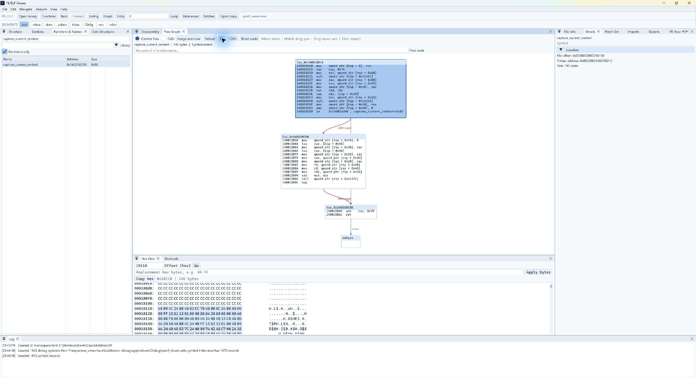
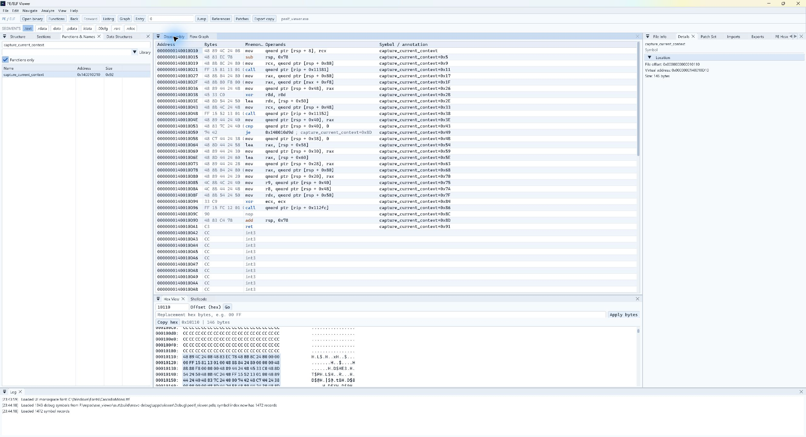
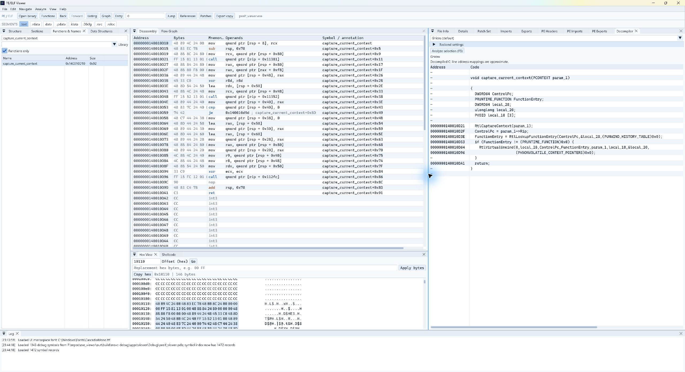

# PE / ELF Explorer (C++23)

A cross-platform executable, shared-library, crash-dump, and live-process analysis suite:
- **Core parsing & runtime library (`peelf_core`)**: Unified `IBinaryImage` spine (`viewer::PeParser` retired in `473ee3f`) covering PE32/PE32+ (ordinals, forwarders, delay-load/bound imports, `.pdata`/`.xdata` unwind, Rich header `DanS`/`Rich` XOR decoder, clean-room cross-platform MSF 7.00/CodeView `.pdb` parser `peelf/pdb.hpp` + RSDS GUID+Age verification, Authenticode `WinVerifyTrust` & structural checks, LoadConfig/GuardCF, TLS, resources/manifest/version, clean-room ECMA-335 `.NET` / CLR metadata & CIL bytecode disassembler `peelf/clr_metadata.hpp`), ELF32/ELF64 LE/BE across 10 CPU variants (including `SHN_XINDEX`/`PN_XNUM` extended numbering and static sectionless `PT_DYNAMIC` recovery), and cross-endian **Mach-O** (`MH_MAGIC`/`MH_MAGIC_64`/`MH_CIGAM`/`MH_CIGAM_64` + Universal `FAT_MAGIC`/`FAT_CIGAM_64`, `LC_DYLD_EXPORTS_TRIE`, `LC_DYLD_CHAINED_FIXUPS`, structural `LC_CODE_SIGNATURE`, `@executable_path`/`@loader_path`/`@rpath` & dyld shared-cache resolution); first-class `TargetCapabilityMatrix` & `Observed<T>` provenance (`WU-21`); static & observed runtime `ExecutableSettings` (`WU-22`); timestamped `ProcessStateSnapshot`, `SnapshotDiff`, and multi-thread `ExecutionTimeline` (`WU-23`, `WU-24`); DWARF v2–v5 + `.gnu_debuglink`/`.note.gnu.build-id` sidecars + Mach-O `__DWARF` & `LC_UUID`-verified `.dSYM` bundle auto-discovery (`WU-39`); Itanium/Rust/MSVC demangling; relocation-tolerant binary & disk-vs-live-RAM diffing; formalized BinSkim/checksec security rules (`PE1001..PE1008`, `ELF2001..ELF2008`, `LIVE3001..LIVE3003`, `MACHO4001..MACHO4006`); static/live crypto & packer constant detector + clean-room YARA-lite rule scanner (`peelf/signatures.hpp`, `WU-38`); offline Windows `.dmp` Minidump, Linux `ET_CORE`, & macOS/iOS Mach-O `MH_CORE` crash dumps (`WU-14`, `WU-39`); strictly read-only `IProcessSession` (`/proc/<pid>/smaps`, `QueryWorkingSetEx`, and **GDB Remote / QEMU RSP** `GdbRemoteBackend::open_read_only`); opt-in BSD-2-Clause `IDebugSession` (`ptrace`, Win32 Debug API, and `GdbRemoteBackend::open_debug`); and embedded MIT **Lua 5.4** transactional scripting (`LuaScriptingEngine`)
- **Vulkan-free CLI launcher & dynamically loaded GUI (`peelf_viewer` + `peelf_gui`)**: `peelf_viewer` links only `peelf_core` for zero-GUI `--headless` JSON, OASIS SARIF 2.1.0, RFC 4180 CSV, & text CI automation (`--clr` `.NET` ECMA-335 inspection, `--rules <path>` YARA-lite scanning, & `--script <file.lua>` batch scripting), and dynamically loads `peelf_gui` (Vulkan 2-frames-in-flight `VulkanManager` + pre-swapchain GPU compute & instanced 2D offscreen canvases + GLFW + Dear ImGui docking with 5 `DockNodeSpec` `View > Workspaces` presets, `Ctrl+K` / `Ctrl+Shift+P` Omni-Search Command Palette, `Ctrl+G` symbolic expression Go-To, and universal capability-aware entity context menus) across 40 dockable panels including `Structure` (live filter bar + static & live thread/FD/security subtrees), `Details` (2-column format-specific property tables), `Hex View`, `Entropy & Digram`, `Disassembly` (virtualized whole-binary linear listing + branch-arc gutter), `.NET / CLR` (ECMA-335 tables, P/Invoke, `#US` literals, & CIL method body disassembler), `Flow Graph` (Graphviz CFG/Calls + `GPU Galaxy` Barnes-Hut force layout), `Decompile`, `References & Notes`, `Strings`, `Structure View` (interactive custom C `struct`/`union`/`enum`/`#pragma pack` parser), `Signatures & Crypto`, `Dependencies`, `Executable & Settings`, `Target Capabilities`, `Binary Diff`, `Scripting`, VMMap `Memory Map`, `Memory Heatmap`, `Process Internals`, `Threads & Stack`, `Execution Timeline`, `Thread Locals`, `Memory Search` (including safe bounded `Regex (UTF-8)`), `PEB / TEB & Flags`, `Handlers`, and opt-in `Debugger`
- **GPU-accelerated Vulkan visualization suite (`WU-29..WU-33`)**: Zero-latency pre-swapchain `GpuOffscreenCanvas` + `GpuHostRingBuffer` + double-precision `ViewportCamera2D` (with automatic deterministic CPU RGBA8 fallback when Vulkan compute/graphics is unavailable) powering four interactive views: **Memory Heatmap** (2D Hilbert/linear live RAM residency, soft-dirty page watcher, RWX & heap/stack attribution), **Entropy & Digram** (multi-resolution 2D byte-entropy & $256 \times 256$ Cantor-dust adjacent-byte plot for packed/encrypted/code/data triage), **Execution Timeline** (Tracy-style GPU-instanced thread swimlanes with nanosecond-to-hour zoom & read-only `LiveThreadMonitor`), and **Flow Graph -> GPU Galaxy** ($O(N \log N + E)$ Barnes-Hut quadtree force layout rendering $10,000+$ whole-binary functions & CFGs with reachability, security-finding, and binary-diff overlays)
- **Analysis & patching integrations**: Capstone multi-arch disassembly, resumable background `ReferenceIndex` & jump-table/indirect-branch recovery, Graphviz CFG/call-graph layout + built-in GPU force-layout fallback, `AsmTK` (in-process x86/x86_64) + `llvm-mc` (multi-arch) assembly-to-bytes providers, transactional `PagedBinaryImage` (with UTC commit timestamps, analyst notes, & RAII `0600` off-`/mnt/c` temp-workspace spillover) + `.pepatch.json` & `IPS`/`IPS32` patch bundles, sandboxed Lua 5.4 `peelf.*` scripting with `ScriptLimits` quotas and explicit `peelf.commit()` / dry-run rollback, `.peproj` v2 `SHA-256` sessions with crash-recovery journals, and `DecompileCache` + persistent LRU-reusable headless Ghidra / Structured Pseudo-C / RetDec / Binary Ninja (`PEELF_DECOMPILE 3`) decompilation

> **Status**: Phase 0 (`P0-1..P0-10`), Wave 1 (`WU-19a..WU-19d`), Wave 2 (`WU-01..WU-28`), the 261-file C++23 audit (`FBF-01..FBF-07`), Wave 3 (`WU-29..WU-33`), Wave 4 (`WU-34..WU-39`), and Wave 5 (`WU-40..WU-43`) are complete with **626 registered CTests** passing (`0` failures) under `-Werror` and `clang-tidy-18` (Clang 18 Debug/Release + `clang18-asan-ubsan` AddressSanitizer/UBSan/LSan + `malformed_inputs_matrix_test`) and `/W4 /WX /FS` (MSVC 2022 Debug/Release), gated continuously by [`.github/workflows/ci.yml`](.github/workflows/ci.yml).

## Documentation

- **[User Guide (`docs/USER_GUIDE.md`)](docs/USER_GUIDE.md)** — End-to-end walkthrough of every UI panel, keyboard shortcut, workflow, security rule, and `--headless` CI/CD recipe
- **[Architecture (`docs/ARCHITECTURE.md`)](docs/ARCHITECTURE.md)** — Target boundaries (`peelf_core` / `peelf_gui` / `peelf_viewer`), subsystem data-flow diagrams, and threading/caching invariants
- **[Roadmap & C++23 Conformance Design (`docs/ROADMAP_DESIGN.md`)](docs/ROADMAP_DESIGN.md)** — Validated specification for the C++23 / CppCoreGuidelines upgrade (`WU-19a..WU-19d`) and Next-Gen Roadmap (`WU-21..WU-28`)
- **[Development Tracker (`ToDo.md`)](ToDo.md)** — Historical phase checklist and active execution queue

## Screenshots

Captured from the running Windows Debug build while inspecting `peelf_viewer.exe`
with its PDB symbols loaded. Click an image to view it at full resolution.

**Control-flow graph** — function search, draggable basic-block cards, branch
connections, and the linked hex view.



**Disassembly and hex** — addresses, instruction bytes, operands, and symbol
annotations alongside the byte editor.



**Ghidra decompiler** — function output with address-to-code mapping beside the
disassembly and hex views.



Original captures are stored in [`docs/screenshots`](docs/screenshots).

## Toolchains

### UI resources and headless startup

The executable is a small launcher. It loads the optional `peelf_gui` module only
for interactive use. `peelf_viewer --headless` with no arguments exits `0` without
loading graphics dependencies, while `peelf_viewer --headless <binary|dump> [--slice <index|arch>] [--rules <path>] [--format json|sarif|csv|text] [--compare <other>] [--fail-on none|error|warning]`
exports structured metadata, `TargetCapabilityMatrix` & `Observed<T>` provenance, `ExecutableSettings`,
dependencies, symbols, security findings (`PE1001..PE1008`, `ELF2001..ELF2008`, `MACHO4001..MACHO4006`),
PE Rich header + crypto/packer detections + YARA-lite rule matches (`--rules`),
crash-dump summaries (Windows `.dmp`, ELF `ET_CORE`, and Mach-O `MH_CORE`), and binary diffs for CI pipelines. Passing `--script <file.lua>` runs sandboxed
Lua 5.4 scripts headlessly (read-only dry-run by default; opt-in writes to `--output-binary <out>` and/or
`--project <workspace.peproj>` when `--script-allow-mutations` is specified and `peelf.commit()` is called).
Configure with `-DPEELF_BUILD_GUI=OFF` to build the launcher without Vulkan, GLFW,
ImGui, or native file dialogs.

The GUI loads `resources/theme.ini` beside the executable at startup. It contains
RGBA color tokens and spacing/rounding metrics. Use **View > Reload theme** to
apply edits, or **View > Interface scale** to adjust text size. Invalid resource
entries are ignored, with built-in defaults for missing values. Build outputs
include the resource directory; distribute it alongside the GUI module and launcher.

Theme parsing, fonts, menus, and rendering belong exclusively to the UI layer.
Binary models, parsers, navigation, symbols, disassembly, and patch operations
have no ImGui/GLFW/Vulkan dependency and are exercised by the non-GUI test binary.

Menus provide **File**, **Edit**, **Navigate**, **Analyze**, **Inspect**, **View**, and **Help** commands. `Ctrl+O` opens a binary; `Ctrl+P` attaches read-only to a live process; `Ctrl+K` / `Ctrl+Shift+P` opens the Omni-Search Command Palette; `Ctrl+G` jumps to a symbolic address expression; `Ctrl+Shift+S` exports a patched copy; `Alt+F4` (**File > Exit**) closes the application. Code views retain monospace fonts; Windows interface controls use Segoe UI when available.

Windows builds embed `resources/viewer.ico` in the launcher and use it for the
window/taskbar icon. On GUI startup, a responsive splash displays the original
`resources/splash.png` artwork and supported CPU families (x86/X64, ARM, RISC-V,
MIPS, and PowerPC), then closes after initialization (minimum 1.2 seconds).
`--headless` and `--help` do not display the splash.

- **Visual Studio 2022** (MSVC v143, **17.6 or newer** — required for `std::expected`, `std::format`, and `std::byteswap`; compiled with `/W4 /WX /FS`)
- **Clang 18** with **Ninja** and `libc++` (recommended on Linux/WSL; compiled with `-Wall -Wextra -Wpedantic -Werror`, including the `clang18-asan-ubsan` sanitizer preset)

## Prerequisites

You need all of the following before configuring:

- **CMake 3.25+**
- **Git** and a working network connection — third-party libraries are downloaded at configure time (see below)
- A **C++23** compiler (see Toolchains)
- The **Vulkan SDK** (from LunarG). The build calls `find_package(Vulkan REQUIRED)`, so the SDK must be installed and discoverable. The SDK installer sets the `VULKAN_SDK` environment variable for you.
- **Graphviz** is optional today, but recommended for call-flow / CFG rendering. The project emits DOT without it; installing Graphviz puts `dot` on `PATH` so CMake can define `PEELF_GRAPHVIZ_DOT_AVAILABLE=1` and the viewer can later render DOT through an external process.
- **Linux only:** GLFW's system dependencies, e.g. on Debian/Ubuntu:
  `sudo apt install xorg-dev libwayland-dev libxkbcommon-dev pkg-config graphviz`

### Graphviz on Windows

Install one of these, then open a new terminal so `PATH` is refreshed:

```powershell
# winget
winget install --id Graphviz.Graphviz -e

# or Chocolatey
choco install graphviz
```

Verify:

```powershell
dot -V
Get-Command dot
cmake --preset msvc-debug
```

If `dot` is not found, add Graphviz's `bin` directory to `PATH` manually. The
default installer path is usually `C:\Program Files\Graphviz\bin`.

## Dependencies (fetched automatically)

This project does **not** require any manual dependency vendoring. The file
`third_party/dependencies.cmake` uses CMake `FetchContent` to download and build
the following the first time you configure:

| Library | Version |
| --- | --- |
| GLFW | 3.4 |
| Dear ImGui | `docking` branch |
| nativefiledialog-extended | 1.2.1 |
| Capstone | 5.0.6 |
| Lua | 5.4.7 (MIT, embedded C VM without `io`/`os`/`debug`/`package`) |
| AsmJit + AsmTK | pinned commits, optional assembly provider dependency |
| Graphviz | 13.0.0, optional source fetch |

Graphviz is optional and is not fetched unless `PEELF_ENABLE_GRAPHVIZ=ON`.
The Vulkan loader/headers are **not** fetched; they come from the installed Vulkan SDK.

> The scripts under `scripts/` (`bootstrap_deps.*`, `getdeps.ps1`) are legacy helpers from
> an earlier vendoring approach and are **not** used by the current build. You can ignore them.

## Build (CMake Presets)

Use the presets whenever possible. They keep build directories under `out/build/`
and match the paths used by the tests and fixture tooling.

### Windows: Visual Studio 2022 (MSVC)

Open a normal PowerShell prompt where Visual Studio and the Vulkan SDK are
discoverable. Graphviz is optional but recommended for call graph rendering.

```powershell
cmake --preset msvc-debug
cmake --build --preset msvc-debug
ctest --test-dir out/build/msvc-debug -C Debug --output-on-failure
```

Output binary: `out/build/msvc-debug/apps/viewer/Debug/peelf_viewer.exe`

To run the viewer directly:

```powershell
.\out\build\msvc-debug\apps\viewer\Debug\peelf_viewer.exe
```

### Linux: Clang 18 + Ninja (Debug, Release, & ASan+UBSan)

```bash
# Debug (626 registered CTests)
cmake --preset clang18-debug
cmake --build --preset clang18-debug
ctest --test-dir out/build/clang18-debug --output-on-failure

# Release
cmake --preset clang18-release
cmake --build --preset clang18-release
ctest --test-dir out/build/clang18-release --output-on-failure

# AddressSanitizer + UndefinedBehaviorSanitizer + LeakSanitizer (includes malformed input matrix)
cmake --preset clang18-asan-ubsan
cmake --build --preset clang18-asan-ubsan
ASAN_OPTIONS=detect_leaks=1:alloc_dealloc_mismatch=0:halt_on_error=1 UBSAN_OPTIONS=print_stacktrace=1:halt_on_error=1 \
  ctest --test-dir out/build/clang18-asan-ubsan --output-on-failure

# Opt-in Clang libFuzzer + ASan + UBSan parser harnesses (-DPEELF_ENABLE_FUZZERS=ON)
cmake --preset clang18-fuzz
cmake --build --preset clang18-fuzz
ASAN_OPTIONS=detect_leaks=1:alloc_dealloc_mismatch=0:halt_on_error=1 UBSAN_OPTIONS=print_stacktrace=1:halt_on_error=1 \
  ./out/build/clang18-fuzz/tests/fuzz/fuzz_binary_image -max_total_time=20 -rss_limit_mb=2048 -timeout=5
```

Output binary: `out/build/<preset>/apps/viewer/peelf_viewer` (fuzzer harnesses: `out/build/clang18-fuzz/tests/fuzz/fuzz_{binary_image,debug_formats,crash_dumps,parsers_dsl}`)

Continuous integration in [`.github/workflows/ci.yml`](.github/workflows/ci.yml) runs `clang18-debug`, `clang18-release`, `clang18-asan-ubsan`, `linux-fuzz-smoke` (`clang18-fuzz` `libFuzzer` + ASan + UBSan across all 4 parser harnesses), and Windows MSVC 2022 `Debug` + `Release` (with `-Werror` / `/WX /FS` and `--headless` JSON/SARIF/CSV smoke checks) on every push and pull request.

### Configure with options

Presets can be combined with `-D` cache options when configuring:

```bash
cmake --preset clang18-debug -DPEELF_ENABLE_GRAPHVIZ=ON -DPEELF_ENABLE_ASMTK=ON
cmake --build --preset clang18-debug
```

For Visual Studio multi-config builds, pass the configuration at build/test time:

```powershell
cmake --build --preset msvc-debug --config Debug
ctest --test-dir out/build/msvc-debug -C Debug --output-on-failure
```

### Install & Portable CPack Archives

Install a relocatable runtime prefix (`bin/`, `lib/` on POSIX, runtime decompiler/theme `resources/`, and documentation) or build a portable distribution archive (`TGZ` on Linux/macOS, `ZIP` on Windows):

```bash
# Stage a relocatable install prefix and verify CLI version
cmake --install out/build/clang18-release --prefix /tmp/peelf-explorer
/tmp/peelf-explorer/bin/peelf_viewer --version

# Produce peelf-explorer-1.0.0-linux-x86_64.tar.gz (or -windows-x64.zip on MSVC)
cpack --config out/build/clang18-release/CPackConfig.cmake -B dist
```

Tagged `v*` pushes (and manual `workflow_dispatch` runs) build, smoke-test, checksum (`SHA256SUMS.txt`), and publish Linux `TGZ` + Windows `ZIP` archives via [`.github/workflows/release.yml`](.github/workflows/release.yml).

### Clang Docker image

The repository includes a Clang 18 build image with Graphviz and cross compilers
for fixture generation:

```bash
docker build -f docker/Dockerfile.clang -t exe-viewer-clang .
docker run --rm -it -v "$PWD":/workspace/exe_viewer -w /workspace/exe_viewer exe-viewer-clang

cmake --preset clang18-debug
cmake --build --preset clang18-debug
ctest --test-dir out/build/clang18-debug --output-on-failure
```

The first configure will take a while because it clones and builds GLFW, ImGui,
nativefiledialog-extended, Capstone, and, by default, AsmJit/AsmTK. Enabling
`PEELF_ENABLE_GRAPHVIZ` also fetches the pinned Graphviz source tree for future
DOT rendering hooks.

### Cross-architecture fixture matrix

The checked-in `bin-matrix/` directory contains non-executable ELF/debug fixture
pairs used by parser, symbol, disassembly, and call-graph tests. Normal builds
use those committed files directly.

To refresh the matrix with Docker:

```powershell
cmake --build out/build/msvc-debug --target generate-bin-matrix
cmake --build out/build/msvc-debug --target test-bin-matrix
```

The generated filenames follow:

```text
elf-linux-<arch>-<bits>-<endian>-callgraph.elf
elf-linux-<arch>-<bits>-<endian>-callgraph.debug
```

To register the Docker-backed refresh as a CTest test, configure with
`-DPEELF_ENABLE_BIN_MATRIX_DOCKER_TEST=ON`. It is off by default because it
requires Docker and rewrites `bin-matrix/`.

## Build options

These CMake options are defined in the top-level `CMakeLists.txt`:

| Option | Default | Effect |
| --- | --- | --- |
| `PEELF_BUILD_VIEWER` | `ON` | Build the `peelf_viewer` CLI/GUI launcher executable |
| `PEELF_BUILD_GUI` | `ON` | Build the `peelf_gui` Vulkan/GLFW/ImGui shared module (`OFF` builds a Vulkan-free CLI launcher) |
| `PEELF_BUILD_SHARED` | `OFF` (Win32) / `ON` (POSIX) | Build `peelf_core` as a shared library |
| `PEELF_BUILD_TESTS` | `ON` | Build the GoogleTest unit & integration suite (`626` CTests) |
| `PEELF_WARNINGS_AS_ERRORS` | `ON` | Enforce `-Werror` (Clang/GCC) and `/W4 /WX /FS` (MSVC) on project targets while isolating `FetchContent` headers as `SYSTEM` |
| `PEELF_ENABLE_SANITIZERS` | `OFF` (`ON` in `clang18-asan-ubsan`) | Enable AddressSanitizer and UndefinedBehaviorSanitizer across project and test targets |
| `PEELF_ENABLE_ASMTK` | `ON` | Fetch and build pinned AsmJit + AsmTK sources for in-process x86/x86_64 assembly |
| `PEELF_ENABLE_GRAPHVIZ` | `OFF` | Fetch optional Graphviz source and expose Graphviz feature macros through `peelf::graphviz` |
| `PEELF_ENABLE_CLANG_TIDY` | `OFF` | Run `clang-tidy` on `peelf_core`, `peelf_gui`, `peelf_viewer`, and `peelf_tests` (Ninja/Makefile generators) |
| `PEELF_INSTALL_DIA_REDIST` | `OFF` | Opt-in installation of `msdia140.dll` next to `peelf_viewer.exe` on Windows (subject to Microsoft DIA redistributable license; native cross-platform `.pdb` parsing works without DIA) |
| `PEELF_ENABLE_BIN_MATRIX_DOCKER_TEST` | `OFF` | Register an opt-in CTest test that refreshes `bin-matrix/` with Docker and runs the focused matrix test |

## Running

For complete panel-by-panel instructions, keyboard shortcuts, and CI recipes, see **[`docs/USER_GUIDE.md`](docs/USER_GUIDE.md)**.

Launch `peelf_viewer`, then use **File > Open...** (`Ctrl+O`) to inspect an executable or shared library (`.exe`, `.dll`, `.sys`, `.so`, `.elf`, `.dylib`, `.bundle`, including stripped/sectionless `PT_DYNAMIC` ELFs, `SHN_XINDEX`/`PN_XNUM` extended-header binaries, and thin/Universal Mach-Os), **File > Open Crash Dump...** for offline Windows `.dmp` Minidumps, Linux ELF `ET_CORE` dumps, or macOS/iOS Mach-O `MH_CORE` dumps, or **File > Attach to Process...** (`Ctrl+P`) for strictly read-only live process inspection. Use **File > Open Debug Symbols...** to load an explicit `.pdb`, `.debug`, or `.dSYM` bundle (cross-platform MSF 7.00/CodeView `.pdb` parsing with RSDS GUID+Age verification works out of the box on Linux & Windows; ELF DWARF v2–v5 + `.gnu_debuglink` / `.note.gnu.build-id` sidecars and Mach-O `__DWARF` + `LC_UUID`-verified `.dSYM` bundles hydrate automatically). Use `Ctrl+K` / `Ctrl+Shift+P` for the Omni-Search Command Palette, `Ctrl+G` for symbolic expression Go-To, **View** to toggle any of the 39 workspace panels, or **View > Reset Layout** to restore default docking; **View > Demangle symbols** toggles Itanium C++, Rust (`v0` + legacy), and MSVC demangling globally. Rendering runs on a Vulkan 2-frames-in-flight (`kMaxFramesInFlight = 2`) swapchain loop with automatic resize/minimize recovery.

The analysis workspace opens a control-flow preview at the entry point. Select a
function to view instruction-bearing basic blocks and directed branch edges as
interactive draggable cards in **Flow Graph**. Use the mouse wheel to zoom,
middle-drag to pan, **Fit** for an overview, and **100%** for readable code.
Clicking a block synchronizes `ViewerSelection`, **Hex View**, and **Disassembly**.
**Calls** switches to inter-procedural fan-out relationships (Graphviz `dot`
provides initial layout when installed). Function bounds use symbol sizes, PE
`.pdata` runtime-function metadata, or ELF `.eh_frame` FDEs before falling back to
adjacent functions or executable region bounds. Indirect control-flow recovery
handles guarded x86 absolute tables, x86/x64 PIC/RIP-relative `i32` offset tables,
ARM Thumb-2 `tbb`/`tbh`, ARM64 PC-relative jump tables, and IAT/GOT pointer slots,
labeling every edge with explicit `ReferenceConfidence` and `evidence`. Applied
byte edits automatically refresh the active graph.

Double-click a graph instruction or listing address to follow a direct target.
Use **Navigate > Back / Forward**, `Backspace` / `Shift+Backspace`, or
`Alt+Left` / `Alt+Right` to retrace navigation, `Space` to switch between
**Flow Graph** and **Disassembly**, arrow keys to step selection, `Enter` to
follow a selected branch target, and `Ctrl+B` (**Navigate > Bookmark selection**)
to toggle categorized bookmarks.

Open **References & Notes** (`X`) to inspect incoming and outgoing cross-references,
filter by confidence (`Direct`, `IndirectTable`, `IndirectPointerSlot`,
`HeuristicConstant`), or search addresses, symbols, strings, user names, and
comments. Instead of a fixed byte cap, `AsyncReferenceScanner` indexes executable
sections/regions asynchronously on a background `std::jthread` in resumable 256 KiB
slices (into sorted $O(\log N + K)$ `ReferenceIndex` tables), reporting live
coverage percentage with **Pause**, **Resume**, and **Scan Full Binary** controls.
The **Strings** browser (**Navigate > Strings**) links extracted ASCII/UTF-8 and
UTF-16LE/BE strings directly to `ReferenceIndex` xrefs and containing functions.

Names, comments, bookmarks (`Ctrl+B`), pinned **Structure View** bindings, imported
debug symbols, staged patches, navigation history, ARM/Thumb mode, and docking
layout persist in **`.peproj` v2** (`PEELF_PROJECT 2`, with automatic in-memory
migration from v1) via **File > Save Analysis Project...** and **File > Open Analysis Project...**.
Each `.peproj` v2 file records original `source_sha256` (`peelf::sha256_hex`) and
`source_size` alongside both canonical `source` and portable workspace-relative
`relative_source` paths. If the binary has moved or changed on disk, an interactive
relocation/mismatch modal guides resolution before replaying patches as an atomic
undoable transaction. Project saves write to a sibling `.tmp` file before atomic
rename, while dirty sessions periodically write off-`/mnt/c` crash-recovery
journals (`$PEELF_CACHE_DIR/recovery` or `/tmp/peelf_viewer-recovery-<uid>`).

For static files, **Patch Set** and **Hex View** stage edits inside transactional
`PagedBinaryImage` overlays (recording UTC commit timestamps and optional analyst notes, while automatically spilling multi-megabyte generated spans to an unlinked `0600` off-`/mnt/c` temp workspace) without mutating the input file on disk (**File > Save Patched As...** / `Ctrl+Shift+S` writes a new binary; live-process sessions enforce
strict read-only protection). **Patch Set** supports both raw hex replacement and
**Assemble at Selection / VA** (`AsmTK` in-process for x86/x86_64 and `llvm-mc`
for ARM, Thumb, AArch64, RISC-V, MIPS, and PowerPC), previewing Capstone round-trip
disassembly, overwritten-instruction slack warnings, optional NOP padding, and
before/after basic-block CFG diffs. Staged edits can also be exported and shared
as portable **`.pepatch.json`** patch bundles (with `SHA-256`, original-byte conflict previews, analyst notes, and UTC timestamps), exported as standard **`IPS` / `IPS32`** binary patches (**Export IPS...**), or summarized via **File > Export Patch Report...**.

Additional workspaces cover:
- **Structure View** & **Data Structures**: Overlay built-in PE, ELF, Win32 (`PEB`/`TEB`), and Linux (`r_debug`/`link_map`) schemas, loaded PDB/DWARF/Ghidra `DataTypeRecord` structs, or interactive custom C `struct`/`union`/`enum`/`typedef`/`#pragma pack` definitions (`WU-37`) onto any static offset or live VA with bitfield/enum decoding, array counts, endian/pointer overrides, click-to-follow pointers, and `.peproj` v2 persistence.
- **Signatures & Crypto** (**View > Signatures & Crypto** & `--headless --rules`): Decodes PE `Rich` header `DanS`/`Rich` XOR toolchains, scans static sections and live memory for cryptographic/hash/compression constants (AES, ChaCha20/Salsa20, SHA-2, MD5, CRC32, zlib, LZ4, Zstd) and packer markers (UPX, VMProtect, Themida, ASPack, MPRESS) + high-entropy code sections, and evaluates custom YARA-lite rules (`WU-38`).
- **Dependencies** (**View > Dependencies**): Inspect static PE imports/delay-load/bound imports/forwarders/`api-ms-win-*` contracts, ELF `DT_NEEDED`/`PT_INTERP`/`DT_RPATH`/`DT_RUNPATH` (`$ORIGIN` expansion), and Mach-O `LC_LOAD_*_DYLIB`/`LC_REEXPORT_DYLIB`/`@rpath`/`@loader_path`/`@executable_path` (with honest macOS dyld shared-cache classification) or live loaded module DAGs, highlighting missing libraries, architecture mismatches, and unresolved symbols.
- **Binary Diff** (**File > Compare With Binary...** & **File > Compare Active Live Module vs. Disk**): Cancellable background `AsyncBinaryDiffController` diffing headers, sections, imports, exports, byte hunks, and 3-tier relocation-tolerant function matches (`ExactName`, `NormalizedFingerprint`, n-gram `Similarity`) across PE, ELF, and thin/Universal Mach-O slices, plus live RAM vs. on-disk module integrity checks separating `.text` inline detours from IAT/GOT pointer hooks alongside synced Hex/Disassembly panes.
- **Security Audit** (**PEB / TEB & Flags > Security Audit (BinSkim)** & `--headless`): Evaluates 25 formalized rules (`PE1001..PE1008`, `ELF2001..ELF2008`, `LIVE3001..LIVE3003`, `MACHO4001..MACHO4006`). `PE1005` and `MACHO4004` explicitly distinguish structural `WIN_CERTIFICATE` / `LC_CODE_SIGNATURE` presence (`Note` when unverified offline/cross-OS) from cryptographic signature and publisher trust verification.
- **Live Process, Crash Dumps & Opt-In Debugger**: VMMap-style `Memory Map` (`/proc/<pid>/smaps` PSS/RSS/Swap & `QueryWorkingSetEx` proportional bars), `Process Internals` (handles/FDs, sockets, tokens/capabilities/Seccomp, thread CPU%), offline `.dmp`, `ET_CORE`, & Mach-O `MH_CORE` crash triage (`WU-39`), and explicit opt-in `IDebugSession` debugging (**Inspect > Start / Attach Debugger (Opt-in)...** with `F5`/`F9`/`F10`/`F11`/`Shift+F11`, software + `DR0..DR7` hardware breakpoints/watchpoints, shadow-filtered memory reads, and clean detach).

Press **`F5`** outside an active paused debugger session (**Navigate > Decompile selection**) to open the **Decompile** panel. **Ghidra** is the primary external provider when configured, falling back automatically to the built-in zero-dependency **Structured Pseudo-C** decompiler (`RetDec`, `Binary Ninja`, and `Annotated assembly` are also selectable).

### Installing and configuring Ghidra

The decompiler uses loaded image/PDB/DWARF symbols and user-renamed annotations for
function and data names. `F5` resolves an interior selection to its containing
function using symbol lengths, PE `.pdata` unwind entries, or ELF `.eh_frame`
ranges when available, and Ghidra analysis supplies function discovery when
authoritative bounds are absent.

The listing has **Address** and **Code** columns. Clicking a mapped code row selects its
instruction ranges in **Hex View** and highlights the corresponding **Flow Graph** blocks.
Mappings are approximate: optimized C can represent several disjoint instructions;
declarations and braces without addresses remain unlinked. Select a contiguous hex
range before editing a multi-range selection.

The **Data Structures** tab beside **Functions & Names** searches structure names,
member names, and member types by substring across PDB, DWARF, and Ghidra layouts,
with one-click **Apply** into **Structure View**, plus a searchable **Data symbols**
list linked to **Hex View**.

Use a local, extracted [official Ghidra release](https://github.com/NationalSecurityAgency/ghidra/releases)
and the JDK required by that release (tested with **Ghidra 12.2 and JDK 25**).
Ghidra is an optional external tool, not linked into the C++ application or
downloaded automatically at startup. No Docker daemon or Ghidra GUI is needed.

In **Decompile > Backend settings**, set the Ghidra root folder and Java
executable, then **Save settings**. Settings persist in `decompiler.ini` next to
the viewer executable. On first startup, `GHIDRA_INSTALL_DIR` and `JAVA_HOME`
supply defaults, and auto-discovery checks `tools` and `out/tools` along parent
directories (such as `out/tools/ghidra_12.2_PUBLIC`).

Decompilation uses two caching tiers so switching functions is fast and never touches `/mnt/c` on WSL:
1. **In-memory `DecompileCache`**: Keyed by `(binary_sha256, patch_revision, symbol_revision, provider, settings_fingerprint, arch, endian, thumb, function_va)`. Repeat visits return instantaneously and automatically invalidate when bytes or symbol names change.
2. **Persistent LRU Headless Ghidra Workspaces**: Keyed by `(binary_sha256, patch_revision, arch, endian, ghidra_home)` under `$PEELF_CACHE_DIR/ghidra_workspaces` (or an off-`/mnt/c` OS cache/temp directory). The first function in a binary runs `analyzeHeadless -import` without `-deleteProject`; subsequent functions reuse the analyzed project via `-process -noanalysis` with incremental symbol sync through `resources/PeelfDecompile.java` (automatically falling back to a clean cold re-import if a stale lock or corrupt workspace is encountered). Use **Re-analyze** or **Clear Cache** in the **Decompile** toolbar to force a fresh run. Cancellation and configurable deadlines (default 180s overall, 60s per function) terminate the headless Java process tree cleanly; the target binary itself is never executed.

**Structured Pseudo-C** works out of the box with zero external dependencies.
**RetDec** uses a local `retdec-decompiler` CLI installation when configured.
**Binary Ninja HLIL** integrates via `resources/bn_decompile.py` (`PEELF_DECOMPILE 3`
protocol with multi-source `discover_binary_ninja` / `probe_binary_ninja_capabilities`,
folded HLIL `CodeRange` spans, `PEELF_SYMBOLS 1` user renames, and `view.types`
`DataTypeRecord` export; requires a Python interpreter with the Binary Ninja API and a
**Commercial-or-higher** headless license — Binary Ninja Free's interactive x86/x64-only
restrictions are diagnosed explicitly; see the [Binary Ninja API cookbook](https://docs.binary.ninja/dev/cookbook.html)).
**Annotated assembly** renders symbol-annotated disassembly rather than C.

Ghidra integration tests are opt-in: set `GHIDRA_INSTALL_DIR` and `JAVA_HOME`, then
run `ctest --test-dir out/build/msvc-debug -C Debug -R GhidraIntegration --output-on-failure`.
They cover all ten supported CPU families plus PE32/PE32+ and effective-byte
replacement. Without Ghidra, those tests skip while unit and process-runner tests
still run. Processor variants unsupported by the installed Ghidra remain backend
errors, rather than silently falling back to an unrelated decoder.

Docker is an optional future deployment adapter for server workloads. The desktop
provider intentionally uses the local installation, avoiding volume mapping and
container startup overhead.

## Notes

- Dear ImGui is pinned to a known `docking` commit in `third_party/dependencies.cmake`.
- Vulkan integration uses the system Vulkan loader from the SDK.
