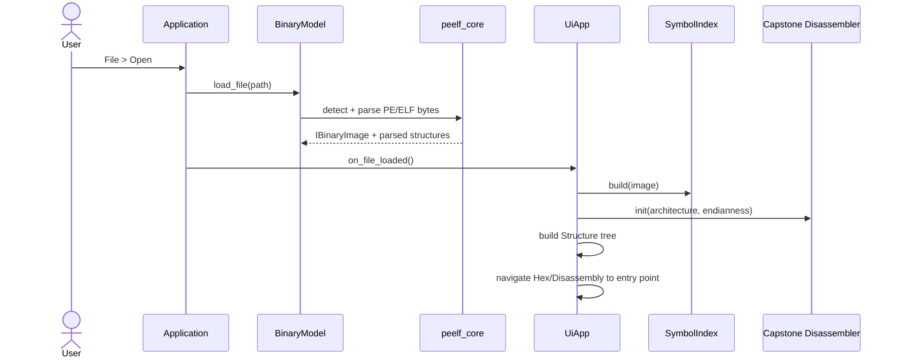
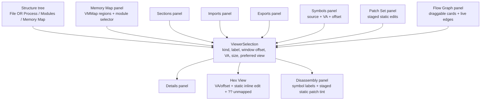
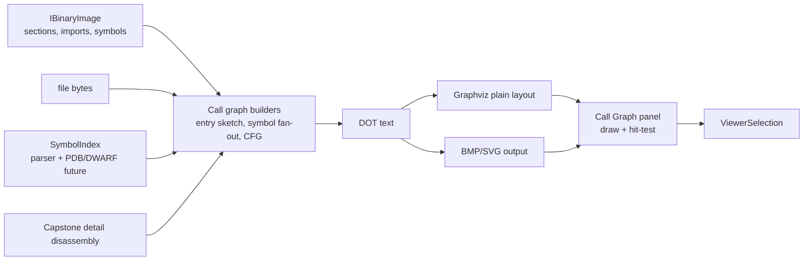
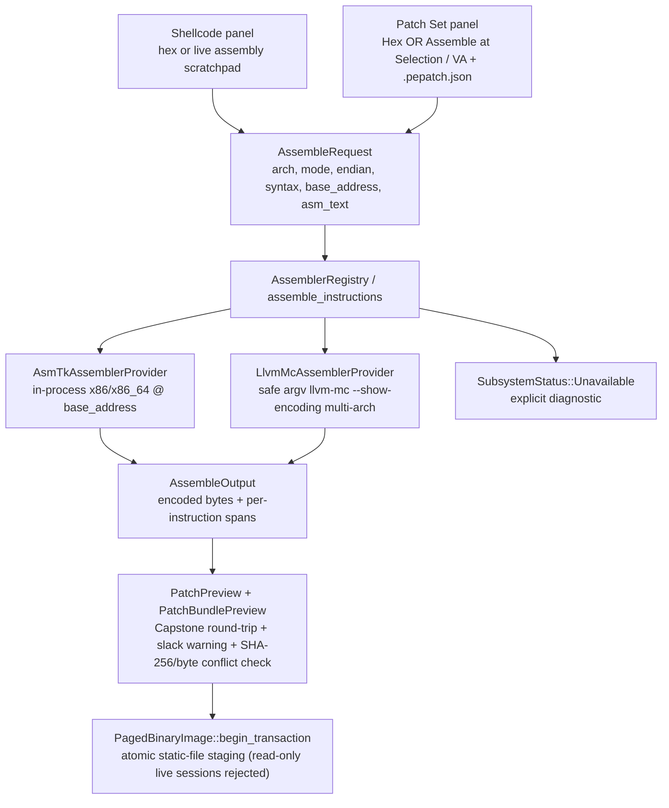
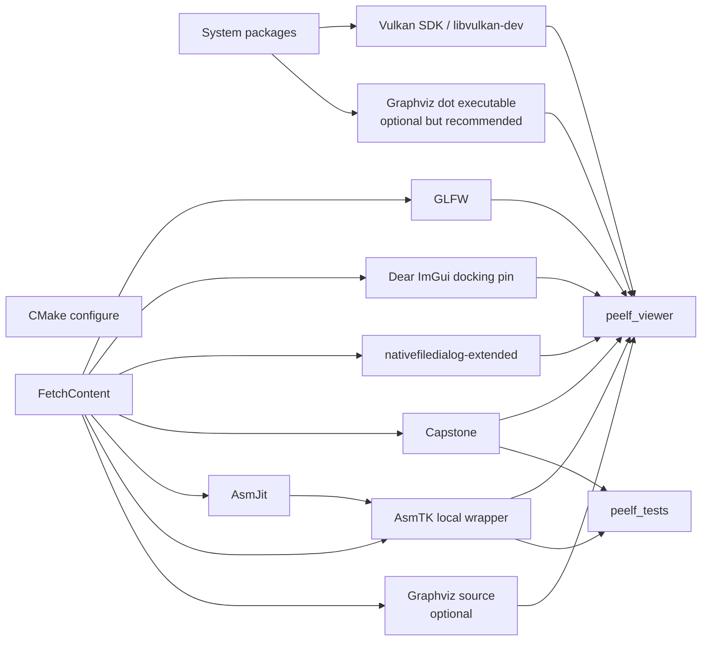
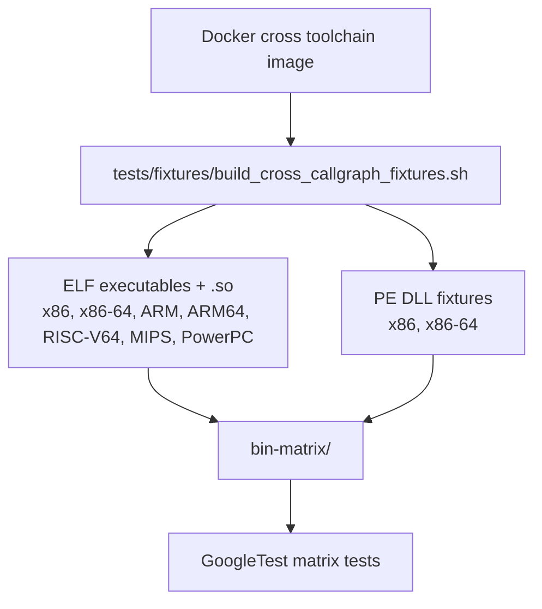

# PE / ELF Explorer Architecture

This document describes the current shape of the project. It is intentionally
practical: the diagrams show how code and data move today, plus the provider
boundaries we are adding for assembler/decompiler/live-process work.

## Runtime Shape

```mermaid
flowchart LR
    user["User"]
    app["peelf_viewer<br/>Application"]
    ui["UiApp<br/>Dear ImGui panels + VMMap + Structure View + Dependencies + Process Internals + Threads/Stack/TLS + Search + Runtime/Flags + Handlers"]
    model["BinaryModel<br/>static file (editable) OR strictly read-only live process"]
    core["peelf_core<br/>C++23 EndianReader + PE/ELF/DWARF parsers + dependency DAG/tree + live rebasing + smaps/internals subsystems"]
    proc["IProcessBackend / IProcessSession<br/>read-only attach + smaps/WorkingSet + handles/sockets/security + thread CPU/contexts"]
    patches["PagedBinaryImage<br/>staged edits + Save Patched As (static files only)"]
    disasm["Capstone wrapper<br/>Disassembler + FunctionIndex"]
    decomp["IDecompiler<br/>StructuredPseudoC + RetDec + Ghidra"]
    symbols["SymbolIndex<br/>PE/ELF symbols + GOT/PLT + rebased PDB"]
    graph["CallGraph model<br/>entry / fan-out / CFG work"]
    graphviz["Graphviz dot<br/>external renderer"]
    vulkan["VulkanManager<br/>textures + ImGui backend"]

    user --> app
    app --> ui
    app --> model
    model --> core
    model --> proc
    model --> patches
    ui --> model
    ui --> disasm
    ui --> decomp
    ui --> symbols
    ui --> graph
    graph --> graphviz
    graphviz --> graph
    graph --> vulkan
    ui --> vulkan
```

## Static File Load Flow



## Strictly Read-Only Live Process Attach, Static Hydration & Multi-Arch Runtime Inspection

```mermaid
sequenceDiagram
    actor User
    participant Ui as UiApp / Panels
    participant Model as BinaryModel
    participant Proc as IProcessBackend / Read-Only Session
    participant Core as peelf_core (Forgiving Multi-Arch Subsystems)
    participant Decomp as FunctionIndex + IDecompiler

    User->>Ui: File > Attach to Process...
    Ui->>Model: list_processes() / attach_process(pid)
    Model->>Proc: open_process(pid) [strictly read-only]
    Model->>Core: resolve_executable_from_command_line(cmdline, cwd, PATH)
    Model->>Core: load_live_module_image(main_module + resolved backing PE/ELF)
    Note over Core: Combines live RAM at runtime ASLR base<br/>with resolved on-disk PE/ELF (.symtab, .pdata, .eh_frame, TLS)<br/>rebased by (live_base - static_base)
    Core-->>Model: Rebased IBinaryImage + SymbolIndex + FunctionIndex
    Model->>Core: harvest_header_flags + inspect_process_environment + inspect_handlers
    Note over Core: Forgiving Availability (Available / Partial / Unavailable):<br/>PEB32/64 + TEB32/64 OR Linux auxv + status + r_debug/link_map + TCB;<br/>SEH/VEH/.pdata/.eh_frame/Linux signals/atexit across 32/64-bit LE/BE
    User->>Ui: Click executable MemoryRegion or Function
    Ui->>Decomp: Disassemble window + CFG + StructuredPseudoC / RetDec / Ghidra
    User->>Ui: Pause Process -> Select Thread
    Ui->>Proc: suspend() + threads() + thread_context(tid)
    Model->>Core: unwind_and_inspect_stack + inspect_thread_locals
    Note over Ui: Stack View highlights Return Addresses (Gold/Amber)<br/>vs. Base/Frame Pointers (Cyan/Teal); TLS decodes PE & ELF Variant I/II
    User->>Ui: Search Heap (Hex / Endian Numbers / UTF-8 & UTF-16 Text)
    Ui->>Core: search_process_memory (target endianness & alignment)
```

## Panel Navigation Model



Selections are the core UI contract. A panel should update `ViewerSelection`
instead of directly rewriting unrelated panels. `UiApp` then maps the selection
to Details/Hex/Disassembly when readable bytes exist. Selections without readable
bytes should remain valid and display a clear "hex not available" style message
as that path is hardened.

## `.peproj` v2 Analysis Sessions & Crash Recovery

Static analysis state persists in versioned `.peproj` (`PEELF_PROJECT 2`) files with
automatic in-memory migration from `PEELF_PROJECT 1`:
- **Target Identity & Portable Relocation**: Records both `relative_source` (proximate to the `.peproj` parent directory) and canonical `source`, verified against original `source_sha256` (`peelf::sha256_hex`) and `source_size` with structured `ExactMatch`, `ModifiedMismatch`, and `RelocationNeeded` handling.
- **Session State**: Persists staged static patches, user symbol/comment annotations, imported debug symbols, bookmarks (`Bookmark`), pinned `AppliedStructureBinding`s, navigation history, and docking layout.
- **Atomic Saves & Autosave Journals**: Project writes stage to a sibling `.tmp` file before atomic rename, while dirty session edits periodically write crash-recovery journals under `$PEELF_CACHE_DIR/recovery` or `/tmp/peelf_viewer-recovery-<uid>`.

## Call Graph Flow



The current UI renders a graph and uses Graphviz `plain` metadata for node
hit-testing. Clicking a function-like node updates the shared selection and can
queue a new fan-out graph rooted at that symbol. The next major step is richer
basic-block CFG construction and more precise indirect-call handling.

## Assembly Providers & Reusable Patch Bundles (`.pepatch.json`)



`IAssemblerProvider` (`peelf/assembler.hpp`) selects `AsmTkAssemblerProvider` first for little-endian x86/x86_64 targets when `PEELF_ASMTK_AVAILABLE` is enabled and falls back to `LlvmMcAssemblerProvider` across ARM, Thumb, AArch64, RISC-V 32/64, PowerPC 32/64, and MIPS 32/64 when `llvm-mc` is installed. Portable `.pepatch.json` patch bundles (`peelf/patch_bundle.hpp`) verify target `expected_sha256`, `expected_size`, and per-entry `original_bytes_hex` before staging all entries inside a single `PagedBinaryImage` transaction, and strictly reject read-only live process sessions.

## Dependency Shape



`peelf::asmtk` and `peelf::graphviz` are stable project-facing targets. Their
feature macros report whether the backing implementation/tool is available.

## Test Fixture Matrix



The checked-in `bin-matrix/` files let normal builds run parser, symbol,
disassembly, and call-graph tests without regenerating fixtures. The Docker
targets refresh the matrix when cross-toolchain coverage changes.

## Binary Comparison & Disk-vs-Live-RAM Integrity Diff (`WU-12`)

- `peelf::compare_binaries` (`libs/peelf_core/include/peelf/binary_diff.hpp`) diffs PE/ELF headers, sections (with SHA-256 and byte-change deltas), imports, exports, bounded coalesced byte hunks, and functions using a three-tier relocation- and address-shift-tolerant matcher (`ExactName`, `NormalizedFingerprint` masking PC/RIP-relative displacements and `.reloc`/ELF fixups, and n-gram `Similarity`).
- `peelf::compare_module_disk_to_live` rebases an on-disk PE/ELF module to its live runtime `ModuleInfo::base_address`, normalizes `.reloc` / ELF `RELATIVE` entries, LoadConfig security cookies, and legitimate IAT/GOT loader resolutions, and surfaces unexpected `.text` `InlineCodeHook` detours and `IatGotPointerHook` hijacks.
- `viewer::BinaryDiffPanel` (`View > Binary Diff`, `File > Compare With Binary...`) provides tabbed inspection plus synchronized side-by-side Hex and Disassembly views.

## Security & Hardening Rule Engine & Headless CLI (`WU-13`)

- `peelf::audit_security` and `peelf::audit_live_process_security` (`libs/peelf_core/include/peelf/security_audit.hpp`) evaluate 19 formalized BinSkim/checksec-style rules (`PE1001..PE1008`, `ELF2001..ELF2008`, `LIVE3001..LIVE3003`) with `Pass`/`Note`/`Warning`/`Error` severities, header/directory/segment/live-region evidence, navigable virtual-address/file-offset anchors, and remediation guidance, surfaced in the GUI inside `PEB / TEB & Flags` (`Security Audit (BinSkim)` tab).
- `peelf_viewer` links `peelf::core` directly (with zero Vulkan/GLFW/ImGui shared-library dependencies) so `peelf_viewer --headless [<binary> [options]]` works in GUI-less CI containers: bare `--headless` exits `0` for smoke compatibility, while `--headless <binary>` supports `--compare`, `--format json|sarif` (valid SARIF 2.1.0), `--output` (atomic write), `--search-root`, `--include-strings` / `--min-string-len`, and `--fail-on none|error|warning` (`0` clean, `1` CLI/file/parse error, `2` policy gate failure).


