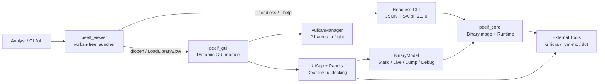
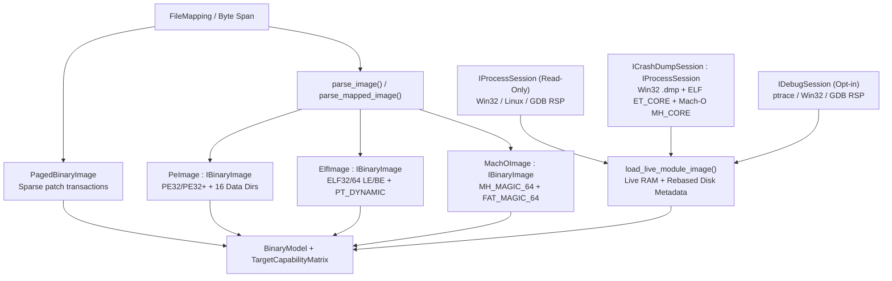
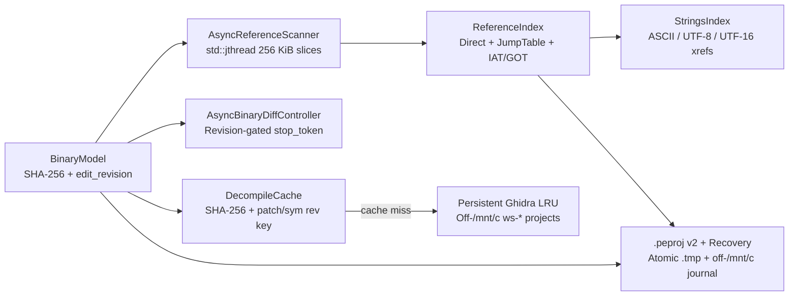
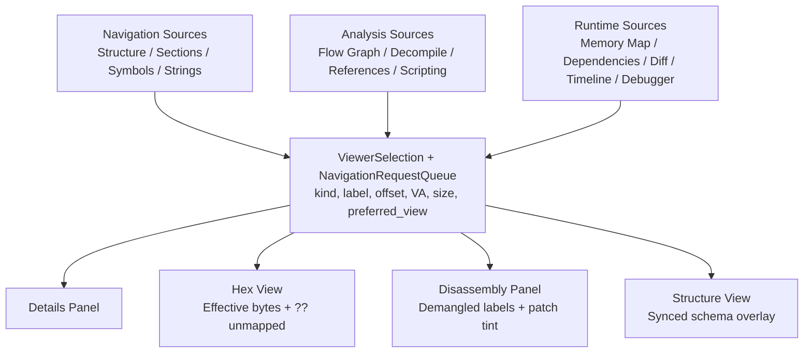
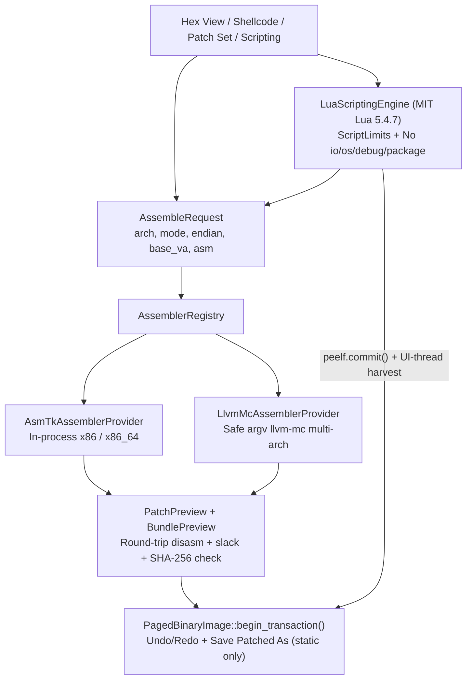
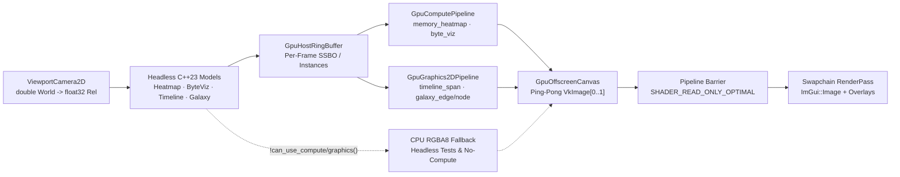
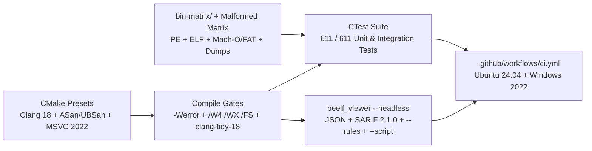

# PE / ELF Explorer Architecture

This document describes the post-`89cf67f` runtime and build architecture of PE / ELF Explorer across its three primary CMake targets (`peelf_core`, `peelf_gui`, and `peelf_viewer`). Related documents:
- **[User Guide (`docs/USER_GUIDE.md`)](USER_GUIDE.md)** — End-to-end feature walkthrough, UI panels, shortcuts, and CLI automation
- **[Roadmap & C++23 Design (`docs/ROADMAP_DESIGN.md`)](ROADMAP_DESIGN.md)** — Validated specification for `WU-19a..WU-19d` and `WU-21..WU-28`

---

## 1. System & Target Split Overview

`peelf_viewer` (`apps/viewer/src/launcher.cpp`) is a lightweight Vulkan-free executable that links **only** `peelf_core` and `${CMAKE_DL_LIBS}`. When invoked with `--headless` or `--help`, it executes completely inside `peelf_core` without loading graphics libraries, making it suitable for minimal CI containers (`-DPEELF_BUILD_GUI=OFF` omits GUI compilation altogether). In interactive desktop sessions, `peelf_viewer` dynamically loads `peelf_gui` (`peelf_gui.dll` / `libpeelf_gui.so`) and invokes `peelf_run_gui()`.

### Target Boundary Invariants
- **`peelf_core` (`libs/peelf_core`)**: Zero ImGui, GLFW, or Vulkan dependencies. Uses `peelf::Result<T> = std::expected<T, peelf::Error>` across API boundaries (`peelf/error.hpp`), forgiving `ForgivingValue<T>` / `SubsystemStatus` (`peelf/forgiving.hpp`), and first-class `TargetCapabilityMatrix` + `Observed<T>` provenance (`peelf/target_capabilities.hpp`, `WU-21`). Image parsing is modularized behind `<peelf/binary_image.hpp>` into `binary_image.cpp` (dispatch, container slice selection, & live PE/Mach-O mapped normalization), `image_mapping.cpp` (`ImageBase` VA/RVA <-> file-offset mapping), `pe_image.cpp` (`PeImage`), `elf_image.cpp` (`ElfImage` with explicit `parse_warnings()`), and `macho_image.cpp` (`MachOImage` + Universal `FAT_MAGIC`/`FAT_CIGAM_64`, `WU-26`). Also hosts clean-room cross-platform MSF 7.00/CodeView `.pdb` parsing (`peelf/pdb.hpp`, `WU-34`), DWARF v2–v5 + Mach-O `__DWARF` & `LC_UUID`-verified `.dSYM` bundle discovery (`peelf/dwarf.hpp`, `WU-39`), PE Rich header + static/live crypto & packer constant detector + YARA-lite rule compiler/scanner (`peelf/signatures.hpp`, `WU-38`), offline Minidump `.dmp`, ELF `ET_CORE`, & Mach-O `MH_CORE` crash dumps (`peelf/crash_dump.hpp`, `WU-14`, `WU-39`), `ExecutableSettings` (`WU-22`), `ProcessStateSnapshot` / `SnapshotDiff` (`WU-23`), `ExecutionTimeline` (`WU-24`), clean-room `GdbRemoteBackend` RSP (`WU-25`), embedded MIT Lua 5.4.7 `LuaScriptingEngine` (`peelf/scripting.hpp`, `WU-28`), and pure C++23 visualization models + deterministic CPU RGBA8 reference rasterizers for `MemoryHeatmap` (`peelf/memory_heatmap.hpp`, `WU-30`), `ByteViz` (`peelf/byte_viz.hpp`, `WU-31`), and `TimelineViewport` + `LiveThreadMonitor` (`peelf/timeline_viewport.hpp`, `WU-32`).
- **`peelf_gui` (`apps/viewer`)**: Owns staged RAII `VulkanManager` (`UniqueTexture`, `GpuOffscreenCanvas`, `GpuHostRingBuffer`, `GpuComputePipeline`, `GpuGraphics2DPipeline`, `ViewportCamera2D`, and compile-time `validate_spirv_words`, `WU-29`) and `Application` (`std::unique_ptr<UiApp>`), `BinaryModel` (`binary_model.cpp` static/patching/scripting core + `binary_model_live.cpp` live/dump/debugger/GDB-RSP sessions), modular `UiApp` (`ui_app.cpp`, `ui_app_project.cpp`, `ui_app_menus_docking.cpp`, `ui_app_process.cpp`, `ui_app_graph.cpp`, `ui_app_navigation.cpp`), pure `DockNodeSpec` `WorkspaceLayout` v12 across 39 dockable panels & capability-aware `ContextActions` + `NavigationRequestQueue` (`WU-27`, `WU-38`), `CommandPalette` & symbolic expression Go-To (`command_palette.*`, `WU-36`), virtualized `LinearDisassemblyModel` (`linear_disassembly.*`, `WU-35`), recursive-descent C header parser (`c_type_parser.*`, `WU-37`), `SignaturesPanel` (`ui_panels_signatures.*`, `WU-38`), `CallGraph` (`call_graph_dot.cpp`, `call_graph_build.cpp`, `call_graph_cfg.cpp`) + `CallGalaxyGraph` / `BarnesHutGalaxyLayout` (`call_graph_galaxy.*`, `WU-33`), background UI controllers (`AsyncReferenceScanner`, `AsyncBinaryDiffController`, `DecompileController`, `DecompileCache`, `BinaryModel::AsyncScriptRunner`), Capstone `Disassembler`, PDB/DIA/DWARF/`.dSYM` symbol bridge, and `.peproj` v2 session management.
- **Compiler, Lint & Sanitizer Gate**: Project targets compile with `-Wall -Wextra -Wpedantic -Werror` on Clang/GCC and `/W4 /WX /FS` on MSVC (`PEELF_WARNINGS_AS_ERRORS=ON`), pass `clang-tidy-18` (`WarningsAsErrors: '*'`), and isolate `FetchContent` headers as `SYSTEM`. All `611/611` CTests pass under `clang18-debug`, `clang18-release`, and `clang18-asan-ubsan` (`AddressSanitizer` + `UndefinedBehaviorSanitizer` + `LeakSanitizer`).

---

## 2. Unified `IBinaryImage` & Session Spine

The duplicate legacy `viewer::PeParser` / `PeModel` path was retired in `473ee3f` (`WU-18`). Every static view, live attached module view, offline crash dump module hydration, dependency resolver, binary differ, and security rule operates on `peelf::IBinaryImage` (`libs/peelf_core/include/peelf/binary_image.hpp`).

### Format & Session Capabilities
- **PE32 / PE32+ (`PeImage`)**: Typed `PeFileHeaderInfo`, `PeOptionalHeaderInfo`, and `PeDataDirectoryEntry` accessors; standard, ordinal, bound, and delay-load imports; named, ordinal, and forwarded exports; base relocations; `.pdata`/`.xdata` unwind metadata; Rich header `DanS`/`Rich` XOR decoder (`WU-38`); CodeView RSDS + clean-room cross-platform MSF 7.00/CodeView `.pdb` symbol/type/line parser (`peelf/pdb.hpp`, `WU-34`) + optional Windows DIA; TLS callbacks; `WIN_CERTIFICATE` table; LoadConfig (SafeSEH, GuardCF, security cookie); resource directory trees (`RT_MANIFEST`, `RT_VERSION`); and CLR `BSJB` metadata (`WU-22`).
- **ELF32 / ELF64 LE/BE (`ElfImage`)**: Supports x86, x86-64, ARM32, ARM64, RISC-V 32/64, MIPS 32/64, and PowerPC 32/64; extended header numbering (`e_shnum == 0`, `SHN_XINDEX`, `PN_XNUM`); static sectionless `PT_DYNAMIC` symbol/relocation/import recovery (`DT_HASH` / `DT_GNU_HASH` / `DT_SYMTAB` / `DT_STRTAB` via `PT_LOAD` VA translation); notes (`.note.ABI-tag`, `.note.gnu.build-id`, `.note.gnu.property`); and DWARF v2–v5 + `.gnu_debuglink` sidecar hydration.
- **Cross-Endian Mach-O & Universal Containers (`MachOImage`, `WU-26`, `WU-39`)**: Supports thin `MH_MAGIC`/`MH_MAGIC_64`/`MH_CIGAM`/`MH_CIGAM_64` and Universal `FAT_MAGIC`/`FAT_CIGAM`/`FAT_MAGIC_64`/`FAT_CIGAM_64` binaries (`parse_binary_container` + `BinaryModel::select_container_slice` + `--headless --slice <index|arch>`). Exposes container-absolute file offsets across fat slices, load commands, classic `nlist` & `LC_DYLD_EXPORTS_TRIE` / `LC_DYLD_CHAINED_FIXUPS`, embedded `__DWARF,__debug_*` (including 16-char `__debug_str_offs`) & `LC_UUID`-verified `.dSYM` bundle auto-discovery, structural `LC_CODE_SIGNATURE` SuperBlob/CodeDirectory/entitlements/CMS inspection, `@executable_path`/`@loader_path`/`@rpath` + `LC_REEXPORT_DYLIB` & honest dyld shared-cache `Dependencies`, and slice-matching `BinaryDiff`.
- **`TargetCapabilityMatrix` & First-Class Provenance (`WU-21`)**: Every loaded or attached target publishes explicit `SupportState` values (`SupportedValidated`, `SupportedExperimental`, `Partial`, `Unsupported` — defaulting strictly to `Unsupported` without evidence), `ProvenanceTag`, `CaptureAvailability`, `CaptureStamp` (`TargetInstanceId` + `snapshot_revision`), `BackingImageIdentity` verification, and `Observed<T>` wrappers surfaced in the `Target Capabilities` panel, `Executable & Settings` (`WU-22`), context-menu gating (`WU-27`), and `--headless` JSON.
- **Strictly Read-Only Live Inspection, Snapshots/Timelines & Opt-In Debugging (`WU-23..WU-25`)**:
  - Default `IProcessSession` (`Ctrl+P` local or `GdbRemoteBackend::open_read_only` over loopback-gated RSP) guarantees `is_read_only() == true` and never injects traps or writes memory.
  - `ProcessStateSnapshot` (`WU-23`) captures point-in-time telemetry (redacting sensitive environment secrets by default) and computes `TargetInstanceId`-verified `SnapshotDiff`s across modules, split/merged/RWX regions, threads, FDs (detecting FD reuse), and sockets. `ExecutionTimeline` (`WU-24`) merges `IDebugSession` events and `SnapshotDiff` deltas into per-thread UI swimlanes with explicit `SamplingGap` and `DroppedEvents` markers.
  - Offline crash dumps (`Minidump` `"MDMP"`, ELF `ET_CORE` with multi-arch `NT_PRSTATUS` decoding, and thin/Universal Mach-O `MH_CORE` with `LC_SEGMENT`/`LC_SEGMENT_64` zero-filled virtual mapping, `LC_THREAD`/`LC_UNIXTHREAD` `x86_64`/`x86`/`ARM64`/`ARM32` thread & exception states, and mapped `MH_EXECUTE`/`MH_DYLIB` module recovery, `WU-14`, `WU-39`) implement `ICrashDumpSession : IProcessSession`, reusing every live inspection panel without executing target code.
  - Active debugging (`peelf::debugger::IDebugSession`) requires explicit opt-in (`ExplicitDebugConsent`), backed by BSD-2-Clause Linux `ptrace`, Win32 Debug API, and `GdbRemoteBackend::open_debug` (`vCont`/`Hc`, `Z0`–`Z4` software/hardware breakpoints & watchpoints, XXE-free `target.xml`/`memory-map`/`libraries-svr4` parsing, `xx`-preserving partial registers, shadowed memory reads, and truthful `detach()`).

---

## 3. Background Analysis, Decompilation & Session Persistence

Expensive static and cross-binary analyses run off the UI render thread with explicit progress, cancellation, or caching so 60+ FPS interactivity is preserved.

- **Resumable `ReferenceIndex` (`WU-03`)**: `AsyncReferenceScanner` scans executable sections/regions in 256 KiB slices on a `std::jthread`, populating sorted `incoming`/`outgoing` xref vectors ($O(\log N + K)$ queries). Recovers direct branches/calls, guarded x86 absolute jump tables, x86/x64 PIC/RIP-relative `i32` tables, ARM Thumb-2 `tbb`/`tbh`, ARM64 PC-relative jump tables, and IAT/GOT indirect slots with `ReferenceConfidence` and `evidence` strings.
- **Two-Tier Persistent Decompilation (`WU-02`, `WU-19b`)**: `DecompileController` runs background decompilation on a `std::jthread` with latest-request replacement, per-job `std::stop_source` cancellation, and `(target_identity, file_generation, edit_revision, snapshot_revision)` validation stamps. `DecompileCache` caches `DecompiledUnit` results in memory by `(binary_sha256, patch_revision, symbol_revision, provider, settings_fingerprint, arch, endian, thumb, function_va)`. On cache miss, `GhidraDecompiler` reuses an LRU-bounded headless workspace (`ws-*` under `$PEELF_CACHE_DIR/ghidra_workspaces` or safe OS temp dir, never `/mnt/c` on WSL): cold imports run `analyzeHeadless -import` without `-deleteProject`, while subsequent functions run `-process -noanalysis` with incremental symbol sync and automatic cold-retry on stale project locks. In-tree `StructuredPseudoCDecompiler` provides an instant zero-dependency fallback.
- **Binary Ninja Integration & Direct C++ SDK Evaluation (`P5b-3 .. P5b-5`, `WU-40`)**:
  - *Discovery, Capability Gating & `PEELF_DECOMPILE 3` Bridge*: `discover_binary_ninja()` and `probe_binary_ninja_capabilities()` resolve Binary Ninja from explicit `DecompilerSettings::binary_ninja_home`, `BN_INSTALL_DIR` / `BINARYNINJA_HOME`, user settings (`lastrun` & `settings.json` under `%APPDATA%/Binary Ninja`, `~/.binaryninja`, and `~/Library/Application Support/Binary Ninja`), standard platform install directories, and `PATH`. `check_binary_ninja_architecture_support()` and `check_binary_ninja_headless_support()` enforce honest edition/architecture diagnostics — reporting `DecompileStatus::Unsupported` when Binary Ninja Free (interactive x86/x64-only; no headless Python batch license and no ARM64/ARM32/MIPS/PowerPC/RISC-V plugins) is targeted instead of failing silently. `BinaryNinjaDecompiler` invokes `apps/viewer/resources/bn_decompile.py` inside an off-`/mnt/c` `0700` scratch workspace with configurable `timeout_seconds`, `--bn-home`, `--arch`, and `PEELF_SYMBOLS 1` user renames, emitting `PEELF_DECOMPILE 3` with folded HLIL `CodeRange` `(address, size)` spans and bounded `view.types` `DataTypeRecord` structs/unions.
  - *`P5b-5` Direct C++ SDK Spike Evaluation*: Direct in-process C++ linking against `binaryninja-api` / `libbinaryninjacore` was evaluated against five criteria: (1) **ABI stability** — `binaryninja-api` statically pins `BN_CURRENT_CORE_ABI_VERSION`, which increments frequently across Binary Ninja point/dev releases, whereas `<bn_home>/python` always matches the user's installed `binaryninjacore` 1:1; (2) **build & runtime isolation** — loading `binaryninjacore` in-process pulls user-installed native BN plugins and LLVM/Rust runtimes into `peelf_gui`, removing hard timeout killability and risking symbol collisions or host crashes on malformed binaries; (3) **licensing & redistribution** — `binaryninjacore` is proprietary commercial software that cannot be redistributed with BSD-2-Clause `exe_viewer`; (4) **optional CMake switch** — `option(PEELF_ENABLE_BINARY_NINJA_SDK ... OFF)` in `CMakeLists.txt` cleanly validates `BN_SDK_DIR` (`binaryninjacore.h`) and `binaryninjacore` when opted in with zero impact when `OFF`; and (5) **zero CI dependency** — neither default builds nor CI require Binary Ninja (`PEELF_ENABLE_BINARY_NINJA_TESTS=OFF`). **Architectural decision:** retain the process-isolated `bn_decompile.py` `PEELF_DECOMPILE 3` bridge as the primary production integration and keep `PEELF_ENABLE_BINARY_NINJA_SDK` solely as an opt-in developer probe.
- **Cancellable Binary Diff (`WU-12`, `WU-17`)**: `AsyncBinaryDiffController` executes `peelf::compare_binaries` (header, section, import, export, byte-hunk, and 3-tier `ExactName` / `NormalizedFingerprint` / `Similarity` function matching) on a background `std::jthread` with monotonic request IDs and `std::stop_token` cooperative cancellation. `peelf::compare_module_disk_to_live` normalizes relocations, LoadConfig cookies, and resolved IAT/GOT entries to isolate `.text` `InlineCodeHook` detours from `IatGotPointerHook` hijacks.
- **`.peproj` v2 Sessions & Crash Recovery (`WU-09`, `WU-37`)**: Stores `source_sha256`, `source_size`, canonical `source`, and portable `relative_source` alongside staged patches, annotations, debug symbols, custom C `struct`/`union`/`enum`/`#pragma pack` definitions (`c_type_parser.*`), bookmarks, pinned `AppliedStructureBinding`s, history, and layout. Writes atomically via `.tmp` rename and maintains periodic off-`/mnt/c` recovery journals.

---

## 4. Panel Selection Hub, `DockNodeSpec` Workspaces, Omni-Search & Universal Context Actions (`WU-27`, `WU-35..WU-36`)

Panels communicate through `ViewerSelection` (`apps/viewer/src/navigation/viewer_navigation.hpp`) and deferred `NavigationRequestQueue` (`apps/viewer/src/ui/context_actions.hpp`) rather than mutating peer panels or Dear ImGui tables mid-iteration.

- **Pure `DockNodeSpec` Workspace Engine (`workspace_layout.*`)**: Defines 5 deterministic `WorkspacePreset`s (*Static Reverse Engineering*, *Live Process / VMMap*, *Debugger*, *Binary Diff*, *Minimal*) over all 39 `WorkspacePanelId` windows (`kWorkspaceLayoutSchemaVersion = 12`), validated independent of ImGui/Vulkan for split-ratio bounds, non-duplicate leaf assignments, and active-tab determinism.
- **Omni-Search `CommandPalette` & Symbolic Go-To (`command_palette.*`, `WU-36`)**: Fuzzy-ranks functions, symbols, strings, types, bookmarks, panels, presets, commands, and security rules (`Ctrl+K` / `Ctrl+Shift+P` with `>`, `@`, `#`, `:`, `?` prefixes) and evaluates `parse_address_expression` (`off:`, `rva:`, `0x...`, `module!sym + offset`, `.section + offset`, registers, `$entry`, `$here`, `Ctrl+G`) completely independent of ImGui.
- **Virtualized Whole-Binary Linear Disassembly (`linear_disassembly.*`, `WU-35`)**: Lazily disassembles 4 KiB address chunks across `WholeBinary`, `ActiveSection`, or `ActiveFunction` scopes with $O(\log N)$ VA lookup, multi-lane intra-function branch-arc routing, and `PagedBinaryImage` patched-byte overlays.
- **Capability-Aware Universal Context Menus (`context_actions.*`)**: `evaluate_context_actions` inspects `InspectableEntity` + `TargetCapabilityMatrix` to enable/disable `Copy VA / File Offset / Label / JSON Summary`, `Follow in Hex / Disassembly / Decompiler / Structure View`, `Add Bookmark`, and `Toggle Software Breakpoint` with explicit unavailable reasons, queuing navigation mutations for safe post-frame execution.

---

## 5. Assembly Providers, Transactional Patching (`.pepatch.json`) & Sandboxed Lua 5.4 Scripting (`WU-28`)

`IAssemblerProvider` (`peelf/assembler.hpp`) dispatches little-endian x86/x86_64 assembly to `AsmTkAssemblerProvider` in-process and routes ARM, Thumb, AArch64, RISC-V 32/64, PowerPC 32/64, and MIPS 32/64 to `LlvmMcAssemblerProvider` via shell-free `argv` execution (`fork`/`execv` on POSIX, `CreateProcessW` on Windows). `.pepatch.json` bundles (`peelf/patch_bundle.hpp`) validate `expected_sha256`, `expected_size`, and per-entry `original_bytes_hex` before staging all spans inside one atomic `PatchTransaction`, rejecting live process sessions unconditionally.

`LuaScriptingEngine` (`peelf/scripting.hpp`) embeds MIT Lua 5.4.7 compiled strictly as C (`LUA_USE_LONGJMP`), isolating every `lua_*` boundary behind zero-destructor C++ trampolines + `lua_pcall`. A custom `lua_Alloc` enforces `ScriptLimits::max_memory_bytes`, a `LUA_MASKCOUNT` hook enforces `max_instructions`, `wall_clock_timeout`, and `std::stop_token` cancellation, `luaL_loadbufferx(..., "t")` rejects binary bytecode, and `io`/`os`/`debug`/`package`/`dofile`/`loadfile` are never opened. Scripts stage byte writes and annotations (`set_label`, `set_comment`, `add_bookmark`) against an isolated read-your-writes clone; mutations apply only when `allow_mutations == true` (static targets only) and `peelf.commit()` succeeds. In the GUI, `BinaryModel::AsyncScriptRunner` executes scripts on a cancellable `std::jthread` (`LaunchRollbackGuard` + non-allocating `catch`) and commits results on the UI thread via `harvest_script_execution()`, discarding stale outcomes if `(file_generation, slice_index, edit_revision, annotation_revision)` changed concurrently.

---

## 6. Vulkan 2-Frames-in-Flight & Pre-Swapchain GPU Visualization Architecture (`WU-18`, `WU-29..WU-33`)

`VulkanManager` (`apps/viewer/src/vulkan/vulkan_manager.*`) decouples CPU ImGui frame preparation from GPU presentation using `kMaxFramesInFlight = 2`, and executes registered offscreen compute and instanced 2D render passes (`register_pre_pass_recorder`) on the same frame command buffer immediately **before** the swapchain ImGui render pass—yielding zero extra queue submissions and zero 1-frame texture lag:

### Frame Synchronization & Offscreen Primitives (`WU-18`, `WU-29`)
- **2-Frames-in-Flight Hazards Eliminated**: Each in-flight slot (`frame_index` in `0..1`) owns an isolated `VkCommandPool`, `VkCommandBuffer`, `image_available` `VkSemaphore`, and `in_flight` `VkFence`, while `render_finished` semaphores are indexed by acquired **swapchain `image_index`**. Minimized zero-extent windows (`width == 0 || height == 0`) pause acquisition cleanly, and `VK_ERROR_OUT_OF_DATE_KHR` / `VK_SUBOPTIMAL_KHR` trigger `recreate_swapchain()`.
- **`GpuOffscreenCanvas` & `GpuHostRingBuffer` (`gpu_offscreen_canvas.*`)**: Allocates per-frame `VK_FORMAT_R8G8B8A8_UNORM` images usable as storage images (`VK_IMAGE_USAGE_STORAGE_BIT`), color attachments (`VK_IMAGE_USAGE_COLOR_ATTACHMENT_BIT`), and sampled ImGui `VkDescriptorSet`s, paired with persistently mapped `HOST_VISIBLE | HOST_COHERENT` per-frame ring slices so streaming `100k+` instances never blocks an in-flight GPU frame.
- **Double-Precision `ViewportCamera2D` (`viewport_camera_2d.hpp`)**: Maintains pan/zoom in `double` world coordinates (covering 64-bit virtual addresses and multi-hour nanosecond timestamps without float32 mantissa jitter) and projects visible primitives into camera-relative `float32` pixel coordinates before GPU upload.
- **Compile-Time SPIR-V Validation & Deterministic CPU Fallback**: Every embedded GLSL 450 shader (`apps/viewer/src/vulkan/shaders/*.glsl` -> constexpr `uint32_t` arrays) is verified by `spirv-val` (`vulkan1.0`) and `static_assert(viewer::validate_spirv_words(...))` (`spirv_validation.hpp`), with `static_assert(sizeof(PushConstants) <= 128)`. Every GPU visualization shares an exact pure-C++23 RGBA8 reference rasterizer used both by headless GoogleTests and automatically at runtime when a Vulkan device lacks storage-image compute or offscreen graphics support.

### Wave 3 Visualization Data-Flow (`WU-30 .. WU-33`)
- **`WU-30` — `Memory Heatmap` (`peelf/memory_heatmap.hpp`, `memory_heatmap.comp.glsl`)**: Harvests Linux `/proc/<pid>/pagemap` + `/proc/<pid>/smaps` or Win32 `VirtualQueryEx` + `QueryWorkingSetEx` into compact 16-byte `MemoryTileGpu` SSBO records, tracks residency/soft-dirty/permission deltas in `MemoryHeatmapDeltaTracker`, and dispatches an $8 \times 8$ compute grid unfolding tiles along order-1..8 2D Hilbert curves or linear rows.
- **`WU-31` — `Entropy & Digram` (`peelf/byte_viz.hpp`, `byte_entropy_map.comp.glsl`, `byte_digram.comp.glsl`)**: Computes multi-resolution Shannon entropy, byte-class ratios, chi-square randomness, diff/patch/xref bitmasks, and $256 \times 256$ adjacent-byte transition matrices (`ByteVizDigramMatrix`), dispatching two compute pipelines into side-by-side offscreen canvases.
- **`WU-32` — `Execution Timeline` & `LiveThreadMonitor` (`peelf/timeline_viewport.hpp`, `timeline_span.{vert,frag}.glsl`)**: Background `LiveThreadMonitor` (`std::jthread` + `std::stop_token`) polls read-only `IProcessSession` thread states/IPs/wait reasons into `ExecutionTimeline`; `TimelineViewportModel` coalesces sub-pixel bursts into LOD spans and streams 32-byte `TimelineSpanGpuInstance` records (`VK_VERTEX_INPUT_RATE_INSTANCE`) through an anti-aliased SDF rounded-box pass with hatched `SamplingGap` bands.
- **`WU-33` — `Flow Graph` `GPU Galaxy` (`call_graph_galaxy.*`, `galaxy_edge.{vert,frag}.glsl`, `galaxy_node.{vert,frag}.glsl`)**: Builds whole-binary (`10,000+` functions, `50,000+` call/tail-jump edges with entry-reachability BFS, `SecurityAuditReport` severity, and `BinaryDiffReport` overlays) or `CallGraph` CFG/fanout galaxies; steps a progressive background `std::jthread` $O(N \log N + E)$ `BarnesHutGalaxyLayout` quadtree solver (`kMaxQuadtreeDepth = 24`, cooperative `std::stop_token`, interactive node pinning); and records two instanced 2D passes (oriented tapered-alpha SDF edges followed by degree-scaled SDF discs with selection/ego/shortest-path halos) underneath crisp ImGui node labels.

### Graph Interaction Renderer Architectural Decision (`P6-12b`, `WU-41`)
Three candidate interactive graph rendering architectures were evaluated against clickable node/edge hit-testing, 64-bit VA/offset metadata fidelity, 60+ FPS pan/zoom responsiveness, theme parity, offline air-gapped determinism, deployment footprint, and unified `ViewerSelection` integration:

1. **Embedded WebView2 + Mermaid / HTML / DOM *(Rejected)***: Introduces a hard Windows-only WebView2 Evergreen runtime dependency that breaks Linux/WSL2 native parity and single-folder air-gapped portability, adds multi-process browser memory overhead, requires asynchronous JSON IPC bridges for selection state, and diverges visually from Dear ImGui docking themes and monospace disassembly typography.
2. **Static Graphviz SVG Rasterization + Hit-Test Metadata *(Retained for Export Only)***: `to_dot()`, `parse_graphviz_plain_layout()`, and `render_graph_with_graphviz()` are retained for deterministic DOT/SVG/PNG/BMP artifact export and optional `dot -Tplain` coordinate seeding, but spawning external `dot` processes is unsuitable as the primary interactive renderer due to subprocess latency, optional external tool availability, lack of live node dragging/pinning, and inability to scale to `10,000+`-node whole-binary call graphs.
3. **Native Dear ImGui `Flow Graph` Canvas + Vulkan `CallGraphGalaxyRenderer` *(Selected Production Architecture)***:
   - **Zero runtime dependency & offline air-gapped determinism**: Runs identically across Windows, Linux, and WSL2 with zero WebView2, browser, or mandatory Graphviz runtime dependencies, backed by deterministic pure-C++23 layout and CPU RGBA8 fallback rasterization for headless verification.
   - **Theme parity & semantic edge styling**: Shares exact Dear ImGui palette tokens, DPI-scaled monospace fonts, and edge-kind encodings (`DirectCall`/`Call`, `ConditionalBranch`, `UnconditionalBranch`, `Fallthrough`, `Return`, `DataReference`) across interactive CFG basic-block cards and galaxy overlays.
   - **60+ FPS pan/zoom from single-function CFGs to whole-binary galaxies**: Pairs immediate-mode draggable CFG/fan-out cards (`ui_app_graph.cpp`) with double-precision `ViewportCamera2D` and Vulkan instanced SDF passes (`CallGraphGalaxyRenderer` + progressive `BarnesHutGalaxyLayout`) for smooth 60+ FPS navigation across `10,000+` functions and `50,000+` edges.
   - **Direct `ViewerSelection` & `NavigationRequestQueue` integration**: Clicking or activating any graph node or basic-block instruction constructs `ViewerSelection` via `selection_from_call_graph_node()` and enqueues `NavigationRequestQueue` requests directly—synchronizing `Details`, `Hex View`, `Disassembly`, `Symbols`, and `Decompile` through the exact same selection contract as tree and table panels.

---

## 7. Security Rule Engine, Signatures / YARA-Lite, CI & Verification Matrix

- **Security Rules (`peelf/security_audit.hpp`)**: Evaluates `PE1001..PE1008`, `ELF2001..ELF2008`, `LIVE3001..LIVE3003`, and `MACHO4001..MACHO4006` with `Pass` / `Note` / `Warning` / `Error` severities, header/segment/region evidence, VA/offset locations, and compiler/linker remediation flags. `PE1005` (`SignBinaryWithAuthenticode`) and `MACHO4004` (`CodeSignatureAndHardenedRuntime`) strictly separate structural signature presence (`Note` when cryptographic OS trust verification is unavailable) from cryptographic trust verification.
- **Signatures, Crypto/Packer Detection & YARA-Lite (`peelf/signatures.hpp`, `WU-38`)**: Decodes PE `Rich` header `DanS`/`Rich` XOR toolchains (`parse_pe_rich_header`), scans static sections and live `IProcessSession` regions for cryptographic/hash/compression tables and packer markers (`scan_crypto_and_packer_constants`), and compiles/evaluates bounded YARA-lite rules (`compile_yara_lite_rules` / `scan_yara_lite` with string modifiers, hex wildcards/jumps, and `pe.*`/`elf.*`/`macho.*`/`entropy(...)` conditions) in both the `Signatures & Crypto` panel and `--headless --rules <path>`.
- **Hostile-Input & Sanitizer Verification (`WU-16`, `WU-17`, `WU-25..WU-28`, `WU-34..WU-39`)**: `tests/malformed_inputs_matrix_test.cpp`, `tests/macho_test.cpp`, `tests/gdb_rsp_test.cpp`, `tests/scripting_test.cpp`, `tests/pdb_parser_test.cpp`, `tests/signatures_and_crypto_test.cpp`, and `tests/macho_core_and_dsym_test.cpp` test wrap-around offsets, cyclic PE forwarders and ELF `sh_link` chains, `SHN_XINDEX`/`PN_XNUM`, malformed fat/Mach-O load commands & trie loops, truncated MSF/CodeView streams, bounded YARA-lite wildcards, XXE/oversized RSP packets, Lua instruction/memory/timeout bombs, and malformed `ET_CORE` / `MH_CORE` crash dumps under `clang18-asan-ubsan`.

