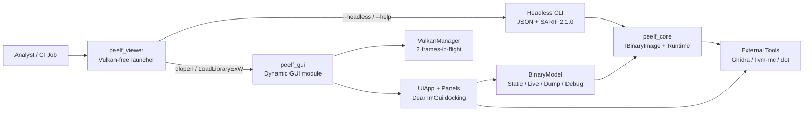
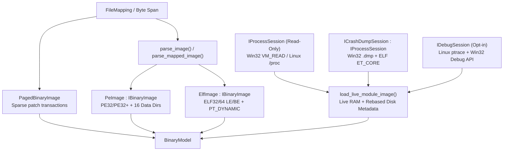
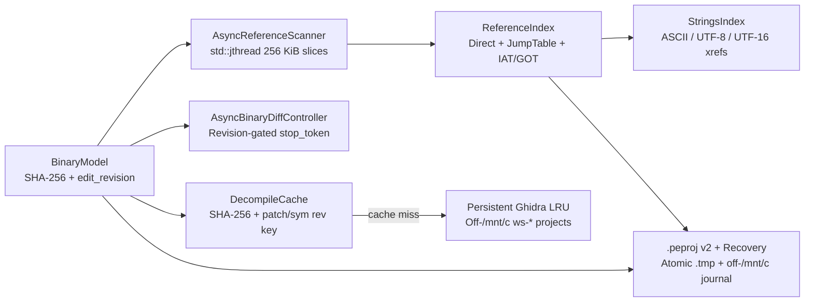
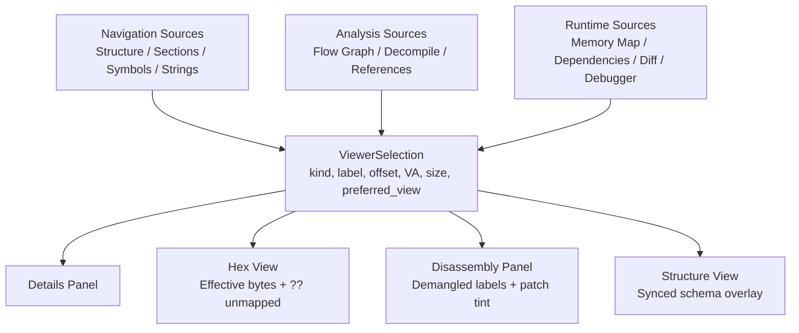
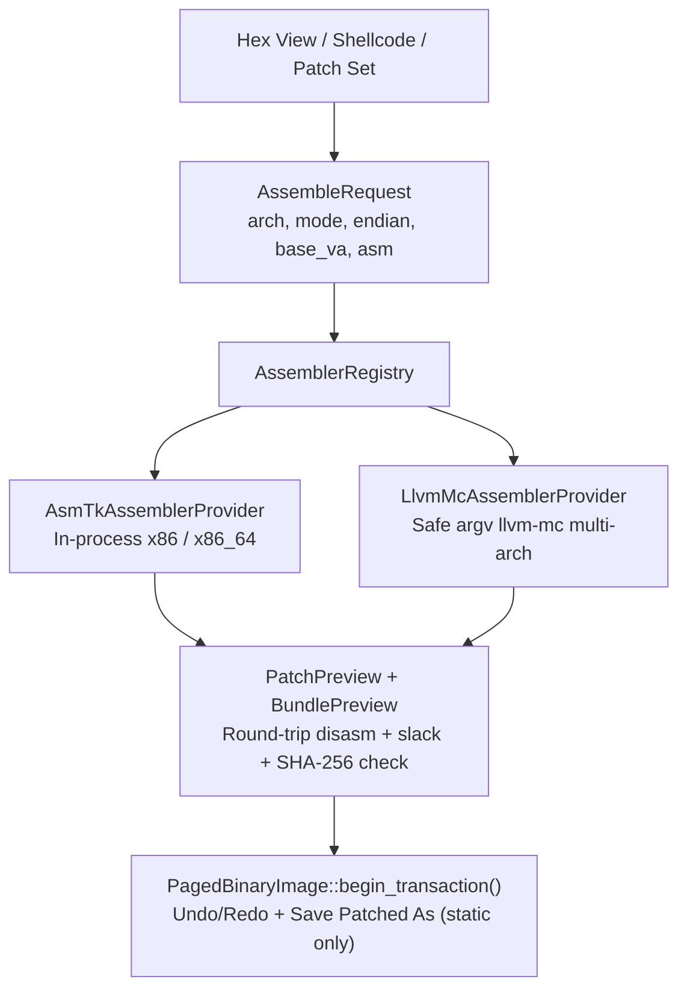
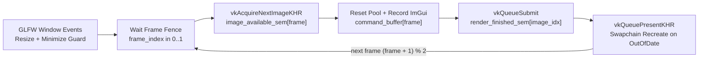
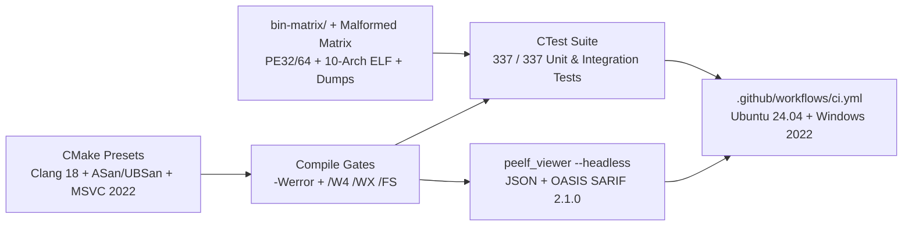

# PE / ELF Explorer Architecture

This document describes the post-`89cf67f` runtime and build architecture of PE / ELF Explorer across its three primary CMake targets (`peelf_core`, `peelf_gui`, and `peelf_viewer`). Related documents:
- **[User Guide (`docs/USER_GUIDE.md`)](USER_GUIDE.md)** — End-to-end feature walkthrough, UI panels, shortcuts, and CLI automation
- **[Roadmap & C++23 Design (`docs/ROADMAP_DESIGN.md`)](ROADMAP_DESIGN.md)** — Validated specification for `WU-19a..WU-19d` and `WU-21..WU-28`

---

## 1. System & Target Split Overview

`peelf_viewer` (`apps/viewer/src/launcher.cpp`) is a lightweight Vulkan-free executable that links **only** `peelf_core` and `${CMAKE_DL_LIBS}`. When invoked with `--headless` or `--help`, it executes completely inside `peelf_core` without loading graphics libraries, making it suitable for minimal CI containers (`-DPEELF_BUILD_GUI=OFF` omits GUI compilation altogether). In interactive desktop sessions, `peelf_viewer` dynamically loads `peelf_gui` (`peelf_gui.dll` / `libpeelf_gui.so`) and invokes `peelf_run_gui()`.

### Target Boundary Invariants
- **`peelf_core` (`libs/peelf_core`)**: Zero ImGui, GLFW, or Vulkan dependencies. Uses `peelf::Result<T> = std::expected<T, peelf::Error>` across API boundaries (`peelf/error.hpp`) and forgiving `ForgivingValue<T>` / `SubsystemStatus` (`peelf/forgiving.hpp`) when partial OS telemetry is expected. Image parsing is modularized behind `<peelf/binary_image.hpp>` into `binary_image.cpp` (dispatch & format stringifiers), `image_mapping.cpp` (`ImageBase` VA/RVA <-> file-offset mapping & live PE normalization), `pe_image.cpp` (`PeImage`), and `elf_image.cpp` (`ElfImage` with explicit `parse_warnings()` for truncated tables).
- **`peelf_gui` (`apps/viewer`)**: Owns staged RAII `VulkanManager` (`UniqueTexture`) and `Application` (`std::unique_ptr<UiApp>`), `BinaryModel` (`binary_model.cpp` static/patching core + `binary_model_live.cpp` live/dump/debugger sessions), modular `UiApp` (`ui_app.cpp`, `ui_app_project.cpp`, `ui_app_menus_docking.cpp`, `ui_app_process.cpp`, `ui_app_graph.cpp`, `ui_app_navigation.cpp`), `CallGraph` (`call_graph_dot.cpp`, `call_graph_build.cpp`, `call_graph_cfg.cpp`), background UI controllers (`AsyncReferenceScanner`, `AsyncBinaryDiffController`, `DecompileController`, `DecompileCache`), Capstone `Disassembler`, DIA/PDB symbol bridge, and `.peproj` v2 session management.
- **Compiler & Sanitizer Gate**: Project targets compile with `-Wall -Wextra -Wpedantic -Werror` on Clang/GCC and `/W4 /WX /FS` on MSVC (`PEELF_WARNINGS_AS_ERRORS=ON`), while `FetchContent` headers are isolated as `SYSTEM`. All `337/337` CTests pass under `clang18-asan-ubsan` (`AddressSanitizer` + `UndefinedBehaviorSanitizer`).

---

## 2. Unified `IBinaryImage` & Session Spine

The duplicate legacy `viewer::PeParser` / `PeModel` path was retired in `473ee3f` (`WU-18`). Every static view, live attached module view, offline crash dump module hydration, dependency resolver, binary differ, and security rule operates on `peelf::IBinaryImage` (`libs/peelf_core/include/peelf/binary_image.hpp`).

### Format & Session Capabilities
- **PE32 / PE32+ (`PeImage`)**: Typed `PeFileHeaderInfo`, `PeOptionalHeaderInfo`, and `PeDataDirectoryEntry` accessors; standard, ordinal, bound, and delay-load imports; named, ordinal, and forwarded exports; base relocations; `.pdata`/`.xdata` unwind metadata; CodeView RSDS + MSF 7.00 Stream 1/3 GUID+Age verification; TLS callbacks; `WIN_CERTIFICATE` table; LoadConfig (SafeSEH, GuardCF, security cookie); resource directory trees; and CLR header.
- **ELF32 / ELF64 LE/BE (`ElfImage`)**: Supports x86, x86-64, ARM32, ARM64, RISC-V 32/64, MIPS 32/64, and PowerPC 32/64; extended header numbering (`e_shnum == 0`, `SHN_XINDEX`, `PN_XNUM`); static sectionless `PT_DYNAMIC` symbol/relocation/import recovery (`DT_HASH` / `DT_GNU_HASH` / `DT_SYMTAB` / `DT_STRTAB` via `PT_LOAD` VA translation); notes (`.note.gnu.build-id`, `.note.gnu.property`); and DWARF v2–v5 + `.gnu_debuglink` sidecar hydration.
- **Strictly Read-Only Live Inspection vs. Opt-In Debugging**:
  - Default `IProcessSession` (`Ctrl+P`) guarantees `is_read_only() == true` (Linux `O_RDONLY` `/proc/<pid>/mem` + `process_vm_readv`; Windows `PROCESS_QUERY_INFORMATION | PROCESS_VM_READ`) and never injects traps or writes memory.
  - Offline crash dumps (`Minidump` `"MDMP"` and ELF `ET_CORE` with multi-arch `NT_PRSTATUS` decoding) implement `ICrashDumpSession : IProcessSession`, reusing every live inspection panel without executing target code.
  - Active debugging (`peelf::debugger::IDebugSession`) requires explicit opt-in via **Inspect > Start / Attach Debugger (Opt-in)...**, backed by BSD-2-Clause native Linux `ptrace` and Win32 Debug API implementations with software breakpoint byte-shadowing in memory reads and clean restoration on detach.

---

## 3. Background Analysis, Decompilation & Session Persistence

Expensive static and cross-binary analyses run off the UI render thread with explicit progress, cancellation, or caching so 60+ FPS interactivity is preserved.

- **Resumable `ReferenceIndex` (`WU-03`)**: `AsyncReferenceScanner` scans executable sections/regions in 256 KiB slices on a `std::jthread`, populating sorted `incoming`/`outgoing` xref vectors ($O(\log N + K)$ queries). Recovers direct branches/calls, guarded x86 absolute jump tables, x86/x64 PIC/RIP-relative `i32` tables, ARM Thumb-2 `tbb`/`tbh`, ARM64 PC-relative jump tables, and IAT/GOT indirect slots with `ReferenceConfidence` and `evidence` strings.
- **Two-Tier Persistent Decompilation (`WU-02`, `WU-19b`)**: `DecompileController` runs background decompilation on a `std::jthread` with latest-request replacement, per-job `std::stop_source` cancellation, and `(target_identity, file_generation, edit_revision, snapshot_revision)` validation stamps. `DecompileCache` caches `DecompiledUnit` results in memory by `(binary_sha256, patch_revision, symbol_revision, provider, settings_fingerprint, arch, endian, thumb, function_va)`. On cache miss, `GhidraDecompiler` reuses an LRU-bounded headless workspace (`ws-*` under `$PEELF_CACHE_DIR/ghidra_workspaces` or safe OS temp dir, never `/mnt/c` on WSL): cold imports run `analyzeHeadless -import` without `-deleteProject`, while subsequent functions run `-process -noanalysis` with incremental symbol sync and automatic cold-retry on stale project locks. In-tree `StructuredPseudoCDecompiler` provides an instant zero-dependency fallback.
- **Cancellable Binary Diff (`WU-12`, `WU-17`)**: `AsyncBinaryDiffController` executes `peelf::compare_binaries` (header, section, import, export, byte-hunk, and 3-tier `ExactName` / `NormalizedFingerprint` / `Similarity` function matching) on a background `std::jthread` with monotonic request IDs and `std::stop_token` cooperative cancellation. `peelf::compare_module_disk_to_live` normalizes relocations, LoadConfig cookies, and resolved IAT/GOT entries to isolate `.text` `InlineCodeHook` detours from `IatGotPointerHook` hijacks.
- **`.peproj` v2 Sessions & Crash Recovery (`WU-09`)**: Stores `source_sha256`, `source_size`, canonical `source`, and portable `relative_source` alongside staged patches, annotations, debug symbols, bookmarks, pinned `AppliedStructureBinding`s, history, and layout. Writes atomically via `.tmp` rename and maintains periodic off-`/mnt/c` recovery journals.

---

## 4. Panel Selection Hub & Synchronized Views

Panels communicate through `ViewerSelection` (`apps/viewer/src/navigation/viewer_navigation.hpp`) rather than mutating peer panels directly.

---

## 5. Assembly Providers & Transactional Patching (`.pepatch.json`)

`IAssemblerProvider` (`peelf/assembler.hpp`) dispatches little-endian x86/x86_64 assembly to `AsmTkAssemblerProvider` in-process and routes ARM, Thumb, AArch64, RISC-V 32/64, PowerPC 32/64, and MIPS 32/64 to `LlvmMcAssemblerProvider` via shell-free `argv` execution (`fork`/`execv` on POSIX, `CreateProcessW` on Windows). `.pepatch.json` bundles (`peelf/patch_bundle.hpp`) validate `expected_sha256`, `expected_size`, and per-entry `original_bytes_hex` before staging all spans inside one atomic `PatchTransaction`, rejecting live process sessions unconditionally.

---

## 6. Vulkan 2-Frames-in-Flight Rendering Loop (`WU-18`)

`VulkanManager` (`apps/viewer/src/vulkan/vulkan_manager.*`) decouples CPU ImGui frame preparation from GPU presentation using `kMaxFramesInFlight = 2`:

- Each in-flight frame (`0` and `1`) owns an isolated `VkCommandPool`, `VkCommandBuffer`, `image_available` `VkSemaphore`, and `in_flight` `VkFence`.
- `render_finished` semaphores are indexed by acquired **swapchain `image_index`** rather than `frame_index` so semaphore reuse stays hazard-free under Vulkan validation layers across triple-buffered swapchains.
- Minimized zero-extent windows (`width == 0 || height == 0`) pause acquisition cleanly, and `VK_ERROR_OUT_OF_DATE_KHR` / `VK_SUBOPTIMAL_KHR` trigger `recreate_swapchain()` + `ImGui_ImplVulkan_SetMinImageCount()`.

---

## 7. Security Rule Engine, CI & Verification Matrix

- **Security Rules (`peelf/security_audit.hpp`)**: Evaluates `PE1001..PE1008`, `ELF2001..ELF2008`, and `LIVE3001..LIVE3003` with `Pass` / `Note` / `Warning` / `Error` severities, header/segment/region evidence, VA/offset locations, and compiler/linker remediation flags. `PE1005` (`SignBinaryWithAuthenticode`) explicitly separates structural `WIN_CERTIFICATE` presence (`Note` when cryptographic verification is unavailable off-Windows) from Windows `WinVerifyTrust` cryptographic signature and publisher trust verification.
- **Hostile-Input & Sanitizer Verification (`WU-16`, `WU-17`)**: `tests/malformed_inputs_matrix_test.cpp` tests wrap-around offsets, cyclic PE forwarders and ELF `sh_link` chains, `SHN_XINDEX`/`PN_XNUM` boundary conditions, cyclic DWARF `DW_AT_type` graphs, truncated LEB128 streams, and `0xFFFFFFFF` `ET_CORE` note alignments under `clang18-asan-ubsan`.

