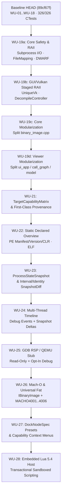

# PE / ELF Explorer — C++23 Conformance & Next-Gen Roadmap Design

This document is the authoritative, validated architectural specification and dependency-ordered execution plan for the **C++23 / CppCoreGuidelines / Effective Modern C++ Conformance Upgrade (`WU-19a..WU-19d`)** and the **Next-Gen Capability Roadmap (`WU-21..WU-28`)**.

Each work unit is scoped as a self-contained, single-PR/commit slice on `main` that must compile cleanly under `-Werror` (Clang 18 Debug, Release, and `clang18-asan-ubsan`) and `/W4 /WX /FS` (MSVC 2022 Debug and Release) with **zero regressions across the CTest suite (`326+` tests)** and new focused unit tests for every added behavior.

Related documentation:
- **[User Guide (`docs/USER_GUIDE.md`)](USER_GUIDE.md)** — Current capabilities, UI workflows, and headless CLI reference
- **[Architecture (`docs/ARCHITECTURE.md`)](ARCHITECTURE.md)** — Post-`89cf67f` target boundaries and runtime data flows
- **[Development Tracker (`ToDo.md`)](../ToDo.md)** — Master checklist and historical `WU-01..WU-18` log

---

## 1. Execution Order & Dependency Graph

Work proceeds in two sequential waves:
1. **Wave 1 — C++23 Conformance, Safety & Modularization (`WU-19a -> WU-19b -> WU-19c -> WU-19d`)**: Eliminates latent resource-lifetime, subprocess-pipe, integer-overflow, and monolithic-file hazards before expanding format and protocol surface area.
2. **Wave 2 — Validated Next-Gen Roadmap (`WU-21 -> WU-22 -> WU-23 -> WU-24 -> WU-25 -> WU-26 -> WU-27 -> WU-28`)**: Builds capability/provenance primitives first, then layers static metadata, live snapshot diffing, multi-thread timelines, GDB RSP remote targets, Mach-O/Universal binaries, workspace presets, and sandboxed Lua 5.4 scripting.

> **Note on Work-Unit Numbering**: Earlier placeholder entries `WU-19` (Docking/Context Menus) and `WU-20` (Lua Scripting) in `ToDo.md` have been superseded by `WU-19a..WU-19d` (C++23 Conformance & Modularization) and promoted to `WU-27` and `WU-28` so docking presets, context actions, and scripting cover `TargetCapabilityMatrix`, GDB RSP, and Mach-O targets uniformly from day one.

---

## 2. Wave 1 — C++23 / CppCoreGuidelines / Effective Modern C++ Upgrade (`WU-19a..WU-19d`)

### Cross-Cutting Standards Enforced Across Wave 1
- **CppCoreGuidelines `R.1` / `R.11` / `C.149` / `E.6`**: Manage every OS descriptor, child PID, `mmap`/Win32 view, Vulkan handle, GLFW window, and heap object through dedicated RAII types or `std::unique_ptr`; zero raw owning pointers (`new`/`delete`) and zero monolithic `initialized_` teardown flags.
- **CppCoreGuidelines `ES.100..ES.106` & Hostile-Input Arithmetic**: All binary/debug offset calculations (`base + index * stride`) use checked `std::uint64_t` helpers returning `std::optional<std::uint64_t>` or `peelf::Result<std::uint64_t>` before narrowing to `std::size_t`.
- **Const-Correctness (`Con.1..Con.4`)**: Read-only memory mappings never expose mutable `std::span<T>` views.
- **Modern Formatting (`std::format`)**: Replace C `std::snprintf` hex formatting with `std::format` (retaining `<cinttypes>` `PRIx64`/`PRIX64` solely where Dear ImGui `InputScalar` format strings require `printf`-style specifiers).

---

### `WU-19a` — Core Safety, Subprocess I/O, Bounds & RAII Fixes (`peelf_core`)
- **Depends on**: Baseline `89cf67f`
- **Primary files**:
  - `libs/peelf_core/src/assembler.cpp`
  - `libs/peelf_core/include/mapping/file_mapping.hpp`
  - `libs/peelf_core/src/dwarf.cpp`
  - `libs/peelf_core/src/binary_image.cpp`, `libs/peelf_core/include/peelf/binary_image.hpp`
  - `CMakeLists.txt` (orphan `.cpp`-in-`include/` guard)
- **Design & Requirements**:
  1. **Non-Deadlocking Subprocess Pipe I/O + `SIGPIPE` Safety + Deadline Reap (`assembler.cpp`)**:
     - Currently, writing large assembly text to `llvm-mc`'s `stdin` sequentially before draining `stdout`/`stderr` can deadlock if the child fills its stdout pipe buffer (>64 KiB), and an early child exit on POSIX can deliver `SIGPIPE` to the host process.
     - Implement concurrent non-blocking `poll()` multiplexing on POSIX (with pipe write error handling suppressing `SIGPIPE` via `ScopedSigpipeSuppress` / `F_SETNOSIGPIPE` where supported without mutating process-wide signal dispositions permanently) and overlapped / dedicated `std::jthread` stdout/stderr drain threads on Windows while streaming `stdin` and closing write-end EOF promptly.
     - Wrap child PID / `PROCESS_INFORMATION` in an RAII `ScopedSubprocess` guard that enforces a configurable wall-clock deadline (`SIGKILL` + `waitpid` on POSIX; `TerminateProcess` + `WaitForSingleObject` on Windows) so timed-out or cancelled invocations never leak zombie processes or pipe descriptors.
  2. **`FileMapping<T>` Alignment-Failure Leak Fix & Const-Correct `writable_span<T>()` (`file_mapping.hpp`)**:
     - Fix `FileMapping::open()`: when `Backend::open_and_map` succeeds (`ptr != nullptr`) and `bytes == 0` or `reinterpret_cast<std::uintptr_t>(ptr) % alignof(T) != 0`, `data_` has not yet been assigned, so calling `close()` currently enters the `data_ == nullptr` branch and calls `Backend::unmap_and_close(backend_, nullptr, 0)`, leaking the mapped view. Unmap `(ptr, bytes)` directly via an RAII guard or by assigning `data_`/`byte_size_` prior to `close()`.
     - Remove the mutable `std::span<T> view() noexcept` overload that allowed callers to obtain a writable `T*` over `MapMode::read_only` pages (undefined behavior / `SIGSEGV` on write). Keep `view()` strictly `std::span<const T> view() const noexcept`, and add `[[nodiscard]] Result<std::span<T>> writable_span() noexcept` returning `make_error("FileMapping is read-only")` unless `is_open() && mode_ == MapMode::read_write`.
  3. **Checked 64-Bit DWARF Table Indexing (`dwarf.cpp`)**:
     - Introduce `[[nodiscard]] constexpr std::optional<std::uint64_t> checked_entry_offset(std::uint64_t base, std::uint64_t index, std::uint64_t entry_size, std::uint64_t section_size) noexcept` using overflow-safe multiplication/addition (`index > (section_size - base) / entry_size`) across `.debug_str_offsets` (`DW_FORM_strx*`), `.debug_addr` (`DW_FORM_addrx*`), `.debug_line` file/directory tables, and compilation-unit header walks.
  4. **Explicit Partial/Truncated ELF Table Diagnostics**:
     - Expose `std::span<const std::string> parse_warnings() const noexcept` (or `SubsystemStatus table_status()`) on `IBinaryImage` so `ElfImage` records explicit diagnostics when `.dynsym`, `.symtab`, `PT_DYNAMIC`, or relocation tables are truncated or partially out-of-bounds instead of silently truncating vectors.
  5. **Public `include/` Hygiene**:
     - Delete any uncompiled orphan `.cpp` file under `libs/peelf_core/include/peelf/` (such as `common.cpp` if present in any workspace) and add a `CMakeLists.txt` configure check asserting zero `*.cpp` files exist under `libs/peelf_core/include/`.
- **Verification**:
  - Multi-megabyte `llvm-mc` stdin/stdout stress test, hung-child deadline kill/reap test, over-aligned `FileMapping<Aligned64>` unmap leak test under `clang18-asan-ubsan`, read-only `writable_span()` rejection test, 64-bit wrap-around `DW_FORM_strx`/`DW_FORM_addrx` malformed DWARF tests, and truncated ELF dynamic/symbol diagnostic tests.

---

### `WU-19b` — GUI / Vulkan Staged RAII & Lifecycle Controllers (`peelf_gui`)
- **Depends on**: `WU-19a`
- **Primary files**:
  - `apps/viewer/src/vulkan/vulkan_manager.h`, `apps/viewer/src/vulkan/vulkan_manager.cpp`
  - `apps/viewer/src/application.h`, `apps/viewer/src/application.cpp`
  - `apps/viewer/src/decompile/decompile_controller.hpp` (new), `apps/viewer/src/decompile/decompile_controller.cpp` (new)
  - `apps/viewer/src/disasm/disassembler.hpp`, `apps/viewer/src/ui/ui_app.hpp`, `apps/viewer/src/ui/ui_app.cpp`
- **Design & Requirements**:
  1. **Staged RAII in `VulkanManager`**:
     - Replace raw Vulkan handles and the single `initialized_` boolean gate with move-only RAII wrappers (`VkInstanceOwner`, `VkSurfaceOwner`, `VkDeviceOwner`, `SwapchainResources`, `FrameSyncSlot`, and `UniqueVulkanTexture` wrapping image + memory + view + ImGui descriptor set).
     - If `init()` throws halfway through device, descriptor pool, or swapchain creation, already-constructed stages destroy themselves deterministically without leaked Vulkan objects or validation-layer errors.
  2. **RAII Ownership in `Application`**:
     - Replace raw `UiApp* ui_ = nullptr` with `std::unique_ptr<UiApp> ui_`, wrap `GLFWwindow*` in a custom-deleter `std::unique_ptr<GLFWwindow, GlfwWindowDeleter>`, and wrap NFD initialization in `ScopedNfdInit`.
  3. **Latest-Request `DecompileController`**:
     - Replace `std::future<DecompiledUnit> decompile_job_` (which currently drops or blocks new user `F5` / function-click requests while a background decompile is in flight) with a dedicated `DecompileController` owning a worker `std::jthread`, `std::stop_source` per active job, and a single-slot `latest_pending_request_` queue protected by `std::mutex` + `std::condition_variable_any`.
     - Selecting Function B while Function A is running requests cancellation of Function A and immediately starts Function B once the worker unwinds, discarding stale generation outputs cleanly.
  4. **Unified `Architecture` Mapping & `std::format` Cleanup**:
     - Provide one `constexpr` `to_disassembler_architecture(peelf::Architecture)` / `to_core_architecture(viewer::Architecture)` utility shared by `UiApp`, `CallGraph`, `PatchPreview`, and `StructuredPseudoCDecompiler`.
     - Convert remaining `std::snprintf(..., "0x%llX", static_cast<unsigned long long>(...))` helpers across `apps/viewer/src/` to `std::format("0x{:X}", value)`.
- **Verification**:
  - Unit tests for `DecompileController` (rapid burst of 10 requests cancels intermediates and delivers the final request deterministically; shutdown while busy joins cleanly without deadlock), `Architecture` round-trip tests, and full `ctest` + ASan/UBSan suite.

---

### `WU-19c` — Core Parser Modularization (`libs/peelf_core/src/`)
- **Depends on**: `WU-19b`
- **Primary files**:
  - `libs/peelf_core/src/image_internal.hpp` (new private header)
  - `libs/peelf_core/src/image_mapping.cpp` (new)
  - `libs/peelf_core/src/pe_image.cpp` (new)
  - `libs/peelf_core/src/elf_image.cpp` (new)
  - `libs/peelf_core/src/binary_image.cpp` (slimmed dispatch & shared `to_string` helpers)
  - `libs/peelf_core/CMakeLists.txt`
- **Design & Requirements**:
  - Split `libs/peelf_core/src/binary_image.cpp` along strict format and mapping boundaries while keeping `<peelf/binary_image.hpp>` completely unchanged for downstream callers:
    - `image_internal.hpp`: Internal `ImageBase` base class, checked span/slice helpers, and internal factory declarations (`parse_pe_image_impl`, `parse_elf_image_impl`).
    - `image_mapping.cpp`: `ImageBase` RVA/VA <-> file-offset mapping (`PT_LOAD` authority, `ET_REL` section fallback, live-mapped spans), `load_live_module_image`, and `normalize_mapped_pe_for_file_parsers`.
    - `pe_image.cpp`: `PeImage` parsing (DOS/COFF/OptionalHeader, 16 data directories, sections, imports/delay-load/bound/ordinals, exports/forwarders, relocations, `.pdata`, RSDS debug, TLS, certificates, LoadConfig, resources, CLR).
    - `elf_image.cpp`: `ElfImage` parsing (ELF32/64 LE/BE, `SHN_XINDEX`/`PN_XNUM`, program/section headers, `.symtab`/`.dynsym`, static sectionless `PT_DYNAMIC` recovery, relocations, notes, SysV/GNU hashes).
    - `binary_image.cpp`: `detect_format`, `parse_image`, `parse_mapped_image`, `parse_rebased_image`, and enum stringifiers.
- **Verification**:
  - Zero behavior change; 100% pass across all parser, bin-matrix, live-hydration, security-audit, and malformed-input tests under Clang 18, ASan/UBSan, and MSVC.

---

### `WU-19d` — Viewer & Model Modularization (`apps/viewer/src/`)
- **Depends on**: `WU-19c`
- **Primary files**:
  - `apps/viewer/src/ui/ui_app.cpp` split into:
    - `ui_app.cpp` (constructor, lifecycle, frame loop, `process_deferred_gpu_work`)
    - `ui_app_project.cpp` (`.peproj` v2 load/save, relocation/mismatch modals, recovery journals, patch reports)
    - `ui_app_menus_docking.cpp` (main menu bar, global shortcuts, `DockBuilder` layout, About modal)
    - `ui_app_process.cpp` (read-only attach modal, live module/map sync, crash-dump & opt-in debugger transitions)
    - `ui_app_graph.cpp` (`Flow Graph` interactive canvas, draggable cards, edge routing, zoom/pan, Graphviz queuing)
    - `ui_app_navigation.cpp` (`ViewerSelection` synchronization, address/offset jump bar, history stack, bookmarks)
  - `apps/viewer/src/graph/call_graph.cpp` split into `call_graph_build.cpp` (entry/fan-out/CFG builders & jump-table wiring) and `call_graph_dot.cpp` (DOT emission, `plain` parser, external `dot` runner)
  - `apps/viewer/src/model/binary_model.cpp` split into `binary_model.cpp` (core state, static load, staged patching, bookmarks/bindings) and `binary_model_live.cpp` (live `IProcessSession`, `ICrashDumpSession`, `IDebugSession`, stack/TLS/internals queries)
  - `apps/viewer/CMakeLists.txt`
- **Verification**:
  - Clean incremental compile times, zero duplicate symbols or ODR violations under both static (`PEELF_BUILD_SHARED=OFF` on MSVC) and shared (`PEELF_BUILD_SHARED=ON` on Linux) configurations, and all `326+` CTests green.

---

## 3. Wave 2 — Validated Next-Gen Roadmap Queue (`WU-21..WU-28`)

### `WU-21` — `TargetProfile`, `ProviderFacts`, `TargetCapabilityMatrix` & First-Class Provenance
- **Depends on**: `WU-19d`
- **New headers/sources**:
  - `libs/peelf_core/include/peelf/provenance.hpp`, `libs/peelf_core/src/provenance.cpp`
  - `libs/peelf_core/include/peelf/capabilities.hpp`, `libs/peelf_core/src/capabilities.cpp`
- **Design & Requirements**:
  1. **Capability Model (`SupportLevel` & `TargetCapabilityMatrix`)**:
     - Define `enum class SupportLevel : std::uint8_t { Unsupported = 0, Partial, SupportedExperimental, SupportedValidated }`.
     - **Default-Deny Rule**: Every capability slot (`Disassembly`, `ControlFlowGraph`, `StructuredDecompile`, `ExternalGhidraDecompile`, `InProcessAssemble`, `ExternalLlvmAssemble`, `StaticPatching`, `DebugSymbolsPdb`, `DebugSymbolsDwarf`, `StackUnwind`, `ThreadLocals`, `ProcessInternals`, `SoftwareBreakpoints`, `HardwareWatchpoints`, `SecurityAudit`) initializes to **`SupportLevel::Unsupported`** and upgrades to `SupportedValidated` / `SupportedExperimental` / `Partial` **only** when `compute_target_capabilities(const TargetProfile&, const ProviderFacts&)` matches explicit validated combinations.
     - `TargetProfile` captures `(Format, ImageKind, Architecture, Endianness, pointer_byte_size, TargetSessionKind { StaticFile, LiveReadOnly, CrashDump, ActiveDebug, RemoteGdbRsp }, os_abi)`.
     - `ProviderFacts` captures runtime availability of Capstone, AsmTK, `llvm-mc`, Graphviz `dot`, DIA SDK, Ghidra, RetDec, Binary Ninja, and OS `ptrace`/Win32 privileges.
  2. **First-Class Provenance (`ProvenanceTag`, `CaptureAvailability`, `CaptureStamp`, `Evidence`, `Observed<T>`)**:
     - Avoid colliding with `peelf::Availability` in `peelf/forgiving.hpp` by naming the richer enum `peelf::CaptureAvailability { Complete, Partial, Unavailable, Redacted }` with `constexpr` conversion helpers from `peelf::Availability` and `SubsystemStatus`.
     - `ProvenanceTag`: `StaticDeclared`, `StaticInferred`, `LiveObserved`, `DumpCaptured`, `DebuggerShadowed`, `UserAnnotated`, `DecompilerSynthesized`.
     - `TargetInstanceId`: Combines `(TargetSessionKind, pid_or_zero, process_start_ticks_or_hash, session_nonce)` so OS PID reuse or opening two dumps never aliases snapshots.
     - `CaptureStamp`: Per-collection stamp storing `(TargetInstanceId target_id, std::uint64_t snapshot_revision, std::uint64_t monotonic_ns, std::uint64_t wall_unix_ms)`.
     - `Evidence`: `{ std::string provider; std::string anchor; std::optional<std::uint64_t> virtual_address; std::optional<std::uint64_t> file_offset; std::string detail; }`.
     - `template <typename T> struct Observed { std::optional<T> value; ProvenanceTag provenance; CaptureAvailability availability; CaptureStamp stamp; Evidence evidence; };`
- **Verification**:
  - Exhaustive matrix unit tests asserting unvalidated architecture/mode combinations default to `SupportLevel::Unsupported`, `CaptureAvailability <-> Availability` round-trips, and `TargetInstanceId` uniqueness across simulated PID reuse.

---

### `WU-22` — Unified Executable & Settings Overview (Static Declared Metadata)
- **Depends on**: `WU-21`
- **New/updated files**:
  - `libs/peelf_core/include/peelf/executable_overview.hpp`, `libs/peelf_core/src/executable_overview.cpp`
  - `apps/viewer/src/ui/ui_panels_file.cpp` (or dedicated `Overview` tab), `libs/peelf_core/src/security_audit.cpp` (`--headless` JSON)
- **Design & Requirements**:
  1. **PE Static Declared Metadata (Bounded & Hostile-Input Safe)**:
     - **`RT_MANIFEST` (Resource Type 24)**: Locate manifest resource payload (bounded to <= 1 MiB, stripping UTF-8 BOM or converting UTF-16LE/BE cleanly without external XML library bloat), extracting `requestedExecutionLevel` (`asInvoker`, `highestAvailable`, `requireAdministrator` + `uiAccess`), `dpiAware` / `dpiAwareness`, `longPathAware`, `heapType`, `supportedOS` GUIDs, and assembly `<assemblyIdentity>` tuples.
     - **`RT_VERSION` (Resource Type 16)**: Parse `VS_VERSIONINFO` (`0xFEEF04BD` `VS_FIXEDFILEINFO` numeric `FileVersion` / `ProductVersion`, `dwFileFlags`, `dwFileOS`, `dwFileType`) plus aligned `StringFileInfo` children (`CompanyName`, `FileDescription`, `FileVersion`, `InternalName`, `LegalCopyright`, `OriginalFilename`, `ProductName`, `ProductVersion`) across multiple language/codepage blocks with strict 32-bit/16-bit length bounds checks.
     - **CLR / .NET Metadata Summary**: When Data Directory 14 (`PeClrHeader`) is present, parse the CLI metadata root (`0x424A5342` `"BSJB"`), runtime version string (e.g. `v4.0.30319`), `COMIMAGE_FLAGS_*` (`ILONLY`, `32BITREQUIRED`, `32BITPREFERRED`, `STRONGNAMESIGNED`, `NATIVE_ENTRYPOINT`), metadata stream directory (`#~`, `#Strings`, `#US`, `#GUID`, `#Blob`), and entry-point token.
  2. **ELF Static Declared Metadata**:
     - Consolidate `PT_INTERP` dynamic loader path, `.note.ABI-tag` (`GNU` OS + minimum kernel `major.minor.patch`), `.note.gnu.build-id` hex digest, `DT_SONAME`, `DT_RPATH`, `DT_RUNPATH`, and decoded `DT_FLAGS` / `DT_FLAGS_1` bitflags (`DF_BIND_NOW`, `DF_STATIC_TLS`, `DF_1_NOW`, `DF_1_PIE`, `DF_1_NOOPEN`, `DF_1_NODELETE`, `DF_1_LOADFLTR`, `DF_1_INITFIRST`).
  3. **Provenance & Headless Export**:
     - Every field carries `ProvenanceTag::StaticDeclared` + file-offset/VA `Evidence`.
     - Render in a clean **Executable & Settings Overview** panel/tab in `peelf_gui` and emit a versioned `"overview": { "schema_version": 1, ... }` object in `peelf_viewer --headless --format json`.
- **Verification**:
  - Synthetic PE fixtures (UTF-8 & UTF-16 manifests, multi-locale `VS_VERSIONINFO`, truncated/cyclic resource trees, CLR `BSJB` header) and ELF fixtures (`.note.ABI-tag`, `.note.gnu.build-id`, `DT_RUNPATH` + `DF_1_*`) tested under `clang18-asan-ubsan` + headless JSON golden assertions.

---

### `WU-23` — Timestamped `ProcessStateSnapshot`, Interval/Identity `SnapshotDiff` & Observed Runtime Settings
- **Depends on**: `WU-21`, `WU-22`
- **New/updated files**:
  - `libs/peelf_core/include/peelf/process_snapshot.hpp`, `libs/peelf_core/src/process_snapshot.cpp`
  - `apps/viewer/src/ui/ui_panels_process_internals.cpp`, `apps/viewer/src/ui/ui_panels_runtime.cpp`
- **Design & Requirements**:
  1. **Timestamped `ProcessStateSnapshot` Capture**:
     - Captures an immutable point-in-time record stamped with `TargetInstanceId` and monotonic `snapshot_revision`:
       - `Observed<std::vector<ModuleInfo>> modules`
       - `Observed<std::vector<MemoryRegion>> memory_regions` (including `smaps`/working-set RSS/PSS/Swap counters)
       - `Observed<std::vector<ThreadSnapshot>> threads` (ID, state, CPU ticks, registers when paused/available, unwound top frames)
       - `Observed<std::vector<HandleOrFdInfo>> handles`
       - `Observed<std::vector<SocketEndpointInfo>> sockets`
       - `Observed<ObservedRuntimeSettings> runtime_settings`: resolved executable path, `argv` vector, `cwd`, UID/GID or Win32 SID + Integrity Level, `umask` / `RLIMIT_*` / `GetProcessMitigationPolicy` flags, and environment key-value entries.
  2. **Default Environment Secret Redaction**:
     - By default (`RedactPolicy::RedactSensitiveDefault`), environment keys matching case-insensitive sensitive patterns (`*SECRET*`, `*TOKEN*`, `*PASSWORD*`, `*PASSWD*`, `*API_KEY*`, `*PRIVATE_KEY*`, `AWS_*`, `AZURE_*`, `GITHUB_*`, `GH_TOKEN`, `COOKIE`, `SESSION*`, `BEARER*`, or high-entropy credential URLs) set `CaptureAvailability::Redacted` and mask the displayed value (`"<redacted: N chars>"`), requiring explicit analyst opt-in (**Reveal Unredacted Environment** toggle in session UI, never persisted to `.peproj` or logs) to inspect raw values.
  3. **Interval- & Identity-Aware `SnapshotDiff` (`diff_process_snapshots(baseline, current)`)**:
     - Rejects cross-target comparisons when `baseline.target_id != current.target_id` unless an explicit cross-run compare flag is requested.
     - **Interval-Aware Memory Region Diff**: Sweeps canonical `[start_va, end_va)` intervals across both snapshots to classify `Added`, `Removed`, `Split`, `Merged`, `ProtectionChanged` (specifically flagging `RW -> RX` JIT finalization vs. `-> RWX` escalation), and `ResizedOrResidentDelta` (`delta_rss`, `delta_pss`, `delta_swap`).
     - **Identity-Aware Entity Diffs**: Diffs modules by `(base_address, normalized_path)`, threads by `tid` (tracking IP/state/frame changes), handles/FDs by `(fd_or_handle, type, target_object)` (detecting FD-number reuse across close+open!), and sockets by `(protocol, local_endpoint, remote_endpoint, inode_or_fd)`.
     - **Partial-Capture Uncertainty Propagation**: If `baseline.handles.availability != Complete` or `current.handles.availability != Complete`, missing rows are marked `DiffUncertainty::UncertainDueToPartialCapture` rather than reported as definitive `Closed`/`Opened` events.
- **Verification**:
  - Deterministic unit tests covering region split/merge/`mprotect` transitions, FD-reuse detection, partial-snapshot uncertainty propagation, PID-reuse `TargetInstanceId` mismatch rejection, and default secret redaction patterns.

---

### `WU-24` — Multi-Thread Execution & Event Timeline
- **Depends on**: `WU-23`
- **New/updated files**:
  - `libs/peelf_core/include/peelf/timeline.hpp`, `libs/peelf_core/src/timeline.cpp`
  - `apps/viewer/src/ui/ui_panels_timeline.hpp`, `apps/viewer/src/ui/ui_panels_timeline.cpp`
- **Design & Requirements**:
  1. **`ITimelineSource` & `TimelineEvent` Model**:
     - Bounded ring/append store merging two event streams onto a shared monotonic nanosecond / sequence axis:
       - **Discrete `IDebugSession` Events**: `ProcessCreated`, `ProcessExited`, `ThreadCreated`, `ThreadExited`, `ModuleLoaded`, `ModuleUnloaded`, `BreakpointHit`, `WatchpointHit`, `ExceptionOrSignal`, `SingleStepCompleted`.
       - **Sampled `SnapshotDiff` Deltas**: `RegionProtectionChanged`, `RegionAllocatedRwx`, `SocketOpened`, `HandleOpened`, `ThreadStateChanged`.
     - **Explicit Uncertainty Markers**:
       - `TimelineMarkerKind::SamplingGap`: Inserted automatically between non-continuous snapshots `(t_prev, t_curr)` to indicate target threads executed unobserved during that interval.
       - `TimelineMarkerKind::DroppedEvents`: Inserted with exact dropped-event count whenever ring capacity or debugger poll budget overflows.
  2. **Interactive `Timeline` Panel (`View > Timeline`)**:
     - Renders a synchronized horizontal time/sequence ruler, global process lane (modules, snapshots, gaps), and collapsible per-thread swimlanes (`TID` + name) with category/severity filters.
     - Clicking an event selects its `ThreadId`, navigates `Disassembly` / `Hex View` to the event PC or target address, and activates the corresponding `ProcessStateSnapshot` or `SnapshotDiff` view when linked.
- **Verification**:
  - Unit tests verifying monotonic ordering across interleaved `IDebugSession` + `SnapshotDiff` events, automatic `SamplingGap` insertion, ring-buffer `DroppedEvents` accounting, and selection payload generation on event click.

---

### `WU-25` — GDB Remote Serial Protocol (`GdbRemoteBackend` / QEMU Stub)
- **Depends on**: `WU-21`, `WU-24`
- **New/updated files**:
  - `libs/peelf_core/include/peelf/gdb_rsp.hpp`, `libs/peelf_core/src/gdb_rsp_protocol.cpp`, `libs/peelf_core/src/gdb_rsp_session.cpp`
  - `apps/viewer/src/ui/ui_app_process.cpp`, `apps/viewer/src/ui/ui_panels_debugger.cpp`
- **Design & Requirements**:
  1. **Clean-Room BSD-2-Clause RSP Transport & Framing**:
     - Implement packet framing (`$<data>#<csum>`, `+`/`-` ACK/NACK, `QStartNoAckMode` negotiation, `}` `0x7d` run-length/binary escaping, RLE `*` response expansion, configurable per-command deadlines, and `std::stop_token` cancellation) over non-blocking TCP sockets (`host:port`) and local stream endpoints.
  2. **Read-Only `IProcessSession` Adapter (`GdbRemoteReadOnlySession`)**:
     - Connects via **File > Connect to GDB Remote Stub (Read-Only)...** without mutating target memory or registers (`is_read_only() == true`):
       - Negotiates `qSupported` (`PacketSize`, `qXfer:features:read+`, `qXfer:memory-map:read+`, `qXfer:libraries:read+`, `qXfer:libraries-svr4:read+`, `qXfer:auxv:read+`, `multiprocess+`).
       - Parses `qXfer:features:read:target.xml` (plus `<xi:include>` annex documents) to dynamically map target architecture and register numbers/widths across x86, x86_64, ARM, AArch64, RISC-V 32/64, MIPS 32/64, and PowerPC 32/64.
       - Populates `memory_regions()` from `qXfer:memory-map:read` (gracefully marking `CaptureAvailability::Partial` / probing ELF `PT_LOAD` via `auxv` `AT_PHDR` when QEMU user-mode omits memory-map XML), `modules()` from SVR4/library XML, `threads()` from `qfThreadInfo`/`qsThreadInfo` (supporting `p<pid>.<tid>` multiprocess syntax), `thread_context()` via `Hg` + `g`/`p`, and `read_memory()` via `m` / `x`.
  3. **Explicit Opt-In `IDebugSession` Adapter (`GdbRemoteDebugSession`)**:
     - Activated **only** through **Inspect > Start / Attach Debugger (Opt-in)... > GDB Remote / QEMU Stub**:
       - Enables register writes (`G`/`P`), memory writes (`M`/`X`), software breakpoints (`Z0,addr,kind` / `z0,addr,kind`, with automatic fallback to client-side trap shadow table only if stub reports empty `Z0` support, keeping `read_memory` shadow-filtered), hardware breakpoints (`Z1`), watchpoints (`Z2` write, `Z3` read, `Z4` access), and execution control (`vCont?` -> `vCont;c`, `vCont;s:<tid>`, fallback `c`/`s`, async `\x03` interrupt, and `D` clean detach).
       - Streams stop-reply packets (`T<sig>...thread:...;watch:...;`) directly into `WU-24` `ITimelineSource`.
- **Verification**:
  - Deterministic in-process loopback mock GDB stub in `tests/gdb_rsp_test.cpp` (no external QEMU binary required in CI) exercising checksum/escaping edge cases, `QStartNoAckMode`, `target.xml` annex includes, memory-map/SVR4 XML parsing, read-only mutation rejection, `Z0`/`Z2` breakpoints/watchpoints, `vCont` stepping, multiprocess thread IDs, and timeout disconnect recovery under ASan/UBSan.

---

### `WU-26` — Mach-O (`MH_MAGIC`/`MH_MAGIC_64`) & Universal (`FAT_MAGIC`/`FAT_CIGAM_64`) `IBinaryImage`
- **Depends on**: `WU-19c`, `WU-21`, `WU-22`
- **New/updated files**:
  - `libs/peelf_core/include/macho/macho_definitions.h`
  - `libs/peelf_core/include/peelf/binary_image.hpp` (`Format::MachO`, non-pure format defaults, `UniversalBinaryInfo` / slice APIs)
  - `libs/peelf_core/src/macho_image.cpp`
  - `libs/peelf_core/src/dependency_tree.cpp`, `libs/peelf_core/src/binary_diff.cpp`, `libs/peelf_core/src/security_audit.cpp`
  - `apps/viewer/src/navigation/viewer_navigation.cpp`, `apps/viewer/src/ui/ui_app_menus_docking.cpp`
- **Design & Requirements**:
  1. **Non-Pure `IBinaryImage` Extensions & Container-Absolute File Offsets**:
     - Add `Format::MachO` and non-pure virtual Mach-O metadata accessors on `IBinaryImage` returning empty spans/`std::nullopt` by default so existing PE, ELF, and test mock subclasses require zero boilerplate overrides.
     - Support Thin Mach-O (`MH_MAGIC`, `MH_CIGAM`, `MH_MAGIC_64`, `MH_CIGAM_64`) and Universal/Fat containers (`FAT_MAGIC`, `FAT_CIGAM`, `FAT_MAGIC_64`, `FAT_CIGAM_64`) across `x86_64`, `arm64` / `arm64e` (stripping Darwin PAC upper metadata bits when resolving virtual addresses), `x86`, `arm`, and `ppc`/`ppc64`.
     - **Container-Absolute Offset Invariant**: When opening a slice inside a Universal binary at `slice_file_offset` (validated strictly against slice bounds and fat-header overlap), `MachOImage` translates `LC_SEGMENT(_64)` / `Section` / `Symbol` file offsets to **container-absolute offsets** (`slice_file_offset + local_offset`) while also exposing `container_slice_offset()` and `slice_relative_offset()`, ensuring `Hex View`, `Structure`, and `PagedBinaryImage` patches operate seamlessly on the real file without corrupting adjacent slices.
  2. **Load Commands, Symbols, Chained Fixups & Dependencies**:
     - Parse `LC_SEGMENT`/`LC_SEGMENT_64` (`__PAGEZERO`, `__TEXT`, `__DATA_CONST`, `__DATA`, `__LINKEDIT`), `LC_MAIN` & `LC_UNIXTHREAD` entry points, `LC_SYMTAB` + `LC_DYSYMTAB` (indirect symbol stubs `__stubs` / `__la_symbol_ptr` / `__got`), `LC_DYLD_INFO(_ONLY)` export tries & bind opcodes, `LC_DYLD_CHAINED_FIXUPS` / `LC_DYLD_EXPORTS_TRIE`, `LC_UUID`, `LC_BUILD_VERSION`, `LC_SOURCE_VERSION`, `LC_ENCRYPTION_INFO(_64)`, and `LC_CODE_SIGNATURE` (`CSMAGIC_EMBEDDED_SIGNATURE` SuperBlob + `CSMAGIC_CODEDIRECTORY` SHA-256 page/special slot summary).
     - Integrate `LC_LOAD_DYLIB`, `LC_LOAD_WEAK_DYLIB`, `LC_REEXPORT_DYLIB`, `LC_LAZY_LOAD_DYLIB`, and `LC_RPATH` into `DependencyGraph` (`WU-10`), expanding `@executable_path`, `@loader_path`, and `@rpath` against `--search-root` / sysroot prefixes.
  3. **Mach-O Security Rules (`MACHO4001..MACHO4006`)**:
     - `MACHO4001` (`EnablePositionIndependentExecutable`): `MH_EXECUTE` carries `MH_PIE` and non-zero `__PAGEZERO`.
     - `MACHO4002` (`DisallowExecutableStackAndHeap`): `MH_ALLOW_STACK_EXECUTION` is absent and `MH_NO_HEAP_EXECUTION` is evaluated appropriately.
     - `MACHO4003` (`EnableStackProtector`): Checks `___stack_chk_fail` / `___stack_chk_guard` imports when stack-bearing C routines are present.
     - `MACHO4004` (`DoNotUseWritableExecutableSegments`): Verifies `maxprot`/`initprot` on all Mach-O segments enforce W^X (`VM_PROT_WRITE | VM_PROT_EXECUTE` forbidden unless explicitly documented JIT entitlement).
     - `MACHO4005` (`DoNotUseInsecureRunpath`): Audits `LC_RPATH` entries for relative `.`, empty, or world-writable `/tmp` paths.
     - `MACHO4006` (`SignBinaryWithCodeSignature`): Inspects `LC_CODE_SIGNATURE` SuperBlob/CodeDirectory structure and **explicitly separates structural signature/ad-hoc hash presence (`Note` when cryptographic CMS/Apple trust-chain verification is not performed on Linux/Windows) from verified trust**, mirroring `PE1005`.
  4. **UI & Headless Integration**:
     - Add an interactive Universal Slice Selector banner/combo when opening fat binaries in `peelf_gui`, wire Mach-O into `Structure`, `Executable Overview` (`WU-22`), `Binary Diff`, and `peelf_viewer --headless <fat_or_macho> [--slice <arch|index>] [--format json|sarif]`.
- **Verification**:
  - Deterministic synthetic Thin & Fat32/Fat64 Mach-O fixtures (`x86_64` + `arm64` universal binary, `arm64e` chained fixups, export trie, `LC_CODE_SIGNATURE`, plus malformed/overlapping fat slices and cyclic export tries in `malformed_inputs_matrix_test.cpp`) verified under `clang18-asan-ubsan`.

---

### `WU-27` — Pure `DockNodeSpec` Workspace Layout Presets & Universal Context Actions
- **Depends on**: `WU-19d`, `WU-21`, `WU-26`
- **New/updated files**:
  - `apps/viewer/src/ui/workspace_layouts.hpp`, `apps/viewer/src/ui/workspace_layouts.cpp`
  - `apps/viewer/src/ui/context_actions.hpp`, `apps/viewer/src/ui/context_actions.cpp`
  - `apps/viewer/src/ui/ui_app_menus_docking.cpp`, `apps/viewer/src/ui/ui_panels_*.cpp`
  - `tests/workspace_layouts_test.cpp`
- **Design & Requirements**:
  1. **Pure `DockNodeSpec` Layout Engine & 5 Curated Presets**:
     - Represent docking splits, ratios, and tab assignments as a pure C++23 value tree (`DockNodeSpec`) independent of `ImGuiContext`, with a thin `apply_dock_layout_spec(ImGuiID dockspace_id, const DockNodeSpec&)` adapter in `ui_app_menus_docking.cpp`.
     - Ship five **View > Workspace Layout** presets (plus keyboard/toolbar quick-switch):
       1. **`Static RE`** (default on static binary load): Left `Structure` + `Functions`/`Symbols`; Center `Flow Graph` / `Disassembly` / `Decompile`; Bottom-Center `Hex View` + `References & Notes` + `Log`; Right `Details` + `Structure View`.
       2. **`Live Process / VMMap`** (auto-suggested on read-only attach): Top-Center `Memory Map` (VMMap visual bars); Bottom-Center `Hex View` + `Disassembly`; Left `Structure` + `Dependencies`; Right `Process Internals` + `Threads & Stack` + `PEB / TEB & Flags`.
       3. **`Debugger`** (auto-activated on opt-in `IDebugSession` start): Center `Disassembly` + `Decompile`; Right `Debugger` (Registers/Breakpoints/Watchpoints) + `Threads & Stack`; Bottom `Hex View` + `Timeline` (`WU-24`) + `Log`.
       4. **`Binary Diff`**: Center `Binary Diff` (synchronized side-by-side Disassembly/Hex); Left `Sections` + `Functions`; Right `Details`.
       5. **`Minimal`**: Left `Structure`; Center `Disassembly` / `Hex View`; Right `Details`.
     - **Versioned Layout Migration**: Tag persisted layouts in `imgui.ini` and `.peproj` v2 with `layout_schema_version`; automatically migrate or rebuild cleanly when upgrading from older workspace versions so panels never vanish or collide on duplicate IDs.
  2. **Capability-Aware Universal Right-Click Context Actions**:
     - Provide a single `build_context_actions(const ViewerSelection&, const TargetCapabilityMatrix&)` + `draw_context_menu(...)` shared across `Structure`, `Sections`, `Symbols`, `Functions`, `Imports`, `Exports`, `Strings`, `References`, `Hex View`, `Disassembly`, `Flow Graph`, `Memory Map`, and `Structure View`:
       - `Go to Virtual Address` / `Go to File Offset`
       - `Open in Hex View` / `Disassemble Here` (enabled when `Disassembly != Unsupported`) / `Decompile Function (F5)` (enabled when `StructuredDecompile != Unsupported`)
       - `Find Cross-References (X)` / `Apply Structure...` / `Toggle Bookmark (Ctrl+B)`
       - `Stage Patch / Assemble Here...` (enabled **only** when `StaticPatching` is supported; hidden/disabled with reason on read-only live/dump targets)
       - `Toggle Breakpoint (F9)` / `Add Watchpoint...` (enabled **only** when `SoftwareBreakpoints` / `HardwareWatchpoints` is supported in active `IDebugSession`)
       - `Copy Address` / `Copy Value` / `Copy Row as JSON`.
- **Verification**:
  - Headless unit tests in `tests/workspace_layouts_test.cpp` verifying every preset's split ratios sum cleanly, all panel window names are unique and accounted for, schema migration handles legacy layout strings, and `build_context_actions` disables mutation/breakpoint actions on read-only targets.

---

### `WU-28` — Embedded MIT Lua 5.4 Transactional Scripting Host (`FG-SCRIPTING`)
- **Depends on**: `WU-19a`, `WU-21`, `WU-26`, `WU-27`
- **New/updated files**:
  - `third_party/dependencies.cmake` (pinned official MIT Lua 5.4 source build)
  - `libs/peelf_core/include/peelf/scripting.hpp`, `libs/peelf_core/src/scripting_lua.cpp`
  - `apps/viewer/src/ui/ui_panels_scripting.hpp`, `apps/viewer/src/ui/ui_panels_scripting.cpp`
  - `libs/peelf_core/src/security_audit.cpp` (`peelf_viewer --headless --script <file.lua>`)
  - `tests/scripting_lua_test.cpp`
- **Design & Requirements**:
  1. **MIT Licensing & C++ RAII / `longjmp` Boundary Safety**:
     - Fetch and build Lua 5.4 (MIT license, 100% compatible with `exe_viewer`'s BSD-2-Clause license) as a static target `peelf::lua` compiled **as C++** (so Lua's internal error unwinding uses C++ exceptions via `LUAI_THROW`/`LUAI_TRY` rather than C `longjmp` skipping C++ destructors), **and** wrap every C++ host binding in a `noexcept` boundary helper that catches any internal C++ exception, stores the diagnostic in `ScriptContext`, releases all C++ temporaries, and only then invokes `lua_error(L)`.
  2. **Deterministic Sandboxing & `ScriptLimits` Quotas**:
     - Load **only** safe standard libraries (`base` with `dofile`/`loadfile` removed, `table`, `string`, `math`, `utf8`). **`io`, `os`, `debug`, and `package` (`require` / native C module loading) are strictly omitted** so untrusted `.lua` analysis/patch scripts cannot touch the host filesystem, spawn processes, or escape memory safety.
     - Enforce `ScriptLimits`:
       - `max_memory_bytes` (default `32 MiB`): enforced in the custom `lua_Alloc` allocator, failing allocations cleanly with `LUA_ERRMEM` when exceeded.
       - `max_instructions` (default `5,000,000` VM ops) & `max_wall_time` (default `5,000 ms`) + `std::stop_token`: enforced inside a `lua_sethook(L, hook, LUA_MASKCOUNT, 1024)` callback that aborts runaway `while true do end` loops deterministically.
       - `max_output_bytes` (default `1 MiB`): bounds captured `print()` / log output.
  3. **Read-Your-Writes Staging & Explicit `commit()` / Rollback**:
     - Expose the `peelf` Lua module over an isolated `ScriptPatchStagingBuffer` layered above `IBinaryImage` / `PagedBinaryImage` / `IProcessSession`:
       - Inspection APIs (work on static files, crash dumps, and read-only live sessions): `peelf.target_info()`, `peelf.sections()`, `peelf.symbols()`, `peelf.imports()`, `peelf.exports()`, `peelf.va_to_offset(va)`, `peelf.offset_to_va(off)`, `peelf.read_bytes(off_or_va, len)`, `peelf.read_u8/u16/u32/u64(off_or_va, [endian])`, `peelf.find_bytes(pattern_hex)`, `peelf.disassemble(va, count)`, `peelf.assemble(arch_or_nil, base_va, asm_text)`.
       - Transactional Mutation APIs (**static `PagedBinaryImage` targets only**; calling `write_*` or `commit` on read-only live/crash-dump sessions raises a deterministic error): `peelf.write_bytes(off, bytes)`, `peelf.write_u8/u16/u32/u64(off, val, [endian])`, `peelf.nop_range(off, len)`, `peelf.rollback()`, and `peelf.commit([description])`.
       - **Read-Your-Writes + Explicit Commit Contract**: Script `read_*` / `disassemble` calls immediately observe bytes staged by earlier `write_*` calls in the same script run, **but** the underlying `BinaryModel` / `PagedBinaryImage` is untouched unless `peelf.commit(...)` is explicitly invoked and the script finishes without error. Any runtime error, quota breach, cancellation, or omitted `commit()` discards the staging overlay with zero side effects.
  4. **GUI Console & Headless Automation**:
     - Add **View > Scripting (Lua)** (`Edit > Scripting workspace`) in `peelf_gui` with script editor, **Run (Dry-Run Preview)** vs. **Run & Allow Commit**, Cancel button, instruction/memory/time telemetry badge, staged byte-diff preview, and output log.
     - Extend `peelf_viewer --headless <binary> --script <file.lua> [--save-patched <output_binary>] [--format json]` so automated analysis and reproducible binary patching pipelines run in CI without Vulkan/GUI dependencies (`--save-patched` writes atomically only after a committed transaction; original `<binary>` is never overwritten in place).
- **Verification**:
  - Comprehensive `tests/scripting_lua_test.cpp` under `clang18-asan-ubsan` and MSVC covering: RAII destructor execution across Lua runtime errors, `io`/`os`/`package`/`debug`/`dofile` sandbox absence, infinite-loop instruction/timeout termination, `max_memory_bytes` OOM handling (`local s = "x"; while true do s = s .. s end`), read-your-writes visibility, uncommitted exit rollback, error-after-write rollback, committed `PatchTransaction` + undo/redo integration, read-only live-session write rejection, and `--headless --script` CLI round-trips.
