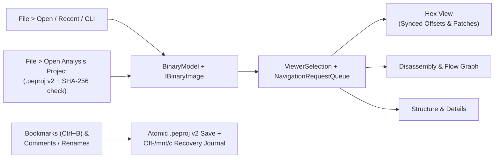
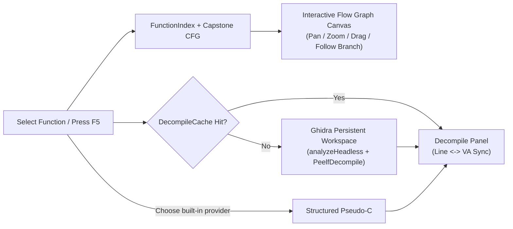
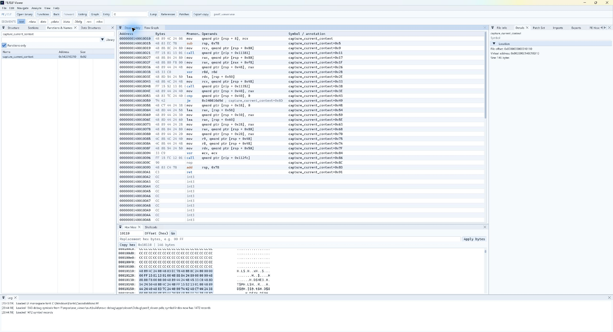
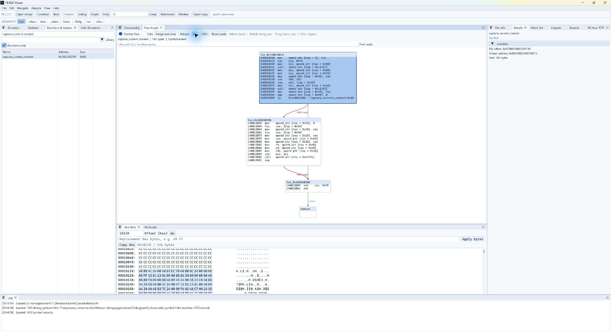
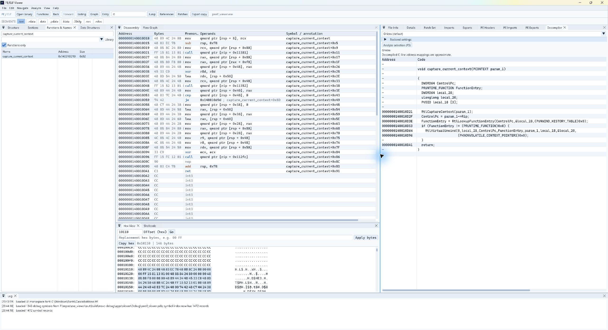
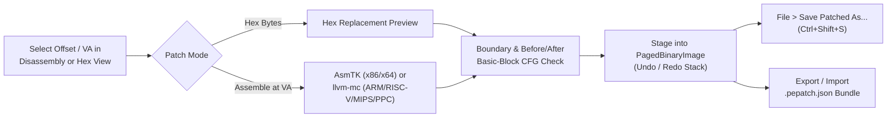
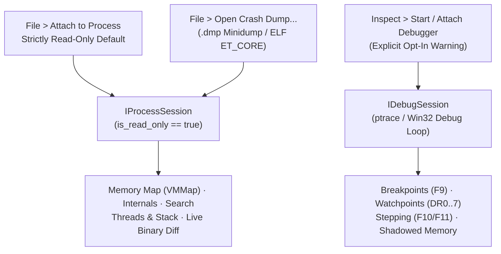
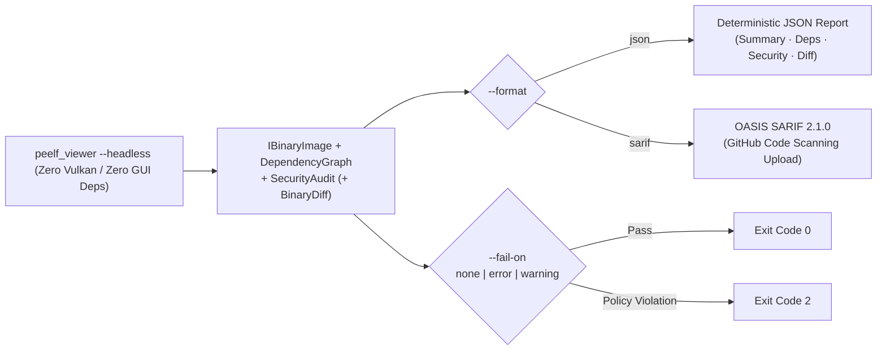

# PE / ELF Explorer — User Guide

PE / ELF Explorer (`peelf_viewer`) helps you inspect PE, ELF, and Mach-O binaries, follow code and data, stage patches, examine processes and crash dumps, and run automated security checks. This guide describes the controls and APIs implemented in this repository. Feature availability depends on the target, host, permissions, and optional tools; **Target Capabilities** explains those limits.

Related documentation:

- **[System Architecture (`docs/ARCHITECTURE.md`)](ARCHITECTURE.md)** — Module boundaries, unified `IBinaryImage`, threading, and Vulkan 2-frames-in-flight design
- **[Roadmap & C++23 Design (`docs/ROADMAP_DESIGN.md`)](ROADMAP_DESIGN.md)** — Validated `WU-19a..WU-19d` C++23 conformance & `WU-21..WU-28` next-gen specifications
- **[Project Overview (`README.md`)](../README.md)** — Repository summary and quick build overview

---

## Table of Contents

1. [Quick start and setup](#1-quick-start-and-setup)
2. [Workspace, navigation, and projects](#2-workspace-navigation-and-projects)
3. [Symbols and debug information](#3-symbols-and-debug-information)
4. [References, notes, and strings](#4-references-notes-and-strings)
5. [Disassembly, graphs, and decompilation](#5-disassembly-graphs-and-decompilation)
6. [Structure View and data types](#6-structure-view-and-data-types)
7. [Dependencies](#7-dependencies)
8. [Patching, Shellcode, and Lua scripting](#8-patching-shellcode-and-lua-scripting)
9. [Binary comparison](#9-binary-comparison)
10. [Live process inspection and snapshots](#10-live-process-inspection-and-snapshots)
11. [Crash dump analysis](#11-crash-dump-analysis)
12. [Debugger and remote targets](#12-debugger-and-remote-targets)
13. [Security audit](#13-security-audit)
14. [Headless CLI and automation](#14-headless-cli-and-automation)
15. [Troubleshooting](#15-troubleshooting)

---

## 1. Quick start and setup

### First analysis

1. Launch the viewer and use **File > Open...** (`Ctrl+O`) to open a binary.
2. Read **File Info** and **Executable Settings** for its format, architecture, entry point, and declared settings. Use **Target Capabilities** if a feature is unavailable.
3. Choose **Navigate > Entry point**, or select a function in **Functions**. Inspect the linked **Disassembly**, **Hex View**, and **Flow Graph** panels.
4. Press `X` for references and notes, or `F5` for decompilation outside a debug session.
5. Use **File > Save Analysis Project...** to preserve your analysis. If you stage byte edits, **File > Save Patched As...** exports a separate binary.

**Address terminology:** a virtual address (VA) is where bytes are mapped in an image or process; a file offset is their position in the disk file. They are not interchangeable. Some virtual regions, such as zero-filled memory, have no file-backed bytes. Universal Mach-O file offsets refer to the container. Live addresses include the module’s actual load base.

### 1.1 Supported Formats, Hosts & Target Architectures

| Dimension | Supported Coverage |
|---|---|
| **Host OS** | Windows 10/11 x64 (MSVC 2022) and Linux / WSL2 Ubuntu 22.04+ (Clang 18) |
| **Static Binary Formats** | **PE32 / PE32+** (`.exe`, `.dll`, `.sys`, `.ocx`, delay-load/bound/forwarded/ordinal tables, `.pdata`, manifest/version/CLR, Authenticode), **ELF32 / ELF64** little- & big-endian (`ET_EXEC`, `ET_DYN`, `ET_REL`, `SHN_XINDEX`/`PN_XNUM`, sectionless `PT_DYNAMIC`-only ELFs), and **Mach-O / Universal FAT** (`MH_MAGIC`/`MH_MAGIC_64`/`MH_CIGAM`/`MH_CIGAM_64`, `FAT_MAGIC`/`FAT_CIGAM_64`, `LC_DYLD_EXPORTS_TRIE`, `LC_DYLD_CHAINED_FIXUPS`, structural `LC_CODE_SIGNATURE`) |
| **Live & Remote Targets** | Local read-only live processes (Win32 / Linux `/proc`), **GDB Remote / QEMU RSP** stubs (`GdbRemoteBackend` read-only & opt-in debug), and opt-in local `ptrace` / Win32 debugging |
| **Offline Crash Dumps** | Windows Minidumps (`.dmp` `MDMP`) and Linux ELF Core Dumps (`ET_CORE`, 32/64-bit LE/BE) |
| **Target Architectures** | `x86` (32-bit), `x86_64`, `ARM` (ARM32 + Thumb-2), `ARM64` (`AArch64` / `arm64e`), `RISC-V` (`RV32`/`RV64`), `MIPS` (`MIPS32`/`MIPS64` LE/BE), `PowerPC` (`PPC32`/`PPC64` LE/BE) |

> On WSL2, keep builds and analysis caches in the Linux filesystem (for example `/home/<user>/projects/exe_viewer`) for better I/O performance. Default recovery and Ghidra cache paths avoid `/mnt/c`.

### 1.2 CMake Presets & Build Commands

Install CMake 3.25+, Git, and a C++23 compiler. GUI builds also need the Vulkan SDK and GLFW platform dependencies; see the [README prerequisites](../README.md#prerequisites). On Linux, the Clang presets use libc++.

Third-party libraries (Dear ImGui docking, GLFW, Capstone, AsmJit/AsmTK, nativefiledialog-extended, and GoogleTest) are fetched and pinned via CMake `FetchContent` (`third_party/dependencies.cmake`). Every preset enforces zero warnings (`-Werror` on Clang/GCC; `/W4 /WX /FS` on MSVC).

#### Linux / WSL2 (Clang 18 + Ninja)

```bash
# 1. Debug build and tests
cmake --preset clang18-debug
cmake --build --preset clang18-debug
ctest --preset clang18-debug

# 2. AddressSanitizer + UndefinedBehaviorSanitizer validation
cmake --preset clang18-asan-ubsan
cmake --build --preset clang18-asan-ubsan
ctest --preset clang18-asan-ubsan

# 3. Optimized Release build
cmake --preset clang18-release
cmake --build --preset clang18-release

# 4. Headless CLI-only build (no Vulkan SDK, X11/Wayland, or GTK3 required)
cmake -S . -B out/build/headless-cli -G Ninja \
  -DCMAKE_C_COMPILER=clang-18 -DCMAKE_CXX_COMPILER=clang++-18 \
  -DCMAKE_BUILD_TYPE=Release -DPEELF_BUILD_GUI=OFF
cmake --build out/build/headless-cli
```

#### Windows x64 (Visual Studio 2022 + LunarG Vulkan SDK)

```powershell
cmake --preset msvc-debug
cmake --build --preset msvc-debug
ctest --test-dir out/build/msvc-debug -C Debug --output-on-failure
.\out\build\msvc-debug\apps\viewer\Debug\peelf_viewer.exe
```

#### Launch Interactive GUI or Headless CLI

```bash
# Interactive Vulkan GUI (loads libpeelf_gui.so / peelf_gui.dll dynamically)
./out/build/clang18-debug/apps/viewer/peelf_viewer
./out/build/clang18-debug/apps/viewer/peelf_viewer /bin/ls

# Vulkan-free Headless CLI (never loads peelf_gui or touches GPU drivers)
./out/build/clang18-debug/apps/viewer/peelf_viewer --headless /bin/ls
./out/build/clang18-debug/apps/viewer/peelf_viewer --help
```

### 1.3 External Tool Setup (Optional Providers)

The GUI needs its graphics dependencies and bundled resources. Static inspection and the built-in pseudo-C decompiler do not require an external analysis program. Assembly provider availability depends on build configuration. Optional tools add these capabilities:

1. **Ghidra — Decompilation**:
   - Unpack a Ghidra installation and install the JDK required by that release.
   - In **Decompiler > Backend settings**, enter the Ghidra root folder and Java executable, then click **Save settings**. `GHIDRA_INSTALL_DIR` and `JAVA_HOME` supply discovery defaults. Settings persist in `decompiler.ini` beside the viewer executable.
   - The first request analyzes the binary; later requests can reuse the Ghidra workspace. Set the timeout in **Backend settings**, use **Cancel** to stop a request, **Re-analyze** to refresh the current function, or **Clear Cache** to remove cached results and workspaces.
   - Cache roots are `$PEELF_CACHE_DIR/ghidra`, otherwise `$XDG_CACHE_HOME/peelf_viewer/ghidra` on Linux or `%LOCALAPPDATA%\peelf_viewer\ghidra` on Windows, with temporary-directory fallbacks. Linux defaults avoid `/mnt/c`.
2. **LLVM Machine Code Playground (`llvm-mc`) — Non-x86 Assembly Patching**:
   - `AsmTK`, when enabled in the build, assembles `x86` and `x86_64` in-process.
   - Installing `llvm` (`sudo apt install llvm-18` or LLVM for Windows on `PATH` so `llvm-mc` / `llvm-mc-18` is discoverable) enables interactive assembly patching across `ARM`, `Thumb-2`, `ARM64`, `RISC-V 32/64`, `MIPS 32/64`, and `PowerPC 32/64`.
3. **Graphviz (`dot`) — Graph Layout**:
   - Interactive `Flow Graph` cards render natively in ImGui. Installing `graphviz` (`dot` on `PATH`) additionally enables Graphviz coordinate layout. The current graph toolbar does not expose image export.
4. **Symbol Discovery Paths, Symbol Servers & `debuginfod`**:
   - **Windows PDB/DIA**: Visual Studio 2022 provides `msdia140.dll` (auto-discovered even without `regsvr32`). Pre-populated local symbol caches referenced in `_NT_SYMBOL_PATH` (for example `srv*C:\Symbols*https://msdl.microsoft.com/download/symbols`) or sibling `.pdb` paths can be selected directly via **File > Open Debug Symbols...**.
   - **Linux Split Debug / `debuginfod`**: The DWARF loader automatically searches `.gnu_debuglink` (sibling directory, `.debug/`, and `/usr/lib/debug/...`) and `.note.gnu.build-id` (`/usr/lib/debug/.build-id/xx/yyyy....debug`, plus `$HOME/.cache/debuginfod_client/<buildid>/debuginfo` populated when `DEBUGINFOD_URLS` tools have cached symbols).

---

## 2. Workspace, navigation, and projects



### 2.1 Opening Files, Universal Mach-O Slices & Navigating the Workspace

- **Open a Binary**: Press **`Ctrl+O`** (**File > Open...**), pick an entry under **File > Recent Binaries**, or pass a file path on the command line (PE, ELF, or thin/Universal Mach-O).
- **Universal Mach-O Slice Selector**: When a multi-architecture Universal (`FAT_MAGIC` / `FAT_CIGAM_64`) Mach-O container is loaded, use the top **Universal Slice** combo (e.g. `arm64`, `arm64e`, `x86_64`) to switch active slices safely between frames; all container-absolute file offsets, load commands, exports tries, chained fixups, security findings, and patches rebind to the chosen slice.
- **Workspaces**: Use **View > Workspaces** to select *Static Reverse Engineering*, *Live Process / VMMap*, *Debugger*, *Binary Diff*, or *Minimal*. **Reset Current Workspace Layout** restores the selected preset. Drag panel tabs to rearrange or dock them; reopen hidden panels through **View**.
- **Universal Capability-Aware Entity Context Menus**: Right-click any row or address across **File Info**, **Sections**, **Imports**, **Exports**, **Functions & Names**, **Disassembly**, **Memory Map**, or **Security Audit** to invoke:
  - **Copy**: `Copy Virtual Address`, `Copy File Offset`, `Copy Label`, or `Copy JSON Summary` (deterministic RFC 8259 snippet with provenance).
  - **Navigate & Act**: `Follow in Hex`, `Follow in Disassembly`, `Follow in Decompiler`, `Follow in Structure View`, `Add Bookmark`, or `Toggle Software Breakpoint` (unavailable actions remain visible-disabled with explicit `TargetCapabilityMatrix` explanations rather than failing silently).
- **`Target Capabilities` & `Observed<T>` Provenance**: Open **View > Target Capabilities** to inspect the target's `TargetProfile`, `ProviderFacts`, `BackingImageIdentity` verification, and per-domain `SupportState` (`SupportedValidated`, `SupportedExperimental`, `Partial`, `Unsupported` — defaulting strictly to `Unsupported` without validation evidence). Capture stamps and provenance distinguish file declarations from runtime observations, partial captures, and unavailable information. Read the explanation beside unsupported or partial capabilities.
- **`Executable & Settings` Static & Runtime Overview**: Open **View > Executable Settings** to inspect declared static metadata side-by-side with observed runtime state:
  - **PE**: Bounded `RT_MANIFEST` XML (requested execution level, DPI awareness, Windows compatibility GUIDs), `RT_VERSION` (`VS_FIXEDFILEINFO` + multi-locale `StringFileInfo`), and CLR `.NET` `BSJB` metadata summary.
  - **ELF**: `PT_INTERP`, `.note.ABI-tag`, `.note.gnu.build-id`, `DT_SONAME`/`DT_RPATH`/`DT_RUNPATH`, and `DT_FLAGS`/`DF_1_*`.
  - **Mach-O**: File type, `LC_BUILD_VERSION` / `LC_VERSION_MIN_*` platform & SDK versions, `LC_MAIN` / `LC_UNIXTHREAD` entry point, `LC_ID_DYLIB` / `LC_RPATH`, `LC_UUID`, and `LC_CODE_SIGNATURE` flags/entitlements summary.
  - **Observed Runtime Settings**: Live command line, working directory, security posture, and environment variables (**sensitive secret values are redacted by default** unless explicitly revealed).
- **Structure Tree, Jump Bar & Synchronized Views**:
  - The left **Structure** panel presents a unified hierarchy (`File/Image -> Headers -> Sections -> Segments -> Imports -> Exports -> Symbols -> Relocations / Notes / Dynamic / Debug`).
  - Enter a hexadecimal virtual address (VA) in the top address field and click **Jump**; **Disassembly** and **Hex View** synchronize byte spans and mapped offsets automatically.

### 2.2 Keyboard Shortcuts & Menu Reference

| Shortcut | Menu Path / Context | Action |
|---|---|---|
| **`Ctrl+O`** | `File > Open...` | Open a static PE, ELF, or Mach-O binary |
| Menu command | `File > Attach to Process...` | Open the read-only attach dialog. The menu advertises `Ctrl+P`, but this revision does not register that keyboard shortcut. |
| **`Ctrl+Shift+S`** | `File > Save Patched As...` | Write staged patches to a new binary file (never overwrites original) |
| **`Ctrl+F5`** | `File > Refresh Process Memory Map` | Re-enumerate live process regions and modules |
| **`Alt+Left`** / **`Backspace`** | `Navigate > Back` | Navigate backward in address selection history |
| **`Alt+Right`** / **`Shift+Backspace`** | `Navigate > Forward` | Navigate forward in address selection history |
| **`Ctrl+B`** | `Navigate > Bookmark selection` | Toggle a named bookmark at the active VA / file offset |
| **`X`** | `Navigate > References & Notes` | Focus incoming/outgoing cross-references and inline notes for current VA |
| **`F5`** *(outside a debug session)* | `Navigate > Decompile selection` | Decompile the function containing the current selection |
| **`F5`** *(debugger paused)* | `Inspect > Continue` | Resume execution in an active opt-in `IDebugSession` |
| **`F9`** | `Inspect > Toggle Breakpoint at Selection` | Set or remove a software breakpoint at the selected VA |
| **`F10`** | `Inspect > Step Over` | Step over the current instruction in an active `IDebugSession` |
| **`F11`** | `Inspect > Step Into` | Step into a single instruction in an active `IDebugSession` |
| **`Shift+F11`** | `Inspect > Step Out` | Execute until the current frame returns (`IDebugSession`) |
| **`Space`** *(in Disasm / Graph)* | `Analyze > Call graph` / `Disassembly` | Toggle focus between linear **Disassembly** and **Flow Graph** |
| **`Enter`** *(in Disasm / Graph)* | Canvas / Table | Follow the direct branch or call target of the selected instruction |
| **`Alt+F4`** | `File > Exit` | Close PE / ELF Explorer (note: `Esc` closes popups only and never exits) |

### 2.3 Bookmarks (`Ctrl+B`), Annotations & `.peproj` v2 Analysis Sessions

1. **Bookmarks & Notes**:
   - Press **`Ctrl+B`** (or click **Bookmark** next to the Jump bar) to bookmark any VA. View, rename, filter, or delete bookmarks in **References & Notes** (`X`).
   - Rename functions/labels in the **References & Notes** name field and attach inline comments; renamed symbols propagate immediately into **Disassembly**, **Flow Graph**, **Strings**, and **Decompiler**.
2. **Saving & Reopening `.peproj` v2 Projects**:
   - Choose **File > Save Analysis Project...** to write a `.peproj` v2 text session (headed `PEELF_PROJECT 2`, not JSON) containing:
     - Cryptographic target identity: **`source_sha256`** (64-hex SHA-256) + **`source_size`**,
     - Both `source` and **`relative_source`** (relative to the `.peproj` directory so projects can be moved across machines or git checkouts),
     - User symbol renames, comments, bookmarks, pinned **Structure View** bindings, and staged patch intervals.
   - Atomic persistence writes `<name>.peproj.tmp` and renames it atomically to avoid replacing the saved project with a partially written file.
3. **Moved or Changed Binaries**:
   - Projects record both absolute and relative source paths plus the original size and SHA-256. If the source cannot be found or its identity differs, **Relocate or Verify Project Binary** displays the problem.
   - Enter the binary path and choose **Open with Specified Path**. For a changed binary, **Load Annotations & Bookmarks Anyway** allows recovery of metadata; compatible saved patches may be restored, while incompatible patches are skipped with a Log diagnostic. Addresses may no longer describe the same code after a rebuild.
4. **Crash Recovery**:
   - Dirty sessions periodically write a recovery journal. When a newer journal is found, use **Restore Autosave** or **Discard Autosave** in the recovery banner. Save the project after restoring.
   - Recovery uses `$PEELF_CACHE_DIR/recovery`, otherwise `$XDG_CACHE_HOME/peelf_viewer/recovery` on Linux or `%LOCALAPPDATA%\peelf_viewer\recovery` on Windows, with temporary-directory fallbacks. Linux ignores `/mnt/c` cache overrides.

Projects also preserve navigation history, ARM/Thumb mode, debug-symbol paths, and workspace layout. A project references its source binary; keep both when transferring an analysis. Saving a project does not export a patched executable.

### 2.4 Panel directory

All 38 workspace panels are listed below. Open them through **View**; **Navigate > Symbols** opens **Functions & Names**, and **Navigate > Structure** opens the tree rather than the typed **Structure View**.

| Panel | What to use it for |
|---|---|
| File Info | File identity, image properties and flags, or process/dump summary and session controls. |
| Structure | Browse headers, sections, segments, imports, exports, symbols, and other format-specific records. Select a node to inspect it. |
| Details | Read the selected object's location, fields, and available symbol/debug information. |
| Sections | Compare section addresses, file ranges, sizes, permissions, and entropy; select a section to inspect its bytes. |
| Hex View | Inspect bytes and ASCII, select ranges, copy hex, and stage static edits. |
| Entropy & Digram | GPU/CPU 2D Hilbert/linear byte-entropy map and $256 \times 256$ Cantor-dust adjacent-byte digram plot with diff/patch/string overlays. |
| Disassembly | Follow decoded instructions and targets; select ARM **Thumb mode** when needed. |
| Flow Graph | Explore function control flow, call fan-out, or interactive **`GPU Galaxy`** whole-binary/CFG Barnes-Hut force layouts. |
| Functions | Filter functions by name/address and origin, then navigate to their code. |
| Functions & Names | Search symbols and names; use **Functions only** and demangling filters. |
| Imports | Filter by library or symbol and inspect imported addresses, ordinals, and delay-load entries. |
| Exports | Filter names or forwarders and navigate to exported code/data. |
| PE Headers | Inspect PE-specific DOS, file, and optional-header fields. |
| PE Imports | Inspect PE import descriptors and their entries. |
| PE Exports | Inspect the PE export directory and filter its entries. |
| References & Notes | Follow incoming/outgoing references; edit names, comments, and categorized bookmarks. |
| Strings | Filter extracted text by encoding, region, length, and reference count. |
| Data Structures | Search recovered structures, members, and types; **Apply** a layout or browse **Data symbols**. |
| Structure View | Decode a type at an address, follow pointers, and pin bindings. |
| Dependencies | Resolve libraries and symbol bindings, adjust search paths, and review missing dependencies. |
| Executable Settings | Compare declared metadata with observed environment/runtime state and snapshot differences. |
| Target Capabilities | Inspect support states, provider explanations, target identity, and capture provenance. |
| Patch Set | Preview and stage hex/assembly edits; revert changes and import/export patch bundles. |
| Shellcode | Convert byte text or assembly to bytes and stage the result at a selection. |
| Scripting | Run sandboxed Lua analysis or explicitly permitted transactions. |
| Binary Diff | Compare files or live module memory against disk and inspect matched functions and changed bytes. |
| Memory Map | Browse process regions/modules, memory usage charts, protection flags, and address ranges. |
| Memory Heatmap | GPU/CPU 2D Hilbert or linear live RAM residency, soft-dirty page delta watcher, and RWX/allocator tile map. |
| Process Internals | Inspect handles/file descriptors, sockets, and security state. |
| Threads & Stack | Select threads, inspect stack bytes/call frames/registers, and refresh context. |
| Thread Locals | Inspect TLS metadata, variables, and available thread-specific slots. |
| Memory Search | Search bytes, numeric values, and text in a file or selected process scope. |
| PEB / TEB & Flags | Run the security audit and inspect header flags, process blocks, and thread blocks. |
| Handlers | Filter recovered handlers and inspect available Linux signal dispositions. |
| Execution Timeline | Tracy-style GPU-instanced thread swimlanes, live thread state/IP monitor, and snapshot/debug event stream. |
| Debugger | Control an opt-in session, breakpoints/watchpoints, registers, stack, and debug events. |
| Decompiler | Select a backend, configure it, and inspect address-linked output. |
| Log | Read timestamped load, analysis, backend, and error diagnostics. |

PE-specific panels require a PE image. Runtime panels depend on a process or captured dump and may have partial data. The **Log** is the first place to look when an action fails.

### 2.5 Appearance and help

Use **View > Interface scale** to change interface size. Edit `resources/theme.ini` beside the executable and choose **View > Reload theme** to apply colors and spacing; missing or invalid values fall back to defaults. **View > Reset Layout** restores docking. **Help > About PE/ELF Explorer** shows application information.

---

## 3. Symbols and debug information

### 3.1 Multi-Language Symbol Demangling

Toggle **View > Demangle symbols** (enabled by default) to decode mangled compiler symbols across **Symbols**, **Functions & Names**, **Imports**, **Exports**, **Disassembly**, **Flow Graph**, **Threads & Stack**, and **Decompiler**:

- **Itanium C++ ABI** (`_Z...`) — GCC / Clang Linux, MinGW, and embedded toolchains
- **Rust v0 (`_R...`) & Legacy Rust (`_ZN...17h<hex>E`)** — Clean crate/module/trait paths without trailing hash noise
- **MSVC C++ (`?...`)** — Visual C++ decorated functions, constructors/destructors, templates, and vtables

### 3.2 Windows CodeView / PDB & RSDS GUID+Age Verification

1. When opening a PE executable or DLL containing an `IMAGE_DEBUG_DIRECTORY` (`IMAGE_DEBUG_TYPE_CODEVIEW` `RSDS` record), PE / ELF Explorer extracts the embedded **PDB GUID**, **Age**, and `.pdb` path.
2. Sibling and configured paths are checked automatically, or you can load an explicit `.pdb` via **File > Open Debug Symbols...**.
3. **PDB Identity Verification**: Before merging symbols, `debug_symbols.cpp` parses the PDB's MSF 7.00 superblock, PDB Info Stream (Stream 1), and DBI Stream (Stream 3) to verify that the **GUID and Age match** the binary's `RSDS` record, rejecting mismatched or corrupt `.pdb` files with an explicit diagnostic in **Log**.
4. On Windows hosts with the DIA SDK (`msdia140.dll`), public symbols, functions, parameters, and user-defined structs/unions (`UDT`s) populate `SymbolIndex` and `StructureCatalog`—and automatically rebase onto live ASLR module base addresses when attached to a running process.

### 3.3 Cross-Platform ELF & MinGW DWARF v2–v5 + Separate Debug Sidecars

On both Windows and Linux hosts without external libraries, the built-in DWARF v2–v5 reader (`peelf/dwarf.hpp`) parses:

- `.debug_info`, `.debug_abbrev`, `.debug_str`, `.debug_line_str`, `.debug_str_offsets` (`DW_FORM_strx*`), `.debug_addr` (`DW_FORM_addrx*`), `.debug_line` (source file + line numbers), `.debug_ranges`, and DWARF v5 `.debug_rnglists` (`DW_RLE_*`).
- Recovering function boundaries (`DW_TAG_subprogram`), variables, formal parameters, source file:line mappings, and composite `DW_TAG_structure_type` / `DW_TAG_union_type` layouts.
- **Automatic Split-Debug Sidecar Discovery**:
  - `.gnu_debuglink` — locates sibling `<file>.debug`, `<dir>/.debug/<file>.debug`, or `/usr/lib/debug/<dir>/<file>.debug` and verifies its IEEE **CRC32** checksum.
  - `.note.gnu.build-id` — resolves `/usr/lib/debug/.build-id/<ab>/<cdef...>.debug` and cached `debuginfod` paths, or load any detached `.debug` file manually via **File > Open Debug Symbols...**.

---

## 4. References, notes, and strings

### 4.1 Resumable Background Cross-Reference Scanner

Cross-reference scanning runs in the background and reports its coverage:

- The scanner indexes executable sections and regions in the background. Choose **To selection** for incoming references, **From selection** for outgoing references, or **All**; filter by text or confidence. Incomplete coverage means references may still be undiscovered.
- Open **References & Notes** (**Navigate > References & Notes** or press **`X`** on any instruction, symbol, or data item) to monitor scan progress (`Scanned X / Y MiB (Z%)`), **Pause**, **Resume**, **Refresh references**, or **Scan Full Binary**.
- Each xref displays its source VA, target VA, resolved symbol/section + offset, reference kind (`Call`, `ConditionalJump`, `UnconditionalJump`, `DataRead`, `DataWrite`, `AddressLoad`), **Confidence** (`Direct`, `IndirectTable`, `IndirectPointerSlot`, `HeuristicConstant`), and **Evidence** tag.

### 4.2 Multi-Arch Indirect-Branch & Switch Jump-Table Recovery

Beyond direct PC-relative calls and branches, `ReferenceIndex` recovers indirect control-flow targets and wires them directly into **References & Notes** and **Flow Graph**:

- **x86 / x86_64**: RIP-relative and PIC base+i32 offset switch jump tables (`lea rdx, [rip+tbl]; movsxd rax, [rdx+rcx*4]; add rax, rdx; jmp rax`), absolute pointer jump tables, and IAT / GOT indirect `call [rip+disp]` / `jmp [rip+disp]` slots.
- **ARM32 / Thumb-2**: `tbb [pc, rn]` and `tbh [pc, rn, lsl #1]` byte/halfword branch tables.
- **ARM64 (`AArch64`)**: `adr`/`adrp` + `ldrb`/`ldrh`/`ldrsw` + `add` + `br` PC-relative switch tables and GOT page loads.

### 4.3 Xref-Linked `Strings` Browser

Open **Strings** (**Navigate > Strings** or **View > Strings**) to inspect literals extracted across `.rodata`, `.rdata`, `.data`, or live readable regions:

- **Encodings**: Automatic classification of `ASCII`, `UTF-8` multi-byte sequences, `UTF-16LE` (Windows wide strings), and `UTF-16BE` (big-endian targets).
- **Filtering & Sorting**: Filter by substring, VA, encoding dropdown (`All Encodings`, `ASCII`, `UTF-8`, `UTF-16LE`, `UTF-16BE`), or containing section/region; sort by `Address`, `Section`, `Encoding`, `Length`, **`XRefs` count**, or `String` text.
- **One-Click Xref Triage**: Sort descending by **`XRefs`** to spot heavily referenced error messages, registry keys, URLs, or format strings; click a row to jump **Hex View** to the string and inspect discovered referencing functions in **References & Notes**.

Use **Min len** to control the minimum string length and **Referenced only (xrefs > 0)** to hide strings without discovered references. **All live regions** broadens a live scan beyond the active module.

---

## 5. Disassembly, graphs, and decompilation



### 5.1 Selecting bytes and instructions

In **Hex View**, click a byte to select it, then Shift-click another byte to select a contiguous range. Enter an **Offset (hex)** and click **Go** to move within the current byte view. **Copy hex** copies the selected bytes; for a decompiler selection covering disjoint ranges, **Copy primary range** copies only the primary range. Use **Apply Structure...** to interpret the selection as a type.

On a static file, enter replacement hex and choose **Apply bytes**, or double-click a byte to open the quick-patch popup and choose **Stage Patch**. Multi-range selections must be replaced with a contiguous selection before editing. Staged bytes are highlighted; unreadable process bytes show `??`.

In **Disassembly**, use Up/Down to move between instructions and Enter or double-click to follow a direct target. `Space` switches between the graph and listing. For ARM32 code, **Thumb mode** changes instruction decoding and is saved with the project.



### 5.2 2D Byte-Entropy & Cantor-Dust Minimap (`Entropy & Digram`)

Open **Entropy & Digram** (**View > Entropy & Digram**) to triage packed, compressed, encrypted, machine-code, ASCII/UTF-16 string, and zero-padded regions across an entire image or selected section without scrolling megabytes of hex:

1. **Spatial 2D Byte Map (`Hilbert` vs. `Linear`)**:
   - Unfolds contiguous file or live-module bytes along a locality-preserving **2D Hilbert curve** (keeping adjacent bytes spatially clustered) or **Linear** row-major strips.
   - Switch **Color Mode** between **Shannon Entropy** ($0.0\text{–}8.0$ bits/byte), **Byte Class** (nulls, printable ASCII, low control bytes, high bytes), and **Chi-Square Randomness** (distinguishing compressed/encrypted payloads from high-entropy native code).
   - Toggle **Overlays** to highlight staged patches, extracted strings, cross-reference targets, and active **Binary Diff** modified/added ranges directly on the map.
2. **$256 \times 256$ Adjacent-Byte Digram ("Cantor Dust")**:
   - Plots log-normalized transition density $(b_i, b_{i+1})$ across the active byte window (`Whole Binary`, `Selected Section`, or `Hex Viewport`), instantly revealing x86/ARM opcode lattices, UTF-16 alternating zero lanes, ASCII text squares, or uniform cryptographic noise.
3. **Interactive Navigation**:
   - Scroll the mouse wheel to zoom around the cursor, middle-drag (or background-drag) to pan, hover any tile to inspect exact offset/VA, section name, entropy, and byte-class breakdown, and left-click to jump **Hex View** and **Disassembly** directly to that block. When Vulkan compute is unavailable, rendering falls back automatically to the deterministic CPU rasterizer.

### 5.3 Interactive `Flow Graph` — Graphviz CFG/Calls & `GPU Galaxy`

Open **Flow Graph** (**Analyze > Call graph** or press **`Space`** inside **Disassembly**):

1. **Hierarchical Graphviz Modes (`Control flow` & `Calls`)**:
   - Choose **Calls** to inspect entry/export call relationships (including resolved PE CRT->`main`/`WinMain`, PDB symbols, and ELF `_start -> __libc_start_main -> main` + GOT/PLT targets) or **Control flow** to view basic blocks, fallthroughs, true/false conditional edges, and recovered switch jump-table edges.
   - If Graphviz `dot` is not installed or times out on a large function, click the **Switch to GPU Galaxy** button in the banner to render immediately on the built-in GPU force-layout engine without external tools.
2. **Whole-Binary & CFG `GPU Galaxy` Force Layout**:
   - Select the **`GPU Galaxy`** radio button to explore $10,000+$ functions and $50,000+$ call/tail-jump edges smoothly via an $O(N \log N + E)$ Barnes-Hut quadtree solver (`BarnesHutGalaxyLayout`) and Vulkan instanced SDF edge/node pipelines:
     - **Scope**: Switch between **Whole-Binary Call Galaxy**, **Active Function CFG**, and **Active Symbol Fanout**.
     - **Color By**: Overlay **Origin / Section**, **Entry Reachability** (`EntryPoint`, `ReachableFromEntry`, `UnreachableInternal`, `ExternalImport`), **Security Findings** (`SecurityAudit` rule severity per function), **Binary Diff** (`Unchanged`, `Relocated`, `Modified`, `Added`, `Removed`), or **Call Degree Heat**.
     - **Progressive Layout Controls**: Toggle **Play / Pause Layout**, click **Reheat** to re-anneal node positions, or **Fit** to frame the graph.
     - **Spotlight & Shortest Call Path**: Selecting a node highlights its **1-hop callers & callees** while dimming unrelated clusters; click **Trace Entry -> Selected** to run a directed BFS and highlight the exact shortest call chain from an entry point to the selected function.
3. **Canvas & Node Interaction**:
   - **Mouse Wheel**: Cursor-anchored `ViewportCamera2D` zoom (`Fit` and `100%` buttons in toolbar).
   - **Left-Drag on Background / Middle-Drag**: Pan across the canvas.
   - **Left-Drag on a Node**: Pin and reposition a node interactively (`GPU Galaxy` keeps pinned nodes anchored while neighboring clusters relax around them; Graphviz mode reroutes splines live).
   - **Search, Double-Click & Context Menu**: Filter functions via **Find node**, hover for a rich tooltip (demangled name, VA, size, in/out degree, reachability, security/diff badges), **double-click** a node to jump **Disassembly** / **Hex View** / **Decompiler**, or **right-click** any node to open the universal `InspectableEntity` context menu.



### 5.4 Decompilation (`F5`) — Built-In Pseudo-C vs. Persistent Headless Ghidra

Select any function or instruction and press **`F5`** (**Navigate > Decompile selection**):

1. **Backend Selection**:
   - **Ghidra** is the primary external provider. Select **Structured Pseudo-C (built-in)** to work without an external decompiler. If a provider fails, inspect its diagnostic and use **Decompile with Structured Pseudo-C**.
   - Switch backends explicitly in the **Decompiler** toolbar dropdown (`Ghidra`, `Binary Ninja HLIL`, `Annotated assembly`, `Structured Pseudo-C (built-in)`, `RetDec CLI`).
2. **Persistent Workspaces & `DecompileCache`**:
   - First-time Ghidra decompilation of a binary creates a keyed headless project in your local cache directory; decompiling additional functions in the same binary reuses the analyzed project (`-noanalysis`) and stores `(binary_revision, backend, function_va)` results in `DecompileCache` for reuse.
   - Staging or undoing a binary patch bumps `edit_revision`, automatically invalidating stale cached pseudo-C so re-pressing `F5` reflects patched instructions.
3. **Bidirectional Line <-> Disassembly Synchronization**:
   - Clicking a C statement in **Decompiler** highlights its originating instruction address in **Disassembly** and **Hex View**; clicking an instruction in **Disassembly** highlights the corresponding pseudo-C line(s).
   - Recovered parameter/struct types (`DataTypeRecord`) appear in the **Data Structures** drawer (**View > Data Structures**) and feed **Structure View**.

---

Decompiler mappings are approximate: one statement can correspond to several disjoint instruction ranges, while braces and declarations may have no address. Recovered pseudo-C is an analysis aid, not the original source.

**RetDec CLI** requires a configured local executable. **Binary Ninja HLIL** requires a Python interpreter with the Binary Ninja API and a license that permits headless use. **Annotated assembly** produces an annotated listing rather than C.



---

## 6. Structure View and data types

Open **Structure View** (**View > Structure View**) to overlay strongly typed layouts onto raw static file offsets or live process virtual addresses:

1. **Built-In Format & OS Runtime Schemas (`StructureCatalog`)**:
   - **PE Header**: `IMAGE_DOS_HEADER`, `IMAGE_NT_HEADERS32`, `IMAGE_NT_HEADERS64`, `IMAGE_SECTION_HEADER`
   - **Win32 Runtime**: `PEB32`, `PEB64`, `RTL_USER_PROCESS_PARAMETERS64`, `TEB64`
   - **ELF Header**: `Elf32_Ehdr`, `Elf64_Ehdr`, `Elf64_Phdr`, `Elf64_Shdr`
   - **Linux Runtime**: `r_debug64`, `link_map64`
2. **Custom C-Struct Definitions & Debug Types (`Debug / User` Category)**:
   - C/C++ `struct` and `union` layouts compiled with `-g` (ELF/MinGW DWARF v2–v5) or `/Zi` (Windows PDB/DIA), or recovered by Ghidra, may be imported into the **`Debug / User`** schema group with the field offsets, sizes, and pointee types available from that provider. Stripped or incomplete debug information limits recovered layouts.
   - Browse all discovered composite layouts at any time via **View > Data Structures**.
3. **Address Mode, Endianness, Array Stride & Pointer Dereferencing**:
   - Choose **`Virtual Addr`** or **`File Offset`** on static files (live processes read **`Live VA`** directly through `read_memory_tolerant`, rendering unreadable guard pages cleanly without failing the rest of the struct).
   - Click **`Use Selection`** (or enable **`Sync`** to follow `ViewerSelection` live as you click in Hex/Disassembly).
   - Set **`Count`** (`1..64`) to decode contiguous arrays of structs (e.g., an array of `IMAGE_SECTION_HEADER` or `Elf64_Phdr` entries using each schema's exact byte stride), and override **`Endian`** (`Auto` / `Little` / `Big`) or **`Ptr`** (`Auto` / `32-bit` / `64-bit`) when inspecting cross-architecture blobs.
   - **Pointer Following**: Fields typed as pointers display a clickable target VA badge (`-> 0x... [preview]`). Left-click to jump to that VA, or right-click a pointer field and choose **`Dereference as <PointeeStruct>`** to re-anchor **Structure View** at the pointee address with its target type!
4. **Persisted Structure Bindings**:
   - Give an overlay an optional label and click **`Pin Binding`**. Pinned bindings appear in the **Pinned Structure Bindings** strip for one-click recall and are saved inside `.peproj` v2 session files.

---

## 7. Dependencies

Open **Dependencies** (**View > Dependencies**) to audit transitive shared-library trees and symbol bindings across both static disk images and attached live processes:

- **PE Dependency Resolution**:
  - Parses standard `IMAGE_DIRECTORY_ENTRY_IMPORT`, **Delay-Load** imports (`ImgDelayDescr`), **Bound** imports, ordinal-only imports, and **Forwarded Exports** (`NTDLL.RtlAllocateHeap`).
  - Recognizes Windows **`api-ms-win-*` and `ext-ms-win-*` virtual API-set contracts** (`VirtualApiSet` badge) so virtual OS redirection DLLs are never misreported as missing files on disk.
- **ELF Dependency Resolution**:
  - Parses `PT_INTERP` dynamic loader path, `DT_NEEDED` libraries, `DT_SONAME`, `DT_RPATH`, and `DT_RUNPATH` (recovering dynamic dependencies even on stripped sectionless `PT_DYNAMIC`-only ELFs).
  - Expands `$ORIGIN` / `${ORIGIN}`, `$LIB`, and `$PLATFORM` tokens accurately relative to each importing binary's directory, plus custom `--search-root` sysroots and optional `LD_LIBRARY_PATH`.
- **Mach-O Dependency Resolution**:
  - Parses `LC_LOAD_DYLIB`, `LC_LOAD_WEAK_DYLIB`, `LC_REEXPORT_DYLIB`, `LC_LAZY_LOAD_DYLIB`, `LC_LOAD_UPWARD_DYLIB`, and `LC_RPATH`, expanding `@executable_path`, `@loader_path`, and `@rpath` chains across configured `--search-root` sysroots while honestly classifying Apple system paths (`/usr/lib/...`, `/System/Library/Frameworks/...`) as **`DyldSharedCacheExpected`** rather than false missing-file errors when no extracted shared cache is mounted.
- **Triage Filters & Symbol Binding Status**:
  - Adjust **Depth** (`1..12`), add semicolon-separated **Extra Search Roots** (ideal for cross-compiled embedded rootfs directories or app bundles), and toggle **`Missing / Issues only`** to immediately isolate:
    - `Unresolved` (red — missing `.dll`/`.so`),
    - `ArchitectureMismatch` (orange — e.g. 64-bit binary finding a 32-bit library first on search path),
    - `UnboundMissingExport` (imported symbol or ordinal absent from target library's export table).
  - Clicking an imported symbol selects its IAT/GOT call site and shows cross-references in **References & Notes**.

---

After changing dependency search roots, **System dirs**, **LD_LIBRARY_PATH**, or **Depth**, click **Re-scan**. A missing library can reflect the host search environment rather than a broken target installation. Use **Slot** and **Caller** on a binding where available to inspect the import slot or referring instruction.

---

## 8. Patching, Shellcode, and Lua scripting



> **Static patch behavior**: Original input files on disk are **never** modified in place, and static patch controls are disabled for process and dump sessions.

### 8.1 Staging Raw Hex or Multi-Arch Assembly Patches

Open **Patch Set** (**Edit > Patch workspace** or **View > Patch Set**) and select a target instruction in **Disassembly** or byte offset in **Hex View**:

1. **Mode 1 — `Hex Bytes`**:
   - Enter hex bytes (e.g. `90 90` or `B8 01 00 00 00 C3`; **Edit > Byte input workspace** / `Shellcode` also converts C arrays, escaped `\x..` strings, and hex dumps) and click **`Preview Replacement`**.
2. **Mode 2 — `Assemble at Selection / VA`**:
   - Type multi-line assembly instructions directly (using `AsmTK` in-process for `x86`/`x86_64`, or `llvm-mc` for `ARM`, `Thumb`, `ARM64`, `RISC-V`, `MIPS`, and `PowerPC`).
   - As you type, `Patch Set` encodes instructions against the exact target **Virtual Address** (so relative `call`/`jmp`/`b`/`jal` displacements compute accurately) and shows a **Live Capstone Round-Trip** disassembly + byte count.
   - **NOP Padding**: Check **`Pad trailing overwritten instruction slack with NOPs`** to automatically emit architecture-appropriate NOPs (`0x90` on x86/x64, `0xD503201F` on ARM64, `0x00000013` on RISC-V, etc.) when your replacement is shorter than the overwritten instruction span, preventing misaligned mid-instruction fallthrough!
   - Click **`Preview Assembly Patch`** to inspect boundary warnings and a side-by-side **Before vs. After Basic-Block CFG** table.
3. **Commit to Staging, Undo/Redo & Save As**:
   - Click **`Stage Patch`** to commit a `PatchTransaction` into `PagedBinaryImage`. Modified bytes highlight immediately in **Hex View** and **Disassembly**.
   - Use **Edit > Undo patch** / **Edit > Redo patch** to step backward or forward across transactions.
   - Press **`Ctrl+Shift+S`** (**File > Save Patched As...**) to export the patched executable to a new file path, or **File > Export Patch Report...** for an audit log.

### 8.2 Reusable `.pepatch.json` Patch Bundles

Share deterministic patches with teammates without redistributing proprietary binaries:

- **Export**: In **Patch Set**, specify a bundle path (`<binary>.pepatch.json`), description, and click **Export Patch Bundle...**. Each hunk records `offset`, `virtual_address`, `original_bytes_hex`, `patched_bytes_hex`, optional `asm_source`, plus target `expected_sha256` and `expected_size`.
- **Import & Pre-Apply Conflict Verification**: Load a `.pepatch.json` bundle to inspect a per-hunk conflict preview (`Ready`, `AlreadyApplied`, `OriginalBytesMismatch`, `OutOfBounds`, or whole-file `SHA-256` mismatch). Applying stages **all** hunks as a single atomic, undoable `PatchTransaction`—if any hunk conflicts, zero bytes are mutated.

Bundle controls include **Import & Preview Patch Bundle...**, **Apply Patch Bundle Atomically**, and **Dismiss Bundle Preview**. **Allow SHA-256 mismatch when all original byte spans match** relaxes whole-file identity checking, but does not bypass conflicting byte spans. Use **Revert** on a staged interval to restore that interval.

### 8.3 Sandboxed Lua 5.4 Transactional `Scripting` Console

Open **Scripting** (**View > Scripting** or **Edit > Scripting console**) to automate analysis, pattern scanning, workspace labeling, and multi-hunk patching inside a sandboxed **Lua 5.4** VM:

1. **Hardened Execution Sandbox & Quotas (`ScriptLimits`)**:
   - Standard host-escape libraries (`io`, `os`, `debug`, `package`, `dofile`, `loadfile`) are **never loaded**, and precompiled Lua bytecode chunks are rejected (`"t"` text-only loader).
   - Configure **Max Insns** (default `1,000,000`), **Memory (MiB)** (default `16 MiB` via custom `lua_Alloc`), and **Timeout (ms)** (default `5,000 ms`). Scripts run in the background. Use **Run Script** to execute and **Cancel** to request cancellation; review output and the mutation summary before saving results.
2. **Dry-Run Staging by Default vs. Opt-In `Allow Target Mutations`**:
   - **Starter Templates**: Pick from built-in templates via the **Template** combo (*Inspect Target & Sections*, *Scan High-Entropy / RWX Sections*, *Auto-Label Entry & Exports (Dry-Run)*, *Stage NOP Patch + Commit*).
   - **Mutation Permission and Dry Runs**: **Allow Target Mutations** must be enabled even to stage a dry-run patch or annotation. With permission disabled, mutation calls fail. With permission enabled, omit `peelf.commit()` to preview changes without applying them. A successful run that calls `peelf.commit()` applies the transaction; errors, cancellation, or quota failures roll it back. Reads within the run see staged bytes.
   - **Capability Protection**: On read-only live processes, offline crash dumps, and remote GDB RSP targets, **Allow Target Mutations** is automatically disabled with an explicit capability explanation. When enabled on a static binary and `peelf.commit()` succeeds, the UI thread atomically harvests patches into `PagedBinaryImage` (fully undoable via **Edit > Undo patch**) and annotations into `ProjectWorkspace`.
   - **Click-to-Navigate Summary**: Every staged/committed label, comment, bookmark, and byte patch is listed in the **Mutations Summary** table—click any row to jump **Hex View** / **Disassembly** directly to its VA or file offset.
3. **`peelf.*` Lua API Reference**:

| Lua function | Behavior |
|---|---|
| `peelf.target_info()` | Returns `format`, `kind`, `arch`, `bitness`, `endianness`, `image_base`, `entry_point`, `is_read_only`, and `allow_mutations`. |
| `peelf.capabilities()` | Returns entries keyed by capability name, including `state`, `can_execute`, `provider_name`, and `reason`. |
| `peelf.sections()` / `peelf.segments()` | Returns 1-indexed records with addresses, file offsets, sizes, and read/write/execute permissions. |
| `peelf.symbols()` / `peelf.imports()` / `peelf.exports()` | Returns parsed symbol, import, or export records. |
| `peelf.strings([limit])` | Returns extracted strings with value, encoding, section, address, offset, and byte length. |
| `peelf.va_to_offset(va)` / `peelf.offset_to_va(off)` | Converts addresses and file offsets; returns `nil` for an unmapped location. |
| `peelf.read_bytes(va, len)` | Returns a raw Lua byte string, including staged changes. Maximum single read: 16 MiB. Addresses are VAs. |
| `peelf.read_u8(va[, endian])` / `read_u16` / `read_u32` / `read_u64` | Reads an unsigned value using target endianness, or explicit `"le"` / `"be"`. Prefix each function with `peelf.`. |
| `peelf.disassemble(va[, count])` | Returns instruction records containing address, size, bytes, mnemonic, operands, and text. |
| `peelf.security_audit()` | Returns severity counts and a `findings` array with rule IDs, evidence, and remediation. |
| `peelf.set_label(va, name)` / `peelf.get_label(va)` | Stages or reads a workspace name. |
| `peelf.set_comment(va, text)` / `peelf.get_comment(va)` | Stages or reads a comment. |
| `peelf.add_bookmark(va, label)` / `peelf.bookmarks()` | Stages a bookmark or lists workspace bookmarks. |
| `peelf.stage_patch(va, bytes)` | Stages a patch at a VA. Supply a raw byte string, such as `string.char(0x90)`, or a byte table, such as `{0x90, 0x90}`. A string such as `"90 90"` is literal text, not decoded hex. |
| `peelf.commit([label])` / `peelf.rollback()` | Requests commit on successful completion, or discards staged changes. |
| `peelf.log(msg)` / `print(...)` | Writes to script output. |

For example, run this read-only script in the console or save it as `inspect.lua` for the CLI:

```lua
local info = peelf.target_info()
print(info.format, info.arch, info.bitness)
for _, section in ipairs(peelf.sections()) do
  print(section.name, string.format("0x%x", section.virtual_address))
end
local audit = peelf.security_audit()
print("Errors:", audit.error_count, "Warnings:", audit.warning_count)
```

The script API does not expose `find_bytes`, `assemble`, `write_bytes`, or `security_findings`. Use **Memory Search** for pattern searches, **Patch Set** or **Shellcode** for assembly, `stage_patch` for scripted patches, and `security_audit().findings` for audit results.

### 8.4 Shellcode conversion scratchpad

Open **View > Shellcode** or **Edit > Byte input workspace**. Paste byte text into the input area, or enable **Assembly input** and enter instructions. The output shows encoded bytes and Capstone round-trip disassembly. Assembly uses the loaded target’s architecture, endianness, ARM/Thumb mode, and selection address; check the displayed **Base VA** before encoding relative branches.

Conversion does not execute the bytes. Choose a file-backed selection and click **Stage Patch** to add the result to the static patch set. **Undo** and **Redo** use patch history; **Clear** empties the scratchpad input. Conversion remains available for a live target, but staging into its memory is disabled. Export a static result with **File > Save Patched As...**.

---

## 9. Binary comparison

Open **Binary Diff** via **File > Compare With Binary...** (static A vs. static B) or **File > Compare Active Live Module vs. Disk** (live in-memory module vs. its backing `.exe`/`.dll`/`.so` on disk):

1. **Cancellable Background Diffing**:
   - Diff jobs run asynchronously on `AsyncBinaryDiffController` (`std::jthread` + `std::stop_token`) so comparing multi-megabyte builds keeps the UI responsive and supports **Cancel** or re-selection.
2. **Structural & 3-Tier Relocation-Tolerant Function Diffing**:
   - Compares **Headers** (entry point, image base, security flags, timestamps), **Sections** (size, entropy/byte delta, permission changes), **Imports**, and **Exports**.
   - Matches functions across builds in 3 tiers: (1) exact symbol name, (2) relocation-normalized fingerprint, and (3) instruction n-gram similarity—classifying functions as `Identical`, **`IdenticalRelocated`** (code moved addresses between builds, only fixup slots changed), `Modified`, `Added`, or `Removed`.
3. **Live-RAM vs. Disk Hook & Tampering Triage**:
   - Normalizes expected loader relocations (`IMAGE_REL_BASED_*` / ELF `R_*_RELATIVE`) and normal IAT/GOT dynamic linker slots so legitimate ASLR rebasing does not flood you with false positives.
   - Highlights anomalous modifications in bright coral as:
     - **`InlineCodeHook`** — `.text` prologue detours (`jmp`/`call`/`push+ret` trampolines or patched instructions in RX pages),
     - **`IatGotPointerHook`** — import/PLT pointers redirected outside expected loaded export modules,
     - **`ReadOnlyDataModified`** — mutated `.rdata`/`.rodata` vtables or constants.
4. **Synchronized Dual Hex & Disassembly View**:
   - Click any modified function or byte hunk to inspect synchronized left-vs-right **Disassembly** and **Hex** panes side by side, or jump the main workspace directly to the hunk VA.

---

Use **Changes / Hooks only** and the text filter to narrow results. **Include .data/.bss** adds writable live data, which normally changes during execution. In **Synchronized Side-by-Side Hex & Disasm**, use **Lockstep Scroll**, **Prev Hunk**, **Next Hunk**, and **Jump Main View Here**. Hook classifications are investigation leads; inspect the evidence before attributing a change.

---

## 10. Live process inspection and snapshots



### 10.1 Attaching read-only

Choose **File > Attach to Process...** or **Inspect > Attach to Process (Read-Only Default)...**:

- Filter processes by name, PID, user, or command line; toggle **Accessible only**, enter a manual PID, or click **Attach Self** to inspect `peelf_viewer` itself.
- **Strict Read-Only Guarantee**: Read-only sessions do not write target memory. Unmapped or guard-paged ranges render safely as `??` in **Hex View** via `read_memory_tolerant`.
- Switch between loaded `.exe`/`.dll`/`.so`/`[vdso]` modules in the **Memory Map** active-module selector or the **Structure** tree (`Modules (...)`)—all headers, symbols, imports, exports, disassembly, and decompilation rebase onto the live ASLR address automatically!
- Read-only attachment prevents byte writes; **Pause Process**, **Resume Process**, and thread pause/resume controls still affect execution when explicitly used.
- Press **`Ctrl+F5`** (**File > Refresh Process Memory Map**) to refresh mappings, or **File > Pause Process** / **Resume Process** when inspecting live thread stacks.

### 10.2 Sysinternals VMMap-Style Visual RAM Explorer (`Memory Map`)

Open **Memory Map** (**View > Memory Map**) for a complete virtual & physical footprint breakdown (`/proc/<pid>/smaps` on Linux; `VirtualQueryEx` + `QueryWorkingSetEx` on Windows):

- **Stacked Proportional Bars**: Interactive horizontal bars break down total **Committed / Virtual**, **Resident (RSS)**, **Proportional Set Size (PSS)**, **Private Dirty/Clean**, **Shared Dirty/Clean**, and **Swap** across:
  - **Categories**: `Image` (azure), `Heap` (amber), `Stack` (violet, attributed to owning `TID`), `MappedFile` (teal), `Anonymous` (green), `[vdso]` (gold), and `Reserved` (slate).
  - **Protections**: `RX`, `R--`, `RW-`, **`RWX`** (high-attention coral), and `---`/Guard.
- **Compressed Canonical VA Heat Strip**: Visualizes address-space layout and ASLR entropy across 32-bit or 48/57-bit canonical virtual memory; click any segment, category bar, or table row to filter or jump **Hex View** / **Disassembly** directly to that region.

Use **Exec**, **Write**, **Modules**, and the region text filter to narrow the map. **Clear Chart Filters** removes a chart selection. **Refresh** updates the map; unavailable memory statistics remain marked rather than treated as zero.

### 10.3 Live RAM, Dirty-Page & Allocator 2D Hilbert Heatmap (`Memory Heatmap`)

Open **Memory Heatmap** (**View > Memory Heatmap**) to inspect page-level physical residency, write activity, and protection anomalies across a process or crash dump on an interactive 2D canvas:

- **Hilbert vs. Linear Layout**: Unfolds virtual memory pages along a **2D Hilbert curve** (preserving 2D spatial locality across neighboring pages and allocations) or **Linear** address rows.
- **Page-Level Residency & Dirty-Page Watcher**:
  - Harvests Linux `/proc/<pid>/pagemap` (present in RAM, swapped, file-backed/shared, soft-dirty) or Windows `QueryWorkingSetEx` (`VirtualAttributes` residency, share count, and protection) without modifying target memory.
  - Enable **Watch Dirty / Poll** (`MemoryHeatmapDeltaTracker`) to highlight pages newly faulted in, written/dirtied, or whose permissions transitioned (such as **`RW- -> RWX`** JIT/unpacking transitions) between refreshes.
- **Color Modes & Click-to-Navigate**: Color tiles by **Residency & Dirty Delta**, **Protection (`RX` / `RW-` / `RWX` / Guard)**, or **Allocator Category (`Image` / `Heap` / `Stack` / `Mapped` / `Anon`)**. Wheel-zoom, pan, hover any tile for page VA, owning module/TID, and residency flags, and click to jump **Hex View** / **Memory Map** directly to that page.

### 10.4 Bounded Endian-Aware `Memory Search`

Open **Memory Search** (**Edit > Memory Search** or **Navigate > Memory Search**):

- **Scopes** (on live processes): `Heap (default)`, `Selected Region`, `Active Module`, or `All Readable Memory` (automatically skipping multi-terabyte sparse/unresident sanitizer shadow reservations).
- **13 Value Types**: `Hex Pattern` with `??` byte wildcards (e.g. `48 8B ?? 10`), signed/unsigned integers (`Int8`/`UInt8` .. `Int64`/`UInt64`), IEEE floats (`Float32`, `Float64`), `Text (UTF-8 / ASCII)`, and `Text (UTF-16)`.
- Configure **Endianness** (`Target Auto`, `Little-Endian`, `Big-Endian`), **Alignment** (`1`, `2`, `4`, `8` bytes), `Case-sensitive`, and `Max hits`; click any match to inspect in **Hex View** or **Structure View**.

For static files, the scope is **Static Binary Image**. Enter a query and click **Search** or press Enter. Check the report’s scanned/skipped regions and limits before treating an empty result as exhaustive.

### 10.5 `Process Internals`, `Threads & Stack`, `Thread Locals`, `PEB / TEB` & `Handlers`

- **Process Internals** (**Navigate > Process Internals**):
  - **Handles / FDs**: Open files, directories, pipes, `memfd`, `anon_inode` (`epoll`/`eventfd`), devices, registry keys, and sync objects with flags/offsets and filter combos.
  - **Sockets**: Active `TCP`, `TCPv6`, `UDP`, `UDPv6`, and `UNIX` domain endpoints correlated directly to owning FD/inode and remote peer `IP:port` + connection state.
  - **Security & Mitigations**: UID/GID, Linux capability bitmasks (`CapEff`/`CapPrm`/`CapBnd`), `Seccomp` mode, `NoNewPrivs`, LSM label, namespaces/cgroups, and Windows Token user/groups, Integrity Level, elevation, privileges, and `GetProcessMitigationPolicy` flags (DEP, ASLR, CFG,ACG, CET Shadow Stack). Every tab displays an explicit `[Available]`, `[Partial]`, or `[Unavailable]` status banner rather than silently omitting restricted kernel fields.
- **Threads & Stack** (**Navigate > Threads & Stack**): Enumerates threads with state, wait reason, start address + symbol, user/kernel **CPU% delta**, general-purpose registers, and unwound stack frames distinguishing concrete frame-pointer chains from heuristic stack-scan candidates.
- **Thread Locals**, **PEB / TEB & Flags**, and **Handlers**: Inspect TLS slots (`PT_TLS`/DTV & `.tls`/TEB), `PEB`/`TEB` or Linux `auxv`/`r_debug`, and registered VEH/SEH/signal/`atexit` handlers.

Select a thread before inspecting **Stack View (Highlighted)**, **Call Frames**, or **Registers & Flags**. Use **Refresh Threads & Context** and **Refresh TLS** after the process changes. Thread pause/resume requires OS support and permission. Handler recovery can be partial; Linux signal masks identify caught/ignored/blocked signals without necessarily revealing handler addresses.

### 10.6 Timestamped `ProcessStateSnapshot`, `SnapshotDiff`, GPU `Execution Timeline` & `Live Thread Monitor`

Track how a live or debugged process evolves over time without losing uncertainty or sampling boundaries:

1. **Point-in-Time `ProcessStateSnapshot` & `SnapshotDiff`**:
   - Capture timestamped snapshots from **Executable Settings** (`Capture Snapshot`) and compare any two revisions sharing the same `TargetInstanceId` (PID reuse across distinct process instances is rejected automatically).
   - `SnapshotDiff` surfaces loaded/unloaded modules, added/removed/split/merged virtual memory regions and **new `RWX` protection transitions**, created/exited threads + stack-pointer shifts, opened/closed handles & FDs (**detecting FD number reuse** when kernel object identity changes), and socket state transitions—propagating partial-capture uncertainty honestly rather than reporting false removals.
2. **Tracy-Style GPU `Execution Timeline` & Read-Only `Live Thread Monitor`**:
   - Open **Execution Timeline** (**View > Execution Timeline**) and select **GPU Swimlanes** (alongside **Classic Swimlanes** and **Chronological Event Stream**) to render thousands of thread execution spans and debug/snapshot markers via Vulkan instanced SDF swimlanes (`TimelineViewportModel`):
     - **Nanosecond-to-Hour Zoom & Multi-LOD Coalescing**: Mouse-wheel zoom smoothly around the cursor from nanosecond instruction stops out to multi-hour session overviews; sub-pixel bursts coalesce automatically into high-density LOD summary bars with event counts.
     - **Read-Only `Live Thread Monitor`**: Toggle **Monitor Threads** on any attached `IProcessSession` to sample per-thread execution state (`Running`, `Sleeping/Waiting`, `Stopped`), instruction pointer + resolved symbol, CPU delta, and OS wait reason at a configurable millisecond cadence on a background `std::jthread`—without injecting breakpoints or `ptrace` traps.
   - **Honest Loss & Gap Markers**: Unsampled intervals render explicit hatched **`SamplingGap`** bands, and ring-buffer overflows render **`DroppedEvents`** markers so analysts never mistake unrecorded intervals for target inactivity. Click any span or event marker to jump **Disassembly**, **Hex View**, or **Threads & Stack** to its thread and instruction address.

---

To compare snapshots in **Executable Settings**, capture at least two, select **Baseline** and **Target**, then click **Diff Snapshots**. **Pause during capture** requests a more stable capture when supported; **Clear Snapshots** removes the retained snapshots.

In **Execution Timeline**, start with **Capture Baseline Snapshot**, then use **Record Snapshot Delta** after the target changes. **Pause to capture** controls capture behavior. Choose **Per-Thread Swimlanes** or **Chronological Event Stream**, filter event categories/text, and enable **Auto-scroll** as needed. **Ring Capacity** sets retained event capacity; **Clear Timeline** clears the timeline. Select an event to inspect its details and follow its linked address. This is sampled observation, not a recording of every executed instruction.

---

## 11. Crash dump analysis

Analyze post-mortem production crashes on **any** host OS (for example, open a Windows `.dmp` on Linux/WSL2 or a Linux ARM64/RISC-V `core` file on Windows) without executing the crashed binary:

1. **Opening a Crash Dump**:
   - Choose **File > Open Crash Dump...** (or pass a `.dmp` / `core` file to `peelf_viewer` on the command line).
   - Both crash dump readers implement the read-only `IProcessSession` + `ICrashDumpSession` interface:
     - **Windows Minidump (`MDMP`)**: Parses `ThreadListStream`, `ModuleListStream`, `MemoryListStream` & `Memory64ListStream` (full-memory dumps), `ExceptionStream` (faulting `TID`, exception code such as `0xC0000005` `EXCEPTION_ACCESS_VIOLATION`, read/write fault target VA), `SystemInfoStream`, `MiscInfoStream`, `HandleDataStream`, and `UnloadedModuleListStream`.
     - **Linux ELF Core (`ET_CORE`)**: Parses 32/64-bit little- and big-endian `PT_LOAD` memory segments plus `PT_NOTE` records (`NT_PRSTATUS` per-thread signal & registers across x86, x86_64, ARM, ARM64, RISC-V 64, MIPS, PowerPC; `NT_PRPSINFO` command line/PID; `NT_SIGINFO` `si_signo`/`si_code`/`si_addr`; `NT_AUXV`; and **`NT_FILE` mapped module filenames & offsets**).
2. **Triage Workflow**:
   - Upon load, PE / ELF Explorer automatically selects the **faulting thread**, displays a crash summary banner (signal / exception code + fault address), and jumps **Disassembly**, **Hex View**, and **Threads & Stack** to the faulting instruction pointer!
   - Load matching debug symbols where supported. Symbolization, unwinding, and decompilation depend on captured memory, module backing files, and available symbols; a small dump may omit the needed bytes. Use **Jump to Faulting IP** in **Threads & Stack** to revisit the crash location.
   - Choose **File > Close Crash Dump** when finished.

---

## 12. Debugger and remote targets

### 12.1 Start or attach a debugger

Choose **Inspect > Start / Attach Debugger (Opt-in)...**, review the execution-control notice, and give explicit consent. Use **Launch Executable (Opt-In)** to enter an executable, arguments, and working directory, or **Attach to Running PID (Opt-In)** to select a process. Debugging can pause the target and modify registers and breakpoint bytes.

Open **View > Debugger** for session status and controls:

| Control | Effect |
|---|---|
| Continue (`F5`) | Resume a paused target. The panel’s **Pass signal/exception** option controls delivery of the pending signal/exception. |
| Pause | Interrupt a running target. |
| Step Into (`F11`) | Execute one machine instruction. |
| Step Over (`F10`) | Step past an instruction or call where supported. |
| Step Out (`Shift+F11`) | Resume toward the caller’s return location where supported. |
| Jump to IP | Navigate to the stopped instruction. |
| Detach Cleanly | Remove debugger breakpoints and release the target without requesting termination. Check diagnostics if cleanup fails. |
| Terminate | End the target process. |

During a debug session, `F5` is reserved for Continue and does nothing while the target is running. Use **Navigate > Decompile selection** to request decompilation in that session.

### 12.2 Breakpoints, registers, and events

Select an instruction and press `F9` to toggle a software breakpoint. In the **Breakpoints** tab, enter a VA or symbol name, choose the breakpoint kind and any supported watchpoint width, add an optional label, and click **Add Breakpoint**. Use the enabled checkbox or **Delete** to manage existing entries.

Hardware execute breakpoints and write/read-write watchpoints depend on the architecture and backend. Local x86 targets typically have four hardware slots; alignment, widths, and remote-stub support impose additional limits. **Target Capabilities** and operation diagnostics describe availability. Reads through the debugger hide its software trap bytes so code views can show the original instructions.

**Registers (Step-Diff Highlighted)** highlights values changed since the previous stop. When paused, enter a register name and hexadecimal value and click **Write Register** to edit it. The **Stack** tab shows captured frames; **Debug Events** records available thread, module, signal, exception, and breakpoint events. **Clear Events** clears that event list.

### 12.3 GDB Remote / QEMU connections

Use **Inspect > Connect GDB Remote / QEMU (Read-Only)...** for inspection, or **Inspect > Connect GDB Remote Debugger (Opt-in)...** for execution control. These connect to an already running RSP server, such as a QEMU GDB stub or gdbserver; they do not start the server for you.

Supply **Endpoint Host**, **TCP Port**, **Timeout (ms)**, and **Fallback Architecture** if the stub cannot describe its target. Non-loopback connections require acknowledgement of unencrypted plaintext RSP. Debug connections additionally require explicit debug consent.

Read-only connections query available memory, registers, mappings, and modules without enabling memory/register writes or breakpoints. Debug connections add supported continue, interrupt, step, breakpoint/watchpoint, and register-write operations. Availability depends on the stub and its target description. Check **Target Capabilities**, partial-data indicators, and connection diagnostics rather than assuming all local process information is available remotely.

---

## 13. Security audit

The security audit selects applicable checks from 25 security hardening rules (`peelf/security_audit.hpp`), viewable in **PEB / TEB & Flags > Security Audit (BinSkim)** and exported via `--headless`. Filter by severity or text, and inspect the evidence and remediation for each finding. Only rules applicable to the format and available runtime data run; a missing observation is not proof of a secure setting:

### 13.1 Windows PE Rules (`PE1001 .. PE1008`)

| Rule ID | Rule Name | Default Fail Level | What It Verifies & Compiler/Linker Remediation |
|---|---|---|---|
| **`PE1001`** | `EnableAddressSpaceLayoutRandomization` | `Error` | `IMAGE_DLLCHARACTERISTICS_DYNAMIC_BASE` (`/DYNAMICBASE`) plus `HIGH_ENTROPY_VA` (`/HIGHENTROPYVA`) on 64-bit PE32+ images |
| **`PE1002`** | `EnableDataExecutionPrevention` | `Error` | `IMAGE_DLLCHARACTERISTICS_NX_COMPAT` (`/NXCOMPAT`) hardware DEP/NX |
| **`PE1003`** | `EnableControlFlowGuard` | `Warning` | `IMAGE_DLLCHARACTERISTICS_GUARD_CF` + `LoadConfig` Guard CF function table (`/guard:cf`) |
| **`PE1004`** | `EnableSafeSEH` | `Error` *(32-bit x86)* | Valid `SEHandlerTable` in `LoadConfig` or `IMAGE_DLLCHARACTERISTICS_NO_SEH` (`/SAFESEH`; N/A `Pass` on 64-bit `.pdata` targets) |
| **`PE1005`** | `SignBinaryWithAuthenticode` | `Note` / `Error` | Inspects Data Directory 4 (`WIN_CERTIFICATE`). **Strictly separates structural presence from cryptographic trust**: on Windows, invokes `WinVerifyTrust` (`WINTRUST_ACTION_GENERIC_VERIFY_V2`) to verify signature digest & certificate chain; on non-Windows hosts (where OS trust roots aren't evaluated), reports structural presence as `Note` (`Unverified`) rather than claiming cryptographic `Pass`. Malformed/out-of-bounds certificate entries report `Error`/`Warning`. |
| **`PE1006`** | `EnableCetShadowStack` | `Note` | Extended DLL characteristic `IMAGE_DLLCHARACTERISTICS_EX_CET_COMPAT` (`/CETCOMPAT`) |
| **`PE1007`** | `DoNotMarkSectionsWritableAndExecutable` | `Error` | Flags any section with both `IMAGE_SCN_MEM_WRITE` and `IMAGE_SCN_MEM_EXECUTE` (W^X violation) |
| **`PE1008`** | `DoNotUseWritableSharedSections` | `Error` | Flags any section with both `IMAGE_SCN_MEM_WRITE` and `IMAGE_SCN_MEM_SHARED` (cross-process tampering risk) |

### 13.2 Linux / Embedded ELF Rules (`ELF2001 .. ELF2008`)

| Rule ID | Rule Name | Default Fail Level | What It Verifies & Compiler/Linker Remediation |
|---|---|---|---|
| **`ELF2001`** | `EnablePositionIndependentExecutable` | `Error` | Executables built as PIE (`ET_DYN` rather than fixed-base `ET_EXEC`; `-fPIE -pie`) |
| **`ELF2002`** | `MarkStackNonExecutable` | `Error` | Presence of `PT_GNU_STACK` without `PF_X` (`-Wl,-z,noexecstack`) |
| **`ELF2003`** | `EnableRelocationReadOnly` | `Warning` / `Error` | `PT_GNU_RELRO` + `BIND_NOW` (`DT_BIND_NOW` / `DF_1_NOW`) for **Full RELRO** (`-Wl,-z,relro,-z,now`); Partial RELRO emits `Warning`, missing RELRO emits `Error` |
| **`ELF2004`** | `EnableStackProtector` | `Warning` | Stack canary symbols (`__stack_chk_fail` / `__stack_chk_guard`; `-fstack-protector-strong`) |
| **`ELF2005`** | `FortifySourceFunctions` | `Warning` | Fortified `*_chk` libc bounds-checked imports vs. unfortified libc calls (`-O2 -D_FORTIFY_SOURCE=3`) |
| **`ELF2006`** | `DoNotUseWritableExecutableSegments` | `Error` | Flags RWX `PT_LOAD` segments (`PF_W | PF_X`), `SHF_WRITE | SHF_EXECINSTR` sections, and `DT_TEXTREL` text relocations |
| **`ELF2007`** | `DoNotUseInsecureRunpath` | `Error` / `Warning` | Audits `DT_RPATH` / `DT_RUNPATH` for empty segments (`::`), `.`, relative paths, `/tmp`, or world-writable directories |
| **`ELF2008`** | `EnableControlFlowEnforcement` | `Note` | `.note.gnu.property` hardware CFI: x86_64 Intel CET (`IBT` + `SHSTK`, `-fcf-protection=full`) or AArch64 `BTI` + `PAC` (`-mbranch-protection=standard`) |

### 13.3 Live Process Rules (`LIVE3001 .. LIVE3003`)

| Rule ID | Rule Name | Level | What It Verifies |
|---|---|---|---|
| **`LIVE3001`** | `AvoidLiveReadWriteExecuteRegions` | `Warning` | Enumerates live virtual memory regions currently mapped `rwx` |
| **`LIVE3002`** | `InspectUnbackedExecutableMemory` | `Warning` | Flags anonymous/private executable pages not backed by an on-disk image (JIT / shellcode / unpacker stubs) |
| **`LIVE3003`** | `VerifyProcessRuntimeMitigations` | `Warning` | Checks OS-level runtime ASLR, DEP, Seccomp, `NoNewPrivs`, and process mitigation policy state |

### 13.4 macOS / Apple Mach-O Rules (`MACHO4001 .. MACHO4006`)

| Rule ID | Rule Name | Default Fail Level | What It Verifies & Compiler/Linker Remediation |
|---|---|---|---|
| **`MACHO4001`** | `EnablePieAndZeroPage` | `Error` | `MH_PIE` on `MH_EXECUTE` and an unmapped `__PAGEZERO` guard segment (`vmaddr == 0`, `vmsize >= 4096`, `initprot == 0`, `maxprot == 0`) |
| **`MACHO4002`** | `EnableMemoryProtectionAndWxorX` | `Error` / `Warning` | Absence of `MH_ALLOW_STACK_EXECUTION`, `MH_NO_HEAP_EXECUTION` on 32-bit executables, and zero `RWX` segments/sections across `initprot` & `maxprot` |
| **`MACHO4003`** | `EnableStackProtectorAndArcIndicators` | `Warning` | Stack-canary symbol (`___stack_chk_fail` / `___stack_chk_guard`) and Objective-C ARC indicator (`_objc_release`) when `__OBJC` / `__objc_*` metadata exists (`Note` when stripped) |
| **`MACHO4004`** | `CodeSignatureAndHardenedRuntime` | `Error` / `Warning` / `Note` | Inspects `LC_CODE_SIGNATURE` (`CS_ADHOC`, `CS_RUNTIME`, identifier/team ID, CMS blob) while strictly separating structural presence (`Note` when unverified offline/cross-OS) from cryptographic Apple trust |
| **`MACHO4005`** | `SafeDylibRpathAndDyldHardening` | `Error` / `Warning` | Rejects world-writable (`/tmp`, `/var/tmp`), unanchored relative, or escaping `..` `LC_RPATH` / `LC_LOAD_*_DYLIB` paths; checks `MH_TWOLEVEL` and `__RESTRICT,__restrict` |
| **`MACHO4006`** | `PointerAuthAndSegmentEncryption` | `Warning` / `Note` | Reports `arm64e` Pointer Authentication (`PAC`) posture on `arm64` slices and warns when `LC_ENCRYPTION_INFO(_64)` has `cryptid != 0` |

---

## 14. Headless CLI and automation



`peelf_viewer --headless` runs completely inside `peelf_viewer` + `peelf_core` without loading `peelf_gui`, initializing GLFW, or requiring a GPU/display server.

### 14.1 CLI Synopsis, Options & Exit Codes

```text
peelf_viewer --headless [<binary_or_dump>] [options]
```

| Option | Description |
|---|---|
| `--headless` | Run in Vulkan-free CLI mode (passing `--headless` alone with no path performs a fast readiness check and exits `0`) |
| `<binary_or_dump>` | Path to a PE, ELF, Mach-O / Universal fat binary, Windows `.dmp` Minidump, or Linux ELF `ET_CORE` file |
| `--slice <index\|arch>` | Select a specific Universal Mach-O slice by 0-based index (e.g. `0`, `1`) or architecture name (e.g. `arm64`, `arm64e`, `x86_64`) |
| `--compare <other_binary>` | Run structural, function, and byte-hunk `BinaryDiff` against `<other_binary>` (static binaries only; matches Universal Mach-O slices automatically or via `--slice`) |
| `--format <json\|sarif\|text>` | Output format: structured `json` (default for audits), **OASIS SARIF 2.1.0** (`sarif`), or human-readable `text` for scripts. Audits accept only `json` (default) or `sarif`; scripts accept only `text` (default) or `json` |
| `--output <path>` | Write report or script output to `<path>` instead of `stdout` |
| `--script <file.lua>` | Execute a sandboxed Lua 5.4 script (`peelf.*` API) against `<binary_or_dump>` in **read-only mode by default** |
| `--script-allow-mutations` | Explicitly permit `--script` to stage and `peelf.commit()` byte patches and workspace annotations on static binaries |
| `--output-binary <path>` | Write committed `--script` byte patches to `<path>` (requires `--script-allow-mutations` and `peelf.commit()`; never overwrites input by default) |
| `--project <workspace.peproj>` | Load existing `.peproj` v2 annotations before `--script` runs and persist committed labels/comments/bookmarks + patch metadata on success |
| `--script-max-instructions <N>` | Override `ScriptLimits::max_instructions` quota for `--script` (default `1000000`) |
| `--script-timeout-ms <ms>` | Override wall-clock execution timeout without repeating the full initial analysis for `--script` (default `5000`) |
| `--search-root <dir>` | Repeatable sysroot / staging directory prefix for resolving `DT_NEEDED` / DLL dependencies |
| `--include-strings` | Extract and embed printable ASCII/UTF-8/UTF-16 strings in the JSON report |
| `--min-string-len <N>` | Minimum character length for `--include-strings` (default `4`) |
| `--fail-on <none\|error\|warning>` | CI policy gate (`none` default):<br/>• `error`: exits `2` on any security `Error` finding, missing library, arch mismatch, or unresolved symbol<br/>• `warning`: exits `2` on those dependency errors or any security `Error` **or** `Warning` finding |
| `-h`, `--help` | Print CLI usage and exit `0` |

**Exit Codes**:

- **`0`** — Analysis or `--script` succeeded and `--fail-on` policy passed.
- **`1`** — Invalid CLI arguments, unreadable/malformed input, or Lua `--script` syntax/runtime/quota/mutation-permission failure.
- **`2`** — Analysis succeeded, but one or more findings violated `--fail-on error` or `--fail-on warning`.

Audit options (`--compare`, `--search-root`, `--include-strings`, `--min-string-len`, and `--fail-on`) cannot be combined with script mode. Both modes accept `--slice`, `--format`, and `--output`. Scripts require an input file. Mutation permission permits staging; a successful `peelf.commit()` is also required to persist changes.

### 14.2 Common Headless Recipes

Replace the example binary paths with your own. Save the read-only Lua example above as `inspect.lua`; `patch_and_label.lua` below represents a script you supply that stages changes and calls `peelf.commit()`.

```bash
# 1. Full JSON audit of a release binary with custom sysroot dependency resolution
peelf_viewer --headless ./build/my_service \
  --search-root /opt/my_service/lib \
  --format json --output audit.json --fail-on error

# 2. Audit a specific Universal Mach-O slice & emit OASIS SARIF 2.1.0 for GitHub Code Scanning
peelf_viewer --headless ./macos/MyApp.app/Contents/MacOS/MyApp \
  --slice arm64 --format sarif --output results.sarif --fail-on error

# 3. Automated release-vs-previous binary comparison in CI
peelf_viewer --headless ./release/v1.1/app.exe \
  --compare ./release/v1.0/app.exe \
  --format json --output diff_v1.0_v1.1.json

# 4. Read-only batch Lua 5.4 inspection script emitting structured JSON
peelf_viewer --headless ./build/my_service \
  --script ./inspect.lua --format json

# 5. Transactional headless Lua patching + .peproj annotation update
peelf_viewer --headless ./firmware.elf \
  --script ./scripts/patch_and_label.lua \
  --script-allow-mutations \
  --output-binary ./firmware.patched.elf \
  --project ./firmware.peproj --format json
```

### 14.3 GitHub Actions workflow example

This template requires a runner with the [build prerequisites](../README.md#prerequisites), a built target binary at the indicated path, and code-scanning upload access. Adjust the target build/download step for your project.

```yaml
name: Binary Hardening Audit
on: [push, pull_request]

jobs:
  security-audit:
    runs-on: ubuntu-24.04
    permissions:
      contents: read
      security-events: write
    steps:
      - uses: actions/checkout@v4

      - name: Build Headless Auditor
        run: |
          cmake -S . -B build-cli -G Ninja -DCMAKE_BUILD_TYPE=Release -DPEELF_BUILD_GUI=OFF -DPEELF_BUILD_TESTS=OFF
          cmake --build build-cli --target peelf_viewer

      - name: Audit Release Artifacts & Emit SARIF 2.1.0
        continue-on-error: true
        id: audit
        run: |
          ./build-cli/apps/viewer/peelf_viewer --headless ./path/to/target_binary \
            --format sarif --output binary-audit.sarif --fail-on error

      - name: Upload SARIF to GitHub Code Scanning
        if: always() && hashFiles('binary-audit.sarif') != ''
        uses: github/codeql-action/upload-sarif@v3
        with:
          sarif_file: binary-audit.sarif

      - name: Enforce Hardening Gate
        if: always() && steps.audit.outcome != 'success'
        run: exit 2
```

---

## 15. Troubleshooting

| Symptom / Question | Cause & Resolution |
|---|---|
| **Linux live attach or opt-in `ptrace` says `Permission denied (EPERM)`** | Linux Yama LSM restricts non-child `ptrace` / `/proc/<pid>/mem` reads by default (`kernel.yama.ptrace_scope = 1`). Attach to processes you launched, run with `CAP_SYS_PTRACE`, or temporarily allow same-UID attach during local debugging via `sudo sysctl -w kernel.yama.ptrace_scope=0`. |
| **Ghidra decompilation falls back to `StructuredPseudoC` or is slow on WSL2** | Verify the Ghidra root and Java executable in **Backend settings** and check that Java meets the installed Ghidra release’s requirements. On WSL2, ensure neither `XDG_CACHE_HOME` nor the target binary resides on `/mnt/c` (9P cross-OS I/O slows JVM startup by 10x+). |
| **`Patch Set` says `Assembler Unavailable` on ARM64 / RISC-V / MIPS / PowerPC** | `x86` and `x86_64` assemble in-process via `AsmTK`, whereas non-x86 targets invoke `llvm-mc`. Install LLVM (`sudo apt install llvm-18` or add `llvm-mc` to `PATH`) and re-select the instruction. |
| **`PE1005` (`SignBinaryWithAuthenticode`) shows `[NOTE]` instead of `[PASS]` on Linux** | Expected design: on Linux/WSL2, PE / ELF Explorer validates the structural `WIN_CERTIFICATE` table (`Note: Authenticode certificate present, cryptographic chain unverified on non-Windows host`) rather than falsely claiming cryptographic `WinVerifyTrust` verification. Run on Windows to evaluate OS root-store trust. |
| **PDB file is rejected when using `File > Open Debug Symbols...`** | Check the **Log** panel: `debug_symbols.cpp` verifies the MSF 7.00 `RSDS` **GUID and Age** against the binary's `IMAGE_DEBUG_DIRECTORY`. Ensure the `.pdb` came from the exact same link invocation as the `.exe`/`.dll`. |
| **Headless CLI fails to start on a minimal Docker container** | Make sure you pass `--headless` (or build with `-DPEELF_BUILD_GUI=OFF`). `peelf_viewer` links only `peelf_core` and `libdl`, so `--headless` never loads `libpeelf_gui.so`, `libvulkan.so.1`, or X11/Wayland libraries. |
| **Panels look crowded or moved off-screen after resizing monitors** | Click **View > Reset Layout** to rebuild the default dockspace and adjust **View > Interface scale**  for HiDPI displays. |
