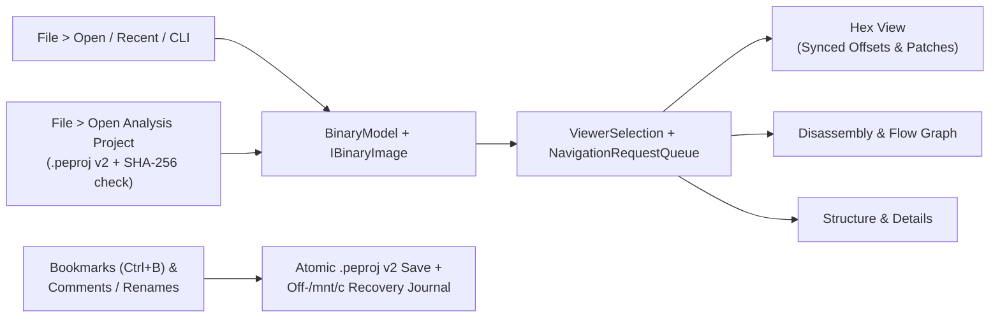
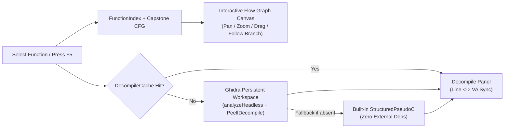
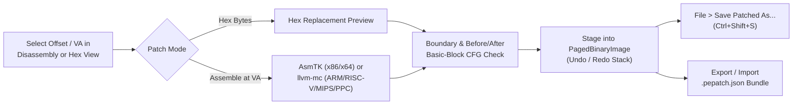
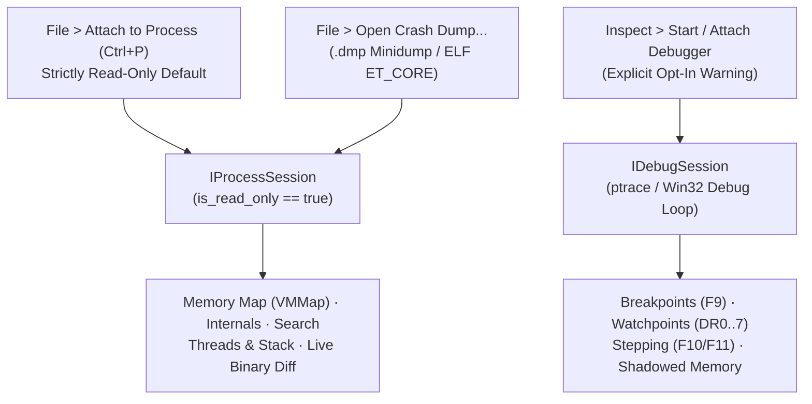
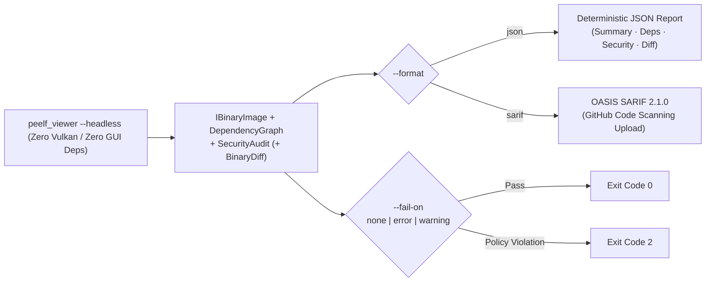

# PE / ELF Explorer — User Guide

Welcome to the **PE / ELF Explorer** (`peelf_viewer`) user guide. PE / ELF Explorer is a cross-platform C++23 static binary analyzer, disassembler, decompiler, transactional binary patcher, read-only live process inspector, offline crash-dump analyzer, opt-in debugger, and CI/CD security auditor built on Dear ImGui (docking) + Vulkan 1.2+ with a zero-Vulkan `--headless` CLI.

Related documentation:
- **[System Architecture (`docs/ARCHITECTURE.md`)](ARCHITECTURE.md)** — Module boundaries, unified `IBinaryImage`, threading, and Vulkan 2-frames-in-flight design
- **[Roadmap & C++23 Design (`docs/ROADMAP_DESIGN.md`)](ROADMAP_DESIGN.md)** — Validated `WU-19a..WU-19d` C++23 conformance & `WU-21..WU-28` next-gen specifications
- **[Project Overview (`README.md`)](../README.md)** — Repository summary and quick build overview

---

## Table of Contents

1. [Quick Start, Supported Platforms, Build Presets & External Tool Setup](#1-quick-start-supported-platforms-build-presets--external-tool-setup)
2. [Workspace Presets, Context Menus, Capabilities, Settings Overview & `.peproj` v2 Sessions](#2-workspace-presets-context-menus-capabilities-settings-overview--peproj-v2-sessions)
3. [Symbols, Demangling, Windows PDB/DIA & ELF DWARF v2–v5 Sidecars](#3-symbols-demangling-windows-pdbdia--elf-dwarf-v2v5-sidecars)
4. [Background Cross-References (`ReferenceIndex`), Jump Tables & `Strings` Browser](#4-background-cross-references-referenceindex-jump-tables--strings-browser)
5. [Interactive Call Graph, Function CFG Canvas & Decompilation](#5-interactive-call-graph-function-cfg-canvas--decompilation)
6. [Static & Live `Structure View` (Built-In Schemas, C Structs, Arrays & Pointers)](#6-static--live-structure-view-built-in-schemas-c-structs-arrays--pointers)
7. [Static & Live `Dependencies` Explorer](#7-static--live-dependencies-explorer)
8. [Binary Patching, Interactive Assembly Preview, `.pepatch.json` Bundles & Sandboxed Lua 5.4 Scripting](#8-binary-patching-interactive-assembly-preview-pepatchjson-bundles--sandboxed-lua-54-scripting)
9. [Binary Comparison (`Binary Diff`) & Disk-vs-Live-RAM Hook Detection](#9-binary-comparison-binary-diff--disk-vs-live-ram-hook-detection)
10. [Read-Only Live Process Inspection, VMMap Explorer, `ProcessStateSnapshot` Diffs & `Execution Timeline`](#10-read-only-live-process-inspection-vmmap-explorer-processstatesnapshot-diffs--execution-timeline)
11. [Offline Crash Dump Triage (Windows `.dmp` Minidumps & Linux ELF `ET_CORE`)](#11-offline-crash-dump-triage-windows-dmp-minidumps--linux-elf-et_core)
12. [Opt-In `IDebugSession` Debugger & `GDB Remote / QEMU RSP` Inspection](#12-opt-in-idebugsession-debugger--gdb-remote--qemu-rsp-inspection)
13. [Formalized BinSkim / checksec Security Audit (`PE1001..PE1008`, `ELF2001..ELF2008`, `LIVE3001..LIVE3003`, `MACHO4001..MACHO4006`)](#13-formalized-binskim--checksec-security-audit-pe1001pe1008-elf2001elf2008-live3001live3003-macho4001macho4006)
14. [Headless CLI & CI/CD Automation (`--headless`, `--slice`, `--script`, JSON & SARIF 2.1.0)](#14-headless-cli--cicd-automation---headless---slice---script-json--sarif-210)
15. [Troubleshooting & Best Practices](#15-troubleshooting--best-practices)

---

## 1. Quick Start, Supported Platforms, Build Presets & External Tool Setup

### 1.1 Supported Formats, Hosts & Target Architectures

| Dimension | Supported Coverage |
|---|---|
| **Host OS** | Windows 10/11 x64 (MSVC 2022) and Linux / WSL2 Ubuntu 22.04+ (Clang 18) |
| **Static Binary Formats** | **PE32 / PE32+** (`.exe`, `.dll`, `.sys`, `.ocx`, delay-load/bound/forwarded/ordinal tables, `.pdata`, manifest/version/CLR, Authenticode), **ELF32 / ELF64** little- & big-endian (`ET_EXEC`, `ET_DYN`, `ET_REL`, `SHN_XINDEX`/`PN_XNUM`, sectionless `PT_DYNAMIC`-only ELFs), and **Mach-O / Universal FAT** (`MH_MAGIC`/`MH_MAGIC_64`/`MH_CIGAM`/`MH_CIGAM_64`, `FAT_MAGIC`/`FAT_CIGAM_64`, `LC_DYLD_EXPORTS_TRIE`, `LC_DYLD_CHAINED_FIXUPS`, structural `LC_CODE_SIGNATURE`) |
| **Live & Remote Targets** | Local read-only live processes (Win32 / Linux `/proc`), **GDB Remote / QEMU RSP** stubs (`GdbRemoteBackend` read-only & opt-in debug), and opt-in local `ptrace` / Win32 debugging |
| **Offline Crash Dumps** | Windows Minidumps (`.dmp` `MDMP`) and Linux ELF Core Dumps (`ET_CORE`, 32/64-bit LE/BE) |
| **Target Architectures** | `x86` (32-bit), `x86_64`, `ARM` (ARM32 + Thumb-2), `ARM64` (`AArch64` / `arm64e`), `RISC-V` (`RV32`/`RV64`), `MIPS` (`MIPS32`/`MIPS64` LE/BE), `PowerPC` (`PPC32`/`PPC64` LE/BE) |

> **WSL2 Filesystem Performance & Hygiene**: When working on WSL2, always keep your repository checkout, CMake `out/build/*` trees, `.peproj` journals, and Ghidra caches inside native Linux ext4 paths (for example `/home/<user>/projects/exe_viewer`), **never** on `/mnt/c`.

### 1.2 CMake Presets & Build Commands

Third-party libraries (Dear ImGui docking, GLFW, Capstone, AsmJit/AsmTK, nativefiledialog-extended, and GoogleTest) are fetched and pinned via CMake `FetchContent` (`third_party/dependencies.cmake`). Every preset enforces zero warnings (`-Werror` on Clang/GCC; `/W4 /WX /FS` on MSVC).

#### Linux / WSL2 (Clang 18 + Ninja)
```bash
# 1. Debug build + full 449-test verification
cmake --preset clang18-debug
cmake --build --preset clang18-debug
ctest --preset clang18-debug

# 2. AddressSanitizer + UndefinedBehaviorSanitizer validation
cmake --preset clang18-asan-ubsan
cmake --build --preset clang18-asan-ubsan
ctest --preset clang18-asan-ubsan

# 3. Optimized Release build
cmake --preset clang18-release
cmake --build --preset clang18-release

# 4. Headless CLI-only build (no Vulkan SDK, X11/Wayland, or GTK3 required)
cmake -S . -B out/build/headless-cli -G Ninja \
  -DCMAKE_C_COMPILER=clang-18 -DCMAKE_CXX_COMPILER=clang++-18 \
  -DCMAKE_BUILD_TYPE=Release -DPEELF_BUILD_GUI=OFF
cmake --build out/build/headless-cli
```

#### Windows x64 (Visual Studio 2022 + LunarG Vulkan SDK)
```powershell
cmake --preset msvc-x64
cmake --build --preset msvc-x64-release
ctest --preset msvc-x64-release
```

#### Launch Interactive GUI or Headless CLI
```bash
# Interactive Vulkan GUI (loads libpeelf_gui.so / peelf_gui.dll dynamically)
./out/build/clang18-debug/apps/viewer/peelf_viewer
./out/build/clang18-debug/apps/viewer/peelf_viewer /bin/ls

# Vulkan-free Headless CLI (never loads peelf_gui or touches GPU drivers)
./out/build/clang18-debug/apps/viewer/peelf_viewer --headless /bin/ls
./out/build/clang18-debug/apps/viewer/peelf_viewer --help
```

### 1.3 External Tool Setup (Optional Providers)

PE / ELF Explorer works out of the box with zero external runtime tools (built-in `StructuredPseudoCDecompiler`, Capstone disassembler, `AsmTK` x86/x64 assembler, DWARF v2–v5 reader, and native layout engine). Configuring optional tools unlocks richer capabilities:

1. **Headless Ghidra (`analyzeHeadless`) — High-Fidelity Decompilation**:
   - Install **JDK 21 LTS** (`sudo apt install openjdk-21-jdk-headless` on Ubuntu/WSL2 or Eclipse Temurin 21 on Windows) and unpack an official [Ghidra release](https://github.com/NationalSecurityAgency/ghidra/releases).
   - Export `GHIDRA_INSTALL_DIR` (or add `<ghidra>/support` to `PATH`), or set the path inside the **Decompile** panel settings:
     ```bash
     export GHIDRA_INSTALL_DIR="$HOME/tools/ghidra_11.3.1_PUBLIC"
     ```
   - `GhidraDecompiler` maintains **persistent LRU-reusable headless workspaces** (`ws-<sha256_prefix>` under `$XDG_CACHE_HOME/peelf_explorer/ghidra_workspaces` or `%LOCALAPPDATA%\peelf_explorer\ghidra_workspaces`, strictly avoiding `/mnt/c`) so subsequent function clicks reuse the analyzed Ghidra database in milliseconds and cache results in `DecompileCache`.
2. **LLVM Machine Code Playground (`llvm-mc`) — Non-x86 Assembly Patching**:
   - `AsmTK` assembles `x86` and `x86_64` in-process with zero external tools.
   - Installing `llvm` (`sudo apt install llvm-18` or LLVM for Windows on `PATH` so `llvm-mc` / `llvm-mc-18` is discoverable) enables interactive assembly patching across `ARM`, `Thumb-2`, `ARM64`, `RISC-V 32/64`, `MIPS 32/64`, and `PowerPC 32/64`.
3. **Graphviz (`dot`) — Static Graph Export**:
   - Interactive `Flow Graph` cards render natively in ImGui. Installing `graphviz` (`dot` on `PATH`) additionally enables Graphviz coordinate layout and SVG/PNG/BMP export.
4. **Symbol Discovery Paths, Symbol Servers & `debuginfod`**:
   - **Windows PDB/DIA**: Visual Studio 2022 provides `msdia140.dll` (auto-discovered even without `regsvr32`). Pre-populated local symbol caches referenced in `_NT_SYMBOL_PATH` (for example `srv*C:\Symbols*https://msdl.microsoft.com/download/symbols`) or sibling `.pdb` paths can be selected directly via **File > Open Debug Symbols...**.
   - **Linux Split Debug / `debuginfod`**: The DWARF loader automatically searches `.gnu_debuglink` (sibling directory, `.debug/`, and `/usr/lib/debug/...`) and `.note.gnu.build-id` (`/usr/lib/debug/.build-id/xx/yyyy....debug`, plus `$HOME/.cache/debuginfod_client/<buildid>/debuginfo` populated when `DEBUGINFOD_URLS` tools have cached symbols).

---

## 2. Workspace Presets, Context Menus, Capabilities, Settings Overview & `.peproj` v2 Sessions



### 2.1 Opening Files, Universal Mach-O Slices & Navigating the Workspace
- **Open a Binary**: Press **`Ctrl+O`** (**File > Open...**), pick an entry under **File > Recent Binaries**, or pass a file path on the command line (PE, ELF, or thin/Universal Mach-O).
- **Universal Mach-O Slice Selector (`WU-26`)**: When a multi-architecture Universal (`FAT_MAGIC` / `FAT_CIGAM_64`) Mach-O container is loaded, use the top **Universal Slice** combo (e.g. `arm64`, `arm64e`, `x86_64`) to switch active slices safely between frames; all container-absolute file offsets, load commands, exports tries, chained fixups, security findings, and patches rebind to the chosen slice.
- **Workspaces & Layout Presets (`View > Workspaces`, `WU-27`)**: Switch instantaneously across 5 curated `DockNodeSpec` layouts (*Static Reverse Engineering*, *Live Process / VMMap*, *Debugger*, *Binary Diff*, and *Minimal*) or choose **View > Workspaces > Reset Current Workspace Layout** (`kWorkspaceLayoutSchemaVersion = 9` across all 36 dockable panels).
- **Universal Capability-Aware Entity Context Menus (`WU-27`)**: Right-click any row or address across **File**, **Sections**, **Imports**, **Exports**, **Symbols**, **Disassembly**, **Memory Map**, or **Security Audit** to invoke:
  - **Copy**: `Copy Virtual Address`, `Copy File Offset`, `Copy Label`, or `Copy JSON Summary` (deterministic RFC 8259 snippet with provenance).
  - **Navigate & Act**: `Follow in Hex`, `Follow in Disassembly`, `Follow in Decompiler`, `Follow in Structure View`, `Add Bookmark`, or `Toggle Software Breakpoint` (unavailable actions remain visible-disabled with explicit `TargetCapabilityMatrix` explanations rather than failing silently).
- **`Target Capabilities` & `Observed<T>` Provenance (`WU-21`)**: Open **View > Target Capabilities** to inspect the target's `TargetProfile`, `ProviderFacts`, `BackingImageIdentity` verification, and per-domain `SupportState` (`SupportedValidated`, `SupportedExperimental`, `Partial`, `Unsupported` — defaulting strictly to `Unsupported` without validation evidence). Every runtime and static datum carries `Observed<T>` provenance (`ProvenanceTag`, `CaptureAvailability`, and `CaptureStamp` with `TargetInstanceId` + `snapshot_revision`).
- **`Executable & Settings` Static & Runtime Overview (`WU-22`)**: Open **View > Executable & Settings** to inspect declared static metadata side-by-side with observed runtime state:
  - **PE**: Bounded `RT_MANIFEST` XML (requested execution level, DPI awareness, Windows compatibility GUIDs), `RT_VERSION` (`VS_FIXEDFILEINFO` + multi-locale `StringFileInfo`), and CLR `.NET` `BSJB` metadata summary.
  - **ELF**: `PT_INTERP`, `.note.ABI-tag`, `.note.gnu.build-id`, `DT_SONAME`/`DT_RPATH`/`DT_RUNPATH`, and `DT_FLAGS`/`DF_1_*`.
  - **Mach-O**: File type, `LC_BUILD_VERSION` / `LC_VERSION_MIN_*` platform & SDK versions, `LC_MAIN` / `LC_UNIXTHREAD` entry point, `LC_ID_DYLIB` / `LC_RPATH`, `LC_UUID`, and `LC_CODE_SIGNATURE` flags/entitlements summary.
  - **Observed Runtime Settings**: Live command line, working directory, security posture, and environment variables (**sensitive secret values are redacted by default** unless explicitly revealed).
- **Structure Tree, Jump Bar & Synchronized Views**:
  - The left **Structure** panel presents a unified hierarchy (`File/Image -> Headers -> Sections -> Segments -> Imports -> Exports -> Symbols -> Relocations / Notes / Dynamic / Debug`).
  - Enter any hex VA in the top **Jump** bar and press `Enter`; **Disassembly** and **Hex View** synchronize byte spans and mapped offsets automatically.

### 2.2 Keyboard Shortcuts & Menu Reference

| Shortcut | Menu Path / Context | Action |
|---|---|---|
| **`Ctrl+O`** | `File > Open...` | Open a static PE or ELF binary |
| **`Ctrl+P`** | `File > Attach to Process...` | Open the read-only live process attach dialog |
| **`Ctrl+Shift+S`** | `File > Save Patched As...` | Write staged patches to a new binary file (never overwrites original) |
| **`Ctrl+F5`** | `File > Refresh Process Memory Map` | Re-enumerate live process regions and modules |
| **`Alt+Left`** / **`Backspace`** | `Navigate > Back` | Navigate backward in address selection history |
| **`Alt+Right`** / **`Shift+Backspace`** | `Navigate > Forward` | Navigate forward in address selection history |
| **`Ctrl+B`** | `Navigate > Bookmark selection` | Toggle a named bookmark at the active VA / file offset |
| **`X`** | `Navigate > References & Notes` | Focus incoming/outgoing cross-references and inline notes for current VA |
| **`F5`** *(static / non-paused)* | `Navigate > Decompile selection` | Decompile the function containing the current selection |
| **`F5`** *(debugger paused)* | `Inspect > Continue` | Resume execution in an active opt-in `IDebugSession` |
| **`F9`** | `Inspect > Toggle Breakpoint at Selection` | Set or remove a software breakpoint at the selected VA |
| **`F10`** | `Inspect > Step Over` | Step over the current instruction in an active `IDebugSession` |
| **`F11`** | `Inspect > Step Into` | Step into a single instruction in an active `IDebugSession` |
| **`Shift+F11`** | `Inspect > Step Out` | Execute until the current frame returns (`IDebugSession`) |
| **`Space`** *(in Disasm / Graph)* | `Analyze > Call graph` / `Disassembly` | Toggle focus between linear **Disassembly** and **Flow Graph** |
| **`Enter`** *(in Disasm / Graph)* | Canvas / Table | Follow the direct branch or call target of the selected instruction |
| **`Alt+F4`** | `File > Exit` | Close PE / ELF Explorer (note: `Esc` closes popups only and never exits) |

### 2.3 Bookmarks (`Ctrl+B`), Annotations & `.peproj` v2 Analysis Sessions
1. **Bookmarks & Notes**:
   - Press **`Ctrl+B`** (or click **Bookmark** next to the Jump bar) to bookmark any VA. View, rename, filter, or delete bookmarks in **References & Notes** (`X`).
   - Rename functions/labels (`N` / **References & Notes** rename box) and attach inline comments; renamed symbols propagate immediately into **Disassembly**, **Flow Graph**, **Strings**, and **Decompile**.
2. **Saving & Reopening `.peproj` v2 Projects**:
   - Choose **File > Save Analysis Project...** to write a `.peproj` v2 JSON session containing:
     - Cryptographic target identity: **`source_sha256`** (64-hex SHA-256) + **`source_size`**,
     - Both `source_path` and **`relative_source`** (relative to the `.peproj` directory so projects can be moved across machines or git checkouts),
     - User symbol renames, comments, bookmarks, pinned **Structure View** bindings, and staged patch intervals.
   - Atomic persistence writes `<name>.peproj.tmp` and renames it atomically so power loss never truncates an existing `.peproj`.
3. **Missing Binary Relocation & SHA-256 Mismatch Modals**:
   - If you move a folder and open `.peproj` via **File > Open Analysis Project...**, `relative_source` resolves automatically. If the binary was moved elsewhere, the **Relocate Missing Binary** modal prompts you to browse to its new location.
   - If the target binary on disk was rebuilt or modified (`SHA-256` or byte size differs), a **Binary Identity Mismatch Warning** modal displays both hashes and asks for confirmation before rebasing annotations.
4. **Crash-Recovery Autosave Journals**:
   - Unsaved annotations, bookmarks, structure bindings, and staged patches are periodically journaled to an off-`/mnt/c` recovery file (`$XDG_STATE_HOME/peelf_explorer/recovery` or `%LOCALAPPDATA%\peelf_explorer\recovery`). After an unexpected termination, reopening the project offers one-click journal recovery; clean saves remove the journal automatically.

---

## 3. Symbols, Demangling, Windows PDB/DIA & ELF DWARF v2–v5 Sidecars

### 3.1 Multi-Language Symbol Demangling
Toggle **View > Demangle symbols** (enabled by default) to decode mangled compiler symbols across **Symbols**, **Functions & Names**, **Imports**, **Exports**, **Disassembly**, **Flow Graph**, **Threads & Stack**, and **Decompile**:
- **Itanium C++ ABI** (`_Z...`) — GCC / Clang Linux, MinGW, and embedded toolchains
- **Rust v0 (`_R...`) & Legacy Rust (`_ZN...17h<hex>E`)** — Clean crate/module/trait paths without trailing hash noise
- **MSVC C++ (`?...`)** — Visual C++ decorated functions, constructors/destructors, templates, and vtables

### 3.2 Windows CodeView / PDB & RSDS GUID+Age Verification
1. When opening a PE executable or DLL containing an `IMAGE_DEBUG_DIRECTORY` (`IMAGE_DEBUG_TYPE_CODEVIEW` `RSDS` record), PE / ELF Explorer extracts the embedded **PDB GUID**, **Age**, and `.pdb` path.
2. Sibling and configured paths are checked automatically, or you can load an explicit `.pdb` via **File > Open Debug Symbols...**.
3. **Cryptographic/Structural MSF 7.00 Verification**: Before merging symbols, `debug_symbols.cpp` parses the PDB's MSF 7.00 superblock, PDB Info Stream (Stream 1), and DBI Stream (Stream 3) to verify that the **GUID and Age match** the binary's `RSDS` record, rejecting mismatched or corrupt `.pdb` files with an explicit diagnostic in **Log**.
4. On Windows hosts with the DIA SDK (`msdia140.dll`), public symbols, functions, parameters, and user-defined structs/unions (`UDT`s) populate `SymbolIndex` and `StructureCatalog`—and automatically rebase onto live ASLR module base addresses when attached to a running process.

### 3.3 Cross-Platform ELF & MinGW DWARF v2–v5 + Separate Debug Sidecars
On both Windows and Linux hosts without external libraries, the built-in DWARF v2–v5 reader (`peelf/dwarf.hpp`) parses:
- `.debug_info`, `.debug_abbrev`, `.debug_str`, `.debug_line_str`, `.debug_str_offsets` (`DW_FORM_strx*`), `.debug_addr` (`DW_FORM_addrx*`), `.debug_line` (source file + line numbers), `.debug_ranges`, and DWARF v5 `.debug_rnglists` (`DW_RLE_*`).
- Recovering function boundaries (`DW_TAG_subprogram`), variables, formal parameters, source file:line mappings, and composite `DW_TAG_structure_type` / `DW_TAG_union_type` layouts.
- **Automatic Split-Debug Sidecar Discovery**:
  - `.gnu_debuglink` — locates sibling `<file>.debug`, `<dir>/.debug/<file>.debug`, or `/usr/lib/debug/<dir>/<file>.debug` and verifies its IEEE **CRC32** checksum.
  - `.note.gnu.build-id` — resolves `/usr/lib/debug/.build-id/<ab>/<cdef...>.debug` and cached `debuginfod` paths, or load any detached `.debug` file manually via **File > Open Debug Symbols...**.

---

## 4. Background Cross-References (`ReferenceIndex`), Jump Tables & `Strings` Browser

### 4.1 Resumable Background Cross-Reference Scanner
Large binaries (tens or hundreds of megabytes of `.text`) never freeze the UI or silently stop at an arbitrary byte limit:
- `AsyncReferenceScanner` disassembles executable sections/regions on a cancellable background `std::jthread` in **256 KiB slices**, publishing sorted incoming (`to -> from`) and outgoing (`from -> to`) xref tables.
- Open **References & Notes** (**Navigate > References & Notes** or press **`X`** on any instruction, symbol, or data item) to monitor scan progress (`Scanned X / Y MiB (Z%)`), **Pause**, **Resume**, or **Rescan**.
- Each xref displays its source VA, target VA, resolved symbol/section + offset, reference kind (`Call`, `ConditionalJump`, `UnconditionalJump`, `DataRead`, `DataWrite`, `AddressLoad`), **Confidence** (`Exact`, `IndirectSlot`, `HeuristicTable`), and **Evidence** tag.

### 4.2 Multi-Arch Indirect-Branch & Switch Jump-Table Recovery
Beyond direct PC-relative calls and branches, `ReferenceIndex` recovers indirect control-flow targets and wires them directly into **References** and **Flow Graph**:
- **x86 / x86_64**: RIP-relative and PIC base+i32 offset switch jump tables (`lea rdx, [rip+tbl]; movsxd rax, [rdx+rcx*4]; add rax, rdx; jmp rax`), absolute pointer jump tables, and IAT / GOT indirect `call [rip+disp]` / `jmp [rip+disp]` slots.
- **ARM32 / Thumb-2**: `tbb [pc, rn]` and `tbh [pc, rn, lsl #1]` byte/halfword branch tables.
- **ARM64 (`AArch64`)**: `adr`/`adrp` + `ldrb`/`ldrh`/`ldrsw` + `add` + `br` PC-relative switch tables and GOT page loads.

### 4.3 Xref-Linked `Strings` Browser
Open **Strings** (**Navigate > Strings** or **View > Strings**) to inspect literals extracted across `.rodata`, `.rdata`, `.data`, or live readable regions:
- **Encodings**: Automatic classification of `ASCII`, `UTF-8` multi-byte sequences, `UTF-16LE` (Windows wide strings), and `UTF-16BE` (big-endian targets).
- **Filtering & Sorting**: Filter by substring, VA, encoding dropdown (`All Encodings`, `ASCII`, `UTF-8`, `UTF-16LE`, `UTF-16BE`), or containing section/region; sort by `Address`, `Section`, `Encoding`, `Length`, **`XRefs` count**, or `String` text.
- **One-Click Xref Triage**: Sort descending by **`XRefs`** to spot heavily referenced error messages, registry keys, URLs, or format strings; click a row to jump **Hex View** to the string and inspect every referencing function in **References & Notes**.

---

## 5. Interactive Call Graph, Function CFG Canvas & Decompilation



### 5.1 Interactive `Flow Graph` (Call Fan-Out & Basic-Block CFG)
Open **Flow Graph** (**Analyze > Call graph** or press **`Space`** inside **Disassembly**):
- **Modes**: Inspect loaded entry/export **Call Fan-Out** (including resolved PE CRT->`main`/`WinMain`, PDB symbols, and ELF `_start -> __libc_start_main -> main` + GOT/PLT targets) or switch to **Function CFG** to view basic blocks, fallthroughs, true/false conditional edges, and recovered switch jump-table edges.
- **Canvas Controls**:
  - **Mouse Wheel**: Smooth zoom around cursor (`Fit`, `100%`, and **Reset Layout** buttons in toolbar).
  - **Middle-Mouse Drag** (or background drag): Pan across the canvas.
  - **Left-Click / Drag Node Card**: Select block (synchronizing **Hex View**, **Disassembly**, and **Details**) or reposition cards interactively with live edge rerouting.
  - **`Up` / `Down` & `Enter`** (or double-click): Walk instructions/nodes and dive into direct branch/call targets; use **`Alt+Left`** (`Backspace`) to pop back.

### 5.2 Decompilation (`F5`) — Built-In Pseudo-C vs. Persistent Headless Ghidra
Select any function or instruction and press **`F5`** (**Navigate > Decompile selection**):
1. **Backend Selection**:
   - **Auto (Default)**: Uses **Headless Ghidra** (`GhidraDecompiler`) when `GHIDRA_INSTALL_DIR` / `analyzeHeadless` is configured, falling back automatically to the built-in **`StructuredPseudoCDecompiler`** (or optional `RetDec` / `Binary Ninja` bridges).
   - Switch backends explicitly in the **Decompile** toolbar dropdown (`Auto`, `Ghidra`, `Structured Pseudo-C`, `Annotated Code`, `RetDec`, `Binary Ninja`).
2. **Persistent Workspaces & `DecompileCache`**:
   - First-time Ghidra decompilation of a binary creates a keyed headless project (`ws-<sha256_prefix>`) in your local cache directory; decompiling additional functions in the same binary reuses the analyzed project (`-noanalysis`) and stores `(binary_revision, backend, function_va)` results in `DecompileCache` for instant recall.
   - Staging or undoing a binary patch bumps `edit_revision`, automatically invalidating stale cached pseudo-C so re-pressing `F5` reflects patched instructions.
3. **Bidirectional Line <-> Disassembly Synchronization**:
   - Clicking a C statement in **Decompile** highlights its originating instruction address in **Disassembly** and **Hex View**; clicking an instruction in **Disassembly** highlights the corresponding pseudo-C line(s).
   - Recovered parameter/struct types (`DataTypeRecord`) appear in the **Data Structures** drawer (**View > Data Structures**) and feed **Structure View**.

---

## 6. Static & Live `Structure View` (Built-In Schemas, C Structs, Arrays & Pointers)

Open **Structure View** (**Navigate > Structure** or **View > Structure View**) to overlay strongly typed layouts onto raw static file offsets or live process virtual addresses:

1. **Built-In Format & OS Runtime Schemas (`StructureCatalog`)**:
   - **PE Header**: `IMAGE_DOS_HEADER`, `IMAGE_NT_HEADERS32`, `IMAGE_NT_HEADERS64`, `IMAGE_SECTION_HEADER`
   - **Win32 Runtime**: `PEB32`, `PEB64`, `RTL_USER_PROCESS_PARAMETERS64`, `TEB64`
   - **ELF Header**: `Elf32_Ehdr`, `Elf64_Ehdr`, `Elf64_Phdr`, `Elf64_Shdr`
   - **Linux Runtime**: `r_debug64`, `link_map64`
2. **Custom C-Struct Definitions & Debug Types (`Debug / User` Category)**:
   - Any C/C++ `struct` or `union` compiled with `-g` (ELF/MinGW DWARF v2–v5) or `/Zi` (Windows PDB/DIA), or recovered from C headers during Ghidra decompilation, is automatically imported into the **`Debug / User`** schema group with exact field offsets, primitive/array/bitfield sizes, and pointee type names.
   - Browse all discovered composite layouts at any time via **View > Data Structures**.
3. **Address Mode, Endianness, Array Stride & Pointer Dereferencing**:
   - Choose **`Virtual Addr`** or **`File Offset`** on static files (live processes read **`Live VA`** directly through `read_memory_tolerant`, rendering unreadable guard pages cleanly without failing the rest of the struct).
   - Click **`Use Selection`** (or enable **`Sync`** to follow `ViewerSelection` live as you click in Hex/Disassembly).
   - Set **`Count`** (`1..64`) to decode contiguous arrays of structs (e.g., an array of `IMAGE_SECTION_HEADER` or `Elf64_Phdr` entries using each schema's exact byte stride), and override **`Endian`** (`Auto` / `Little` / `Big`) or **`Ptr`** (`Auto` / `32-bit` / `64-bit`) when inspecting cross-architecture blobs.
   - **Pointer Following**: Fields typed as pointers display a clickable target VA badge (`-> 0x... [preview]`). Left-click to jump to that VA, or right-click a pointer field and choose **`Dereference as <PointeeStruct>`** to re-anchor **Structure View** at the pointee address with its target type!
4. **Persisted Structure Bindings**:
   - Give an overlay an optional label and click **`Pin Binding`**. Pinned bindings appear in the **Pinned Structure Bindings** strip for one-click recall and are saved inside `.peproj` v2 session files.

---

## 7. Static & Live `Dependencies` Explorer

Open **Dependencies** (**View > Dependencies**) to audit transitive shared-library trees and symbol bindings across both static disk images and attached live processes:

- **PE Dependency Resolution**:
  - Parses standard `IMAGE_DIRECTORY_ENTRY_IMPORT`, **Delay-Load** imports (`ImgDelayDescr`), **Bound** imports, ordinal-only imports, and **Forwarded Exports** (`NTDLL.RtlAllocateHeap`).
  - Recognizes Windows **`api-ms-win-*` and `ext-ms-win-*` virtual API-set contracts** (`VirtualApiSet` badge) so virtual OS redirection DLLs are never misreported as missing files on disk.
- **ELF Dependency Resolution**:
  - Parses `PT_INTERP` dynamic loader path, `DT_NEEDED` libraries, `DT_SONAME`, `DT_RPATH`, and `DT_RUNPATH` (recovering dynamic dependencies even on stripped sectionless `PT_DYNAMIC`-only ELFs).
  - Expands `$ORIGIN` / `${ORIGIN}`, `$LIB`, and `$PLATFORM` tokens accurately relative to each importing binary's directory, plus custom `--search-root` sysroots and optional `LD_LIBRARY_PATH`.
- **Mach-O Dependency Resolution (`WU-26`)**:
  - Parses `LC_LOAD_DYLIB`, `LC_LOAD_WEAK_DYLIB`, `LC_REEXPORT_DYLIB`, `LC_LAZY_LOAD_DYLIB`, `LC_LOAD_UPWARD_DYLIB`, and `LC_RPATH`, expanding `@executable_path`, `@loader_path`, and `@rpath` chains across configured `--search-root` sysroots while honestly classifying Apple system paths (`/usr/lib/...`, `/System/Library/Frameworks/...`) as **`DyldSharedCacheExpected`** rather than false missing-file errors when no extracted shared cache is mounted.
- **Triage Filters & Symbol Binding Status**:
  - Adjust **Max Depth** (`1..16`), add semicolon/colon-separated **Extra Search Roots** (ideal for cross-compiled embedded rootfs directories or app bundles), and toggle **`Issues Only`** to immediately isolate:
    - `Unresolved` (red — missing `.dll`/`.so`),
    - `ArchitectureMismatch` (orange — e.g. 64-bit binary finding a 32-bit library first on search path),
    - `UnboundMissingExport` (imported symbol or ordinal absent from target library's export table).
  - Clicking an imported symbol selects its IAT/GOT call site and shows cross-references in **References & Notes**.

---

## 8. Binary Patching, Interactive Assembly Preview, `.pepatch.json` Bundles & Sandboxed Lua 5.4 Scripting



> **Safety Invariant**: Original input files on disk are **never** modified in place, and patching controls are strictly disabled when attached to a read-only live process or crash dump.

### 8.1 Staging Raw Hex or Multi-Arch Assembly Patches
Open **Patch Set** (**Edit > Patch workspace** or **View > Patch Set**) and select a target instruction in **Disassembly** or byte offset in **Hex View**:
1. **Mode 1 — `Hex Bytes`**:
   - Enter hex bytes (e.g. `90 90` or `B8 01 00 00 00 C3`; **Edit > Byte input workspace** / `Shellcode` also converts C arrays, escaped `\x..` strings, and hex dumps) and click **`Preview Replacement`**.
2. **Mode 2 — `Assemble at Selection / VA`**:
   - Type multi-line assembly instructions directly (using `AsmTK` in-process for `x86`/`x86_64`, or `llvm-mc` for `ARM`, `Thumb`, `ARM64`, `RISC-V`, `MIPS`, and `PowerPC`).
   - As you type, `Patch Set` encodes instructions against the exact target **Virtual Address** (so relative `call`/`jmp`/`b`/`jal` displacements compute accurately) and shows a **Live Capstone Round-Trip** disassembly + byte count.
   - **NOP Padding**: Check **`Pad trailing overwritten instruction slack with NOPs`** to automatically emit architecture-appropriate NOPs (`0x90` on x86/x64, `0xD503201F` on ARM64, `0x00000013` on RISC-V, etc.) when your replacement is shorter than the overwritten instruction span, preventing misaligned mid-instruction fallthrough!
   - Click **`Preview Assembly Patch`** to inspect boundary warnings and a side-by-side **Before vs. After Basic-Block CFG** table.
3. **Commit to Staging, Undo/Redo & Save As**:
   - Click **`Stage Patch`** to commit a `PatchTransaction` into `PagedBinaryImage`. Modified bytes highlight immediately in **Hex View** and **Disassembly**.
   - Use **Edit > Undo patch** / **Edit > Redo patch** to step backward or forward across transactions.
   - Press **`Ctrl+Shift+S`** (**File > Save Patched As...**) to export the patched executable to a new file path, or **File > Export Patch Report...** for an audit log.

### 8.2 Reusable `.pepatch.json` Patch Bundles
Share deterministic patches with teammates without redistributing proprietary binaries:
- **Export**: In **Patch Set**, specify a bundle path (`<binary>.pepatch.json`), description, and click **Export Bundle**. Each hunk records `file_offset`, `virtual_address`, `original_bytes_hex`, `patched_bytes_hex`, optional `asm_source`, plus target `expected_sha256` and `expected_size`.
- **Import & Pre-Apply Conflict Verification**: Load a `.pepatch.json` bundle to inspect a per-hunk conflict preview (`Ready`, `AlreadyApplied`, `OriginalBytesMismatch`, `OutOfBounds`, or whole-file `SHA-256` mismatch). Applying stages **all** hunks as a single atomic, undoable `PatchTransaction`—if any hunk conflicts, zero bytes are mutated.

### 8.3 Sandboxed Lua 5.4 Transactional `Scripting` Console (`WU-28`)
Open **Scripting** (**View > Scripting** or **Edit > Scripting console**) to automate analysis, pattern scanning, workspace labeling, and multi-hunk patching inside a deterministic, sandboxed **Lua 5.4.7** VM:
1. **Hardened Execution Sandbox & Quotas (`ScriptLimits`)**:
   - Standard host-escape libraries (`io`, `os`, `debug`, `package`, `dofile`, `loadfile`) are **never loaded**, and precompiled Lua bytecode chunks are rejected (`"t"` text-only loader).
   - Configure **Max Instructions** (default `2,000,000`), **Max Memory (MiB)** (default `32 MiB` via custom `lua_Alloc`), and **Timeout (ms)** (default `5,000 ms`). Scripts run asynchronously on `BinaryModel::AsyncScriptRunner` with an instant **Cancel** button (`std::stop_source`) and never block or race UI rendering.
2. **Dry-Run Staging by Default vs. Opt-In `Allow Target Mutations`**:
   - **Starter Templates**: Pick from built-in templates via the **Template** combo (*Inspect Target & Sections*, *Scan High-Entropy / RWX Sections*, *Auto-Label Entry & Exports (Dry-Run)*, *Stage NOP Patch + Commit*).
   - **Read-Your-Writes Staging**: Byte writes and annotations (`set_label`, `set_comment`, `add_bookmark`) operate on an isolated staging clone. If `peelf.commit()` is omitted, **Allow Target Mutations** is unchecked, or an error/quota failure occurs, all staged changes remain a harmless **Dry-Run** preview.
   - **Capability Protection**: On read-only live processes, offline crash dumps, and remote GDB RSP targets, **Allow Target Mutations** is automatically disabled with an explicit capability explanation. When enabled on a static binary and `peelf.commit()` succeeds, the UI thread atomically harvests patches into `PagedBinaryImage` (fully undoable via **Edit > Undo patch**) and annotations into `ProjectWorkspace`.
   - **Click-to-Navigate Summary**: Every staged/committed label, comment, bookmark, and byte patch is listed in the **Mutations Summary** table—click any row to jump **Hex View** / **Disassembly** directly to its VA or file offset.
3. **`peelf.*` Lua API Reference**:

| Lua Function | Behavior |
|---|---|
| `peelf.target_info()` | Returns `{ format, arch, endianness, is_64bit, pointer_size, entry_va, image_base, file_size, sha256, is_live, is_read_only, allow_mutations }` |
| `peelf.capabilities()` | Returns capability support states (`"SupportedValidated"`, `"SupportedExperimental"`, `"Partial"`, `"Unsupported"`) |
| `peelf.sections()` / `peelf.symbols()` / `peelf.imports()` / `peelf.exports()` / `peelf.security_findings()` | Returns 1-indexed arrays of parsed sections (with `entropy`), symbols, imports, exports, or BinSkim/checksec findings |
| `peelf.va_to_offset(va)` / `peelf.offset_to_va(off)` | Translates between virtual addresses and container-aware file offsets (`nil` if unmapped) |
| `peelf.read_bytes(va_or_off, len [, "va"\|"offset"])` | Reads staged/effective bytes as a Lua binary string (reflects uncommitted `write_bytes` in the same run) |
| `peelf.find_bytes(hex_pattern [, section_name])` | Scans for hex bytes + `??` wildcards (e.g. `"48 89 ?? 24"`), returning `{ { offset, va }, ... }` |
| `peelf.disassemble(va, count)` | Disassembles `count` instructions via Capstone, returning `{ { address, size, mnemonic, operands, bytes }, ... }` |
| `peelf.assemble(asm_text, base_va)` | Encodes assembly via `AsmTK` (x86/x64) or `llvm-mc` (multi-arch), returning raw assembled byte string |
| `peelf.write_bytes(offset, raw_or_hex [, is_hex])` | Stages byte modifications at `offset` (requires `allow_mutations`; throws Lua error on read-only targets) |
| `peelf.set_label(va, name)` / `peelf.set_comment(va, text)` / `peelf.add_bookmark(va, label [, note])` | Stages workspace symbol renames, comments, and bookmarks |
| `peelf.commit()` / `peelf.rollback()` | Marks staged mutations for atomic commit on completion, or discards all staged changes immediately |
| `peelf.log(msg)` / `print(...)` | Appends formatted diagnostic lines to the **Scripting** output console (and `--headless --script` stdout/JSON) |

---

## 9. Binary Comparison (`Binary Diff`) & Disk-vs-Live-RAM Hook Detection

Open **Binary Diff** via **File > Compare With Binary...** (static A vs. static B) or **File > Compare Active Live Module vs. Disk** (live in-memory module vs. its backing `.exe`/`.dll`/`.so` on disk):

1. **Cancellable Background Diffing**:
   - Diff jobs run asynchronously on `AsyncBinaryDiffController` (`std::jthread` + `std::stop_token`) so comparing multi-megabyte builds keeps the UI responsive and supports instant **Cancel** or re-selection.
2. **Structural & 3-Tier Relocation-Tolerant Function Diffing**:
   - Compares **Headers** (entry point, image base, security flags, timestamps), **Sections** (size, entropy/byte delta, permission changes), **Imports**, and **Exports**.
   - Matches functions across builds in 3 tiers: (1) Exact symbol/export name, (2) Entry VA/RVA, and (3) **Relocation-normalized byte signature**—classifying functions as `Identical`, **`IdenticalRelocated`** (code moved addresses between builds, only fixup slots changed), `Modified`, `Added`, or `Removed`.
3. **Live-RAM vs. Disk Hook & Tampering Triage**:
   - Normalizes expected loader relocations (`IMAGE_REL_BASED_*` / ELF `R_*_RELATIVE`) and normal IAT/GOT dynamic linker slots so legitimate ASLR rebasing does not flood you with false positives.
   - Highlights anomalous modifications in bright coral as:
     - **`InlineCodeHook`** — `.text` prologue detours (`jmp`/`call`/`push+ret` trampolines or patched instructions in RX pages),
     - **`IatGotPointerHook`** — import/PLT pointers redirected outside expected loaded export modules,
     - **`ReadOnlyDataModified`** — mutated `.rdata`/`.rodata` vtables or constants.
4. **Synchronized Dual Hex & Disassembly View**:
   - Click any modified function or byte hunk to inspect synchronized left-vs-right **Disassembly** and **Hex** panes side by side, or jump the main workspace directly to the hunk VA.

---

## 10. Read-Only Live Process Inspection, VMMap Explorer, `ProcessStateSnapshot` Diffs & `Execution Timeline`



### 10.1 Attaching Read-Only (`Ctrl+P`)
Press **`Ctrl+P`** (**File > Attach to Process...** or **Inspect > Attach to Process (Read-Only Default)...**):
- Filter processes by name, PID, user, or command line; toggle **Accessible only**, enter a manual PID, or click **Attach Self** to inspect `peelf_viewer` itself.
- **Strict Read-Only Guarantee**: Read-only sessions never open `PROCESS_VM_WRITE` / `PROCESS_VM_OPERATION` on Windows and never issue `PTRACE_POKETEXT`/`POKEDATA` on Linux. Unmapped or guard-paged ranges render safely as `??` in **Hex View** via `read_memory_tolerant`.
- Switch between loaded `.exe`/`.dll`/`.so`/`[vdso]` modules in the **Memory Map** active-module selector or the **Structure** tree (`Modules (...)`)—all headers, symbols, imports, exports, disassembly, and decompilation rebase onto the live ASLR address automatically!
- Press **`Ctrl+F5`** (**File > Refresh Process Memory Map**) to refresh mappings, or **File > Pause Process** / **Resume Process** when inspecting live thread stacks.

### 10.2 Sysinternals VMMap-Style Visual RAM Explorer (`Memory Map`)
Open **Memory Map** (**View > Memory Map**) for a complete virtual & physical footprint breakdown (`/proc/<pid>/smaps` on Linux; `VirtualQueryEx` + `QueryWorkingSetEx` on Windows):
- **Stacked Proportional Bars**: Interactive horizontal bars break down total **Committed / Virtual**, **Resident (RSS)**, **Proportional Set Size (PSS)**, **Private Dirty/Clean**, **Shared Dirty/Clean**, and **Swap** across:
  - **Categories**: `Image` (azure), `Heap` (amber), `Stack` (violet, attributed to owning `TID`), `MappedFile` (teal), `Anonymous` (green), `[vdso]` (gold), and `Reserved` (slate).
  - **Protections**: `RX`, `R--`, `RW-`, **`RWX`** (high-attention coral), and `---`/Guard.
- **Compressed Canonical VA Heat Strip**: Visualizes address-space layout and ASLR entropy across 32-bit or 48/57-bit canonical virtual memory; click any segment, category bar, or table row to filter or jump **Hex View** / **Disassembly** directly to that region.

### 10.3 Bounded Endian-Aware `Memory Search`
Open **Memory Search** (**Edit > Memory Search** or **Navigate > Memory Search**):
- **Scopes** (on live processes): `Heap (default)`, `Selected Region`, `Active Module`, or `All Readable Memory` (automatically skipping multi-terabyte sparse/unresident sanitizer shadow reservations).
- **13 Value Types**: `Hex Pattern` with `??` byte wildcards (e.g. `48 8B ?? 10`), signed/unsigned integers (`Int8`/`UInt8` .. `Int64`/`UInt64`), IEEE floats (`Float32`, `Float64`), `Text (UTF-8 / ASCII)`, and `Text (UTF-16)`.
- Configure **Endianness** (`Target Auto`, `Little-Endian`, `Big-Endian`), **Alignment** (`1`, `2`, `4`, `8` bytes), `Case-sensitive`, and `Max hits`; click any match to inspect in **Hex View** or **Structure View**.

### 10.4 `Process Internals`, `Threads & Stack`, `Thread Locals`, `PEB / TEB` & `Handlers`
- **Process Internals** (**Navigate > Process Internals**):
  - **Handles / FDs**: Open files, directories, pipes, `memfd`, `anon_inode` (`epoll`/`eventfd`), devices, registry keys, and sync objects with flags/offsets and filter combos.
  - **Sockets**: Active `TCP`, `TCPv6`, `UDP`, `UDPv6`, and `UNIX` domain endpoints correlated directly to owning FD/inode and remote peer `IP:port` + connection state.
  - **Security & Mitigations**: UID/GID, Linux capability bitmasks (`CapEff`/`CapPrm`/`CapBnd`), `Seccomp` mode, `NoNewPrivs`, LSM label, namespaces/cgroups, and Windows Token user/groups, Integrity Level, elevation, privileges, and `GetProcessMitigationPolicy` flags (DEP, ASLR, CFG,ACG, CET Shadow Stack). Every tab displays an explicit `[Available]`, `[Partial]`, or `[Unavailable]` status banner rather than silently omitting restricted kernel fields.
- **Threads & Stack** (**Navigate > Threads & Stack**): Enumerates threads with state, wait reason, start address + symbol, user/kernel **CPU% delta**, general-purpose registers, and unwound stack frames distinguishing concrete frame-pointer chains from heuristic stack-scan candidates.
- **Thread Locals**, **PEB / TEB & Flags**, and **Handlers**: Inspect TLS slots (`PT_TLS`/DTV & `.tls`/TEB), `PEB`/`TEB` or Linux `auxv`/`r_debug`, and registered VEH/SEH/signal/`atexit` handlers.

### 10.5 Timestamped `ProcessStateSnapshot`, `SnapshotDiff` & Multi-Thread `Execution Timeline` (`WU-23`, `WU-24`)
Track how a live or debugged process evolves over time without losing uncertainty or sampling boundaries:
1. **Point-in-Time `ProcessStateSnapshot` & `SnapshotDiff` (`WU-23`)**:
   - Capture timestamped snapshots from **Executable & Settings** / **Process Internals** (`Capture Snapshot`) and compare any two revisions sharing the same `TargetInstanceId` (PID reuse across distinct process instances is rejected automatically).
   - `SnapshotDiff` surfaces loaded/unloaded modules, added/removed/split/merged virtual memory regions and **new `RWX` protection transitions**, created/exited threads + stack-pointer shifts, opened/closed handles & FDs (**detecting FD number reuse** when kernel object identity changes), and socket state transitions—propagating partial-capture uncertainty honestly rather than reporting false removals.
2. **Multi-Thread `Execution Timeline` Swimlanes (`WU-24`)**:
   - Open **Execution Timeline** (**View > Execution Timeline**) to inspect a chronological + per-thread swimlane view merging `IDebugSession` stop/breakpoint/watchpoint/signal/module events with `SnapshotDiff` deltas.
   - **Honest Loss & Gap Markers**: Intervals between polled snapshots render explicit **`SamplingGap`** bands, and ring-buffer overflows render **`DroppedEvents`** markers so analysts never mistake unrecorded intervals for target inactivity. Click any event marker to jump **Disassembly**, **Hex View**, or **Threads & Stack** to its thread and instruction address.

---

## 11. Offline Crash Dump Triage (Windows `.dmp` Minidumps & Linux ELF `ET_CORE`)

Analyze post-mortem production crashes on **any** host OS (for example, open a Windows `.dmp` on Linux/WSL2 or a Linux ARM64/RISC-V `core` file on Windows) without executing the crashed binary:

1. **Opening a Crash Dump**:
   - Choose **File > Open Crash Dump...** (or pass a `.dmp` / `core` file to `peelf_viewer` on the command line).
   - Both crash dump readers implement the read-only `IProcessSession` + `ICrashDumpSession` interface:
     - **Windows Minidump (`MDMP`)**: Parses `ThreadListStream`, `ModuleListStream`, `MemoryListStream` & `Memory64ListStream` (full-memory dumps), `ExceptionStream` (faulting `TID`, exception code such as `0xC0000005` `EXCEPTION_ACCESS_VIOLATION`, read/write fault target VA), `SystemInfoStream`, `MiscInfoStream`, `HandleDataStream`, and `UnloadedModuleListStream`.
     - **Linux ELF Core (`ET_CORE`)**: Parses 32/64-bit little- and big-endian `PT_LOAD` memory segments plus `PT_NOTE` records (`NT_PRSTATUS` per-thread signal & registers across x86, x86_64, ARM, ARM64, RISC-V 64, MIPS, PowerPC; `NT_PRPSINFO` command line/PID; `NT_SIGINFO` `si_signo`/`si_code`/`si_addr`; `NT_AUXV`; and **`NT_FILE` mapped module filenames & offsets**).
2. **Triage Workflow**:
   - Upon load, PE / ELF Explorer automatically selects the **faulting thread**, displays a crash summary banner (signal / exception code + fault address), and jumps **Disassembly**, **Hex View**, and **Threads & Stack** to the faulting instruction pointer!
   - Load matching `.pdb` or `.debug` DWARF sidecars via **File > Open Debug Symbols...** to symbolize the crashed call stack, variables, and **Decompile (`F5`)** the faulting function directly from dump memory.
   - Choose **File > Close Crash Dump** when finished.

---

## 12. Opt-In `IDebugSession` Debugger & `GDB Remote / QEMU RSP` Inspection

Active debugging mutates target execution state and is therefore **strictly opt-in**, isolated from read-only live inspection:

1. **Starting or Attaching an Opt-In Debug Session**:
   - Open **Inspect > Start / Attach Debugger (Opt-in)...**.
   - Review the explicit confirmation modal noting that active debugging attaches via OS debug APIs (Linux `ptrace` or Windows `DebugActiveProcess` / `DEBUG_ONLY_THIS_PROCESS` on a dedicated Win32 debug-loop thread) and can pause/modify the target.
   - Choose **Launch Executable Under Debugger** (specify executable path + arguments) or **Attach Debugger to Running PID**.
2. **Execution Control & Stepping**:
   - **`F5`** (**Inspect > Continue**) — Resume execution until the next breakpoint, watchpoint, signal, or exception.
   - **Inspect > Pause** — Interrupt running target cleanly.
   - **`F10`** (**Inspect > Step Over**) — Step over `call` instructions (automatically placing a temporary return-address breakpoint when needed).
   - **`F11`** (**Inspect > Step Into**) — Single-step one machine instruction (`PTRACE_SINGLESTEP` / trap flag `TF`, transparently stepping past software breakpoints by restoring the original byte, single-stepping, and re-arming the trap).
   - **`Shift+F11`** (**Inspect > Step Out**) — Run until the current function returns to its caller frame.
3. **Software Breakpoints (`F9`) & Breakpoint-Shadowed Memory Reads**:
   - Select any instruction in **Disassembly** and press **`F9`** (or add an address in the **Debugger** panel's **Breakpoints** tab).
   - **Shadowed Reads**: `IDebugSession::read_memory` automatically masks injected trap opcodes (`0xCC` on x86/x64, `BRK` `0xD4200000` on ARM64, `EBREAK` on RISC-V) with the saved original instruction bytes—so **Disassembly**, **Hex View**, **Flow Graph**, and **Decompile** never show corrupted instructions where breakpoints are armed!
4. **Hardware Breakpoints & Data Watchpoints (`DR0..DR7` / Arch Debug Regs)**:
   - In the **Debugger** panel (**View > Debugger**), add up to 4 hardware slots (`Execute`, `Write`, or `Read/Write` watchpoints of width `1`, `2`, `4`, or `8` bytes) to catch global/heap memory corruption at the exact instruction that writes to an address.
5. **Step-Diff Highlighted Registers & Clean Detach**:
   - The **Registers** tab compares register values before and after each step/stop, highlighting changed registers in gold/amber and allowing inline hex edits when paused.
   - The **Debug Events** log records thread creations, DLL/`.so` loads, signals/exceptions, and breakpoint hits.
   - Click **Detach Cleanly** (**Inspect > Detach Debugger Cleanly**) to strip all software trap bytes from target RAM, clear `DR7` hardware debug registers, and release the process safely without terminating it.
6. **`GDB Remote / QEMU RSP` Read-Only Inspection & Opt-In Debugging (`WU-25`)**:
   - Connect to `qemu-user` / `qemu-system` (`-gdb tcp::1234 -S`), `gdbserver`, OpenOCD, or JTAG/microVM stubs across `x86`, `x86_64`, `ARM`, `ARM64`, `RISC-V`, `MIPS`, and big-endian `PowerPC` via a clean-room BSD-2-Clause GDB Remote Serial Protocol client:
   - **Read-Only RSP Attach (`Inspect > Connect GDB Remote / QEMU (Read-Only)...`)**: Opens `GdbRemoteBackend::open_read_only` (`IProcessSession`), negotiating `qSupported` / `QStartNoAckMode` and reading bounded XXE-free `qXfer:features:read:target.xml`, `qXfer:memory-map:read`, and `qXfer:libraries-svr4:read` (`libraries` fallback) plus `xx`-preserving partial register packets without sending `M`/`G`/`P`/`Z*`/`vKill`. Non-loopback endpoints require explicit remote-endpoint acknowledgement (`allow_remote_endpoint`).
   - **Opt-In RSP Debugging (`Inspect > Connect GDB Remote Debugger (Opt-in)...`)**: Requires `ExplicitDebugConsent`, enabling `vCont` (`Hc` + `c`/`s` fallback and `0x03` async interrupt), `Z0`/`z0` software breakpoints with shadowed memory reads, `Z1`–`Z4`/`z1`–`z4` hardware breakpoints & watchpoints (degrading `TargetCapabilityMatrix` honestly when a stub replies `""`), target-endian `P`/`G` register writes, `M` memory writes, stepping, `Execution Timeline` stop-reply decoding (`Sxx`/`Txx`/`Wxx`/`Xxx`/`O`), and truthful `detach()` (retaining session state if `z*` cleanup or `D` fails).

---

## 13. Formalized BinSkim / checksec Security Audit (`PE1001..PE1008`, `ELF2001..ELF2008`, `LIVE3001..LIVE3003`, `MACHO4001..MACHO4006`)

Every loaded binary or attached process is evaluated against 25 deterministic security hardening rules (`peelf/security_audit.hpp`), viewable in the **File** security summary and exported via `--headless`:

### 13.1 Windows PE Rules (`PE1001 .. PE1008`)

| Rule ID | Rule Name | Default Fail Level | What It Verifies & Compiler/Linker Remediation |
|---|---|---|---|
| **`PE1001`** | `EnableAddressSpaceLayoutRandomization` | `Error` | `IMAGE_DLLCHARACTERISTICS_DYNAMIC_BASE` (`/DYNAMICBASE`) plus `HIGH_ENTROPY_VA` (`/HIGHENTROPYVA`) on 64-bit PE32+ images |
| **`PE1002`** | `EnableDataExecutionPrevention` | `Error` | `IMAGE_DLLCHARACTERISTICS_NX_COMPAT` (`/NXCOMPAT`) hardware DEP/NX |
| **`PE1003`** | `EnableControlFlowGuard` | `Warning` | `IMAGE_DLLCHARACTERISTICS_GUARD_CF` + `LoadConfig` Guard CF function table (`/guard:cf`) |
| **`PE1004`** | `EnableSafeSEH` | `Error` *(32-bit x86)* | Valid `SEHandlerTable` in `LoadConfig` or `IMAGE_DLLCHARACTERISTICS_NO_SEH` (`/SAFESEH`; N/A `Pass` on 64-bit `.pdata` targets) |
| **`PE1005`** | `SignBinaryWithAuthenticode` | `Note` / `Error` | Inspects Data Directory 4 (`WIN_CERTIFICATE`). **Strictly separates structural presence from cryptographic trust**: on Windows, invokes `WinVerifyTrust` (`WINTRUST_ACTION_GENERIC_VERIFY_V2`) to verify signature digest & certificate chain; on non-Windows hosts (where OS trust roots aren't evaluated), reports structural presence as `Note` (`Unverified`) rather than claiming cryptographic `Pass`. Malformed/out-of-bounds certificate entries report `Error`/`Warning`. |
| **`PE1006`** | `EnableCetShadowStack` | `Note` | Extended DLL characteristic `IMAGE_DLLCHARACTERISTICS_EX_CET_COMPAT` (`/CETCOMPAT`) |
| **`PE1007`** | `DoNotMarkSectionsWritableAndExecutable` | `Error` | Flags any section with both `IMAGE_SCN_MEM_WRITE` and `IMAGE_SCN_MEM_EXECUTE` (W^X violation) |
| **`PE1008`** | `DoNotUseWritableSharedSections` | `Error` | Flags any section with both `IMAGE_SCN_MEM_WRITE` and `IMAGE_SCN_MEM_SHARED` (cross-process tampering risk) |

### 13.2 Linux / Embedded ELF Rules (`ELF2001 .. ELF2008`)

| Rule ID | Rule Name | Default Fail Level | What It Verifies & Compiler/Linker Remediation |
|---|---|---|---|
| **`ELF2001`** | `EnablePositionIndependentExecutable` | `Error` | Executables built as PIE (`ET_DYN` rather than fixed-base `ET_EXEC`; `-fPIE -pie`) |
| **`ELF2002`** | `MarkStackNonExecutable` | `Error` | Presence of `PT_GNU_STACK` without `PF_X` (`-Wl,-z,noexecstack`) |
| **`ELF2003`** | `EnableRelocationReadOnly` | `Warning` / `Error` | `PT_GNU_RELRO` + `BIND_NOW` (`DT_BIND_NOW` / `DF_1_NOW`) for **Full RELRO** (`-Wl,-z,relro,-z,now`); Partial RELRO emits `Warning`, missing RELRO emits `Error` |
| **`ELF2004`** | `EnableStackProtector` | `Warning` | Stack canary symbols (`__stack_chk_fail` / `__stack_chk_guard`; `-fstack-protector-strong`) |
| **`ELF2005`** | `FortifySourceFunctions` | `Warning` | Fortified `*_chk` libc bounds-checked imports vs. unfortified libc calls (`-O2 -D_FORTIFY_SOURCE=3`) |
| **`ELF2006`** | `DoNotUseWritableExecutableSegments` | `Error` | Flags RWX `PT_LOAD` segments (`PF_W | PF_X`), `SHF_WRITE | SHF_EXECINSTR` sections, and `DT_TEXTREL` text relocations |
| **`ELF2007`** | `DoNotUseInsecureRunpath` | `Error` / `Warning` | Audits `DT_RPATH` / `DT_RUNPATH` for empty segments (`::`), `.`, relative paths, `/tmp`, or world-writable directories |
| **`ELF2008`** | `EnableControlFlowEnforcement` | `Note` | `.note.gnu.property` hardware CFI: x86_64 Intel CET (`IBT` + `SHSTK`, `-fcf-protection=full`) or AArch64 `BTI` + `PAC` (`-mbranch-protection=standard`) |

### 13.3 Live Process Rules (`LIVE3001 .. LIVE3003`)

| Rule ID | Rule Name | Level | What It Verifies |
|---|---|---|---|
| **`LIVE3001`** | `AvoidLiveReadWriteExecuteRegions` | `Warning` | Enumerates live virtual memory regions currently mapped `rwx` |
| **`LIVE3002`** | `InspectUnbackedExecutableMemory` | `Warning` | Flags anonymous/private executable pages not backed by an on-disk image (JIT / shellcode / unpacker stubs) |
| **`LIVE3003`** | `VerifyProcessRuntimeMitigations` | `Warning` | Checks OS-level runtime ASLR, DEP, Seccomp, `NoNewPrivs`, and process mitigation policy state |

### 13.4 macOS / Apple Mach-O Rules (`MACHO4001 .. MACHO4006`)

| Rule ID | Rule Name | Default Fail Level | What It Verifies & Compiler/Linker Remediation |
|---|---|---|---|
| **`MACHO4001`** | `EnablePieAndZeroPage` | `Error` | `MH_PIE` on `MH_EXECUTE` and an unmapped `__PAGEZERO` guard segment (`vmaddr == 0`, `vmsize >= 4096`, `initprot == 0`, `maxprot == 0`) |
| **`MACHO4002`** | `EnableMemoryProtectionAndWxorX` | `Error` / `Warning` | Absence of `MH_ALLOW_STACK_EXECUTION`, `MH_NO_HEAP_EXECUTION` on 32-bit executables, and zero `RWX` segments/sections across `initprot` & `maxprot` |
| **`MACHO4003`** | `EnableStackProtectorAndArcIndicators` | `Warning` | Stack-canary symbol (`___stack_chk_fail` / `___stack_chk_guard`) and Objective-C ARC indicator (`_objc_release`) when `__OBJC` / `__objc_*` metadata exists (`Note` when stripped) |
| **`MACHO4004`** | `CodeSignatureAndHardenedRuntime` | `Error` / `Warning` / `Note` | Inspects `LC_CODE_SIGNATURE` (`CS_ADHOC`, `CS_RUNTIME`, identifier/team ID, CMS blob) while strictly separating structural presence (`Note` when unverified offline/cross-OS) from cryptographic Apple trust |
| **`MACHO4005`** | `SafeDylibRpathAndDyldHardening` | `Error` / `Warning` | Rejects world-writable (`/tmp`, `/var/tmp`), unanchored relative, or escaping `..` `LC_RPATH` / `LC_LOAD_*_DYLIB` paths; checks `MH_TWOLEVEL` and `__RESTRICT,__restrict` |
| **`MACHO4006`** | `PointerAuthAndSegmentEncryption` | `Warning` / `Note` | Reports `arm64e` Pointer Authentication (`PAC`) posture on `arm64` slices and warns when `LC_ENCRYPTION_INFO(_64)` has `cryptid != 0` |

---

## 14. Headless CLI & CI/CD Automation (`--headless`, `--slice`, `--script`, JSON & SARIF 2.1.0)



`peelf_viewer --headless` runs completely inside `peelf_viewer` + `peelf_core` without loading `peelf_gui`, initializing GLFW, or requiring a GPU/display server.

### 14.1 CLI Synopsis, Options & Exit Codes

```text
peelf_viewer --headless [<binary_or_dump>] [options]
```

| Option | Description |
|---|---|
| `--headless` | Run in Vulkan-free CLI mode (passing `--headless` alone with no path performs a fast readiness check and exits `0`) |
| `<binary_or_dump>` | Path to a PE, ELF, Mach-O / Universal fat binary, Windows `.dmp` Minidump, or Linux ELF `ET_CORE` file |
| `--slice <index\|arch>` | Select a specific Universal Mach-O slice by 0-based index (e.g. `0`, `1`) or architecture name (e.g. `arm64`, `arm64e`, `x86_64`) |
| `--compare <other_binary>` | Run structural, function, and byte-hunk `BinaryDiff` against `<other_binary>` (static binaries only; matches Universal Mach-O slices automatically or via `--slice`) |
| `--format <json\|sarif\|text>` | Output format: structured `json` (default for audits), **OASIS SARIF 2.1.0** (`sarif`), or human-readable `text` (default when `--script` is used without `--format`) |
| `--output <path>` | Write report or script output to `<path>` instead of `stdout` |
| `--script <file.lua>` | Execute a sandboxed Lua 5.4 script (`peelf.*` API) against `<binary_or_dump>` in **read-only dry-run mode by default** |
| `--script-allow-mutations` | Explicitly permit `--script` to stage and `peelf.commit()` byte patches and workspace annotations on static binaries |
| `--output-binary <path>` | Write committed `--script` byte patches to `<path>` (requires `--script-allow-mutations` and `peelf.commit()`; never overwrites input by default) |
| `--project <workspace.peproj>` | Load existing `.peproj` v2 annotations before `--script` runs and persist committed labels/comments/bookmarks + patch metadata on success |
| `--script-max-instructions <N>` | Override `ScriptLimits::max_instructions` quota for `--script` (default `2000000`) |
| `--script-timeout-ms <ms>` | Override wall-clock execution timeout in milliseconds for `--script` (default `5000`) |
| `--search-root <dir>` | Repeatable sysroot / staging directory prefix for resolving `DT_NEEDED` / DLL dependencies |
| `--include-strings` | Extract and embed printable ASCII/UTF-8/UTF-16 strings in the JSON report |
| `--min-string-len <N>` | Minimum character length for `--include-strings` (default `4`) |
| `--fail-on <none\|error\|warning>` | CI policy gate (`none` default):<br/>• `error`: exits `2` on any security `Error` finding, missing library, arch mismatch, or unresolved symbol<br/>• `warning`: exits `2` on any `Error` **or** `Warning` finding |
| `-h`, `--help` | Print CLI usage and exit `0` |

**Exit Codes**:
- **`0`** — Analysis or `--script` succeeded and `--fail-on` policy passed.
- **`1`** — Invalid CLI arguments, unreadable/malformed input, or Lua `--script` syntax/runtime/quota/mutation-permission failure.
- **`2`** — Analysis succeeded, but one or more findings violated `--fail-on error` or `--fail-on warning`.

### 14.2 Common Headless Recipes

```bash
# 1. Full JSON audit of a release binary with custom sysroot dependency resolution
peelf_viewer --headless ./build/my_service \
  --search-root /opt/my_service/lib \
  --format json --output audit.json --fail-on error

# 2. Audit a specific Universal Mach-O slice & emit OASIS SARIF 2.1.0 for GitHub Code Scanning
peelf_viewer --headless ./macos/MyApp.app/Contents/MacOS/MyApp \
  --slice arm64 --format sarif --output results.sarif --fail-on error

# 3. Automated release-vs-previous binary comparison in CI
peelf_viewer --headless ./release/v1.1/app.exe \
  --compare ./release/v1.0/app.exe \
  --format json --output diff_v1.0_v1.1.json

# 4. Read-only batch Lua 5.4 inspection script emitting structured JSON
peelf_viewer --headless ./build/my_service \
  --script ./scripts/audit_rwx_and_exports.lua --format json

# 5. Transactional headless Lua patching + .peproj annotation update
peelf_viewer --headless ./firmware.elf \
  --script ./scripts/patch_and_label.lua \
  --script-allow-mutations \
  --output-binary ./firmware.patched.elf \
  --project ./firmware.peproj --format json
```

### 14.3 GitHub Actions Workflow Example (Upload SARIF to GitHub Security)

```yaml
name: Binary Hardening Audit
on: [push, pull_request]

jobs:
  security-audit:
    runs-on: ubuntu-24.04
    permissions:
      contents: read
      security-events: write
    steps:
      - uses: actions/checkout@v4

      - name: Build Headless Auditor
        run: |
          cmake -S . -B build-cli -G Ninja -DCMAKE_BUILD_TYPE=Release -DPEELF_BUILD_GUI=OFF -DPEELF_BUILD_TESTS=OFF
          cmake --build build-cli --target peelf_viewer

      - name: Audit Release Artifacts & Emit SARIF 2.1.0
        continue-on-error: true
        id: audit
        run: |
          ./build-cli/apps/viewer/peelf_viewer --headless ./path/to/target_binary \
            --format sarif --output binary-audit.sarif --fail-on error

      - name: Upload SARIF to GitHub Code Scanning
        uses: github/codeql-action/upload-sarif@v3
        with:
          sarif_file: binary-audit.sarif

      - name: Enforce Hardening Gate
        if: steps.audit.outcome != 'success'
        run: exit 2
```

---

## 15. Troubleshooting & Best Practices

| Symptom / Question | Cause & Resolution |
|---|---|
| **Linux live attach (`Ctrl+P`) or opt-in `ptrace` says `Permission denied (EPERM)`** | Linux Yama LSM restricts non-child `ptrace` / `/proc/<pid>/mem` reads by default (`kernel.yama.ptrace_scope = 1`). Attach to processes you launched, run with `CAP_SYS_PTRACE`, or temporarily allow same-UID attach during local debugging via `sudo sysctl -w kernel.yama.ptrace_scope=0`. |
| **Ghidra decompilation falls back to `StructuredPseudoC` or is slow on WSL2** | Verify `GHIDRA_INSTALL_DIR` points to the root folder containing `support/analyzeHeadless` and `java --version` reports **JDK 21+**. On WSL2, ensure neither `XDG_CACHE_HOME` nor the target binary resides on `/mnt/c` (9P cross-OS I/O slows JVM startup by 10x+). |
| **`Patch Set` says `Assembler Unavailable` on ARM64 / RISC-V / MIPS / PowerPC** | `x86` and `x86_64` assemble in-process via `AsmTK`, whereas non-x86 targets invoke `llvm-mc`. Install LLVM (`sudo apt install llvm-18` or add `llvm-mc` to `PATH`) and re-select the instruction. |
| **`PE1005` (`SignBinaryWithAuthenticode`) shows `[NOTE]` instead of `[PASS]` on Linux** | Expected design: on Linux/WSL2, PE / ELF Explorer validates the structural `WIN_CERTIFICATE` table (`Note: Authenticode certificate present, cryptographic chain unverified on non-Windows host`) rather than falsely claiming cryptographic `WinVerifyTrust` verification. Run on Windows to evaluate OS root-store trust. |
| **PDB file is rejected when using `File > Open Debug Symbols...`** | Check the **Log** panel: `debug_symbols.cpp` verifies the MSF 7.00 `RSDS` **GUID and Age** against the binary's `IMAGE_DEBUG_DIRECTORY`. Ensure the `.pdb` came from the exact same link invocation as the `.exe`/`.dll`. |
| **Headless CLI fails to start on a minimal Docker container** | Make sure you pass `--headless` (or build with `-DPEELF_BUILD_GUI=OFF`). `peelf_viewer` links only `peelf_core` and `libdl`, so `--headless` never loads `libpeelf_gui.so`, `libvulkan.so.1`, or X11/Wayland libraries. |
| **Panels look crowded or moved off-screen after resizing monitors** | Click **View > Reset Layout** to rebuild the default dockspace and adjust **View > Interface scale** (`100%`–`200%`) for HiDPI displays. |
